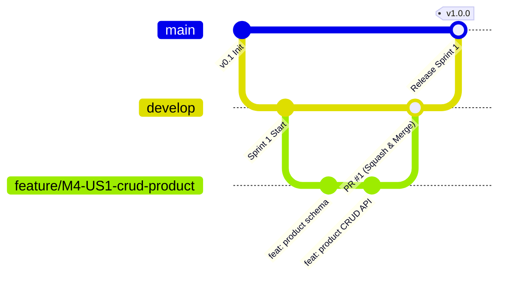

# Araya Business Hub Platform — Modul 4: Penawaran & Tagihan Penjualan (Sales)

> **Proyek Perangkat Lunak (Capstone) IF21W0705 — Universitas Pasundan**  
> Sistem ERP untuk Badan Pengelola Usaha (BPU) Universitas Pasundan.

Repository ini mengelola **Modul 4 (Sales & Invoicing)** yang bertanggung jawab atas pengelolaan master produk/jasa, pencatatan pelanggan, siklus hidup dokumen penawaran (*quotation*), tagihan penjualan (*invoice*), integrasi transaksi checkout dari katalog Modul 5, serta verifikasi pembayaran *payment gateway* (Midtrans Sandbox).

---

## 👥 Tim & Peran Pengembang

- **Backend Developer (BE):** Arsitektur API, logika kalkulasi finansial, state machine dokumen, dan integrasi webhook.
- **Frontend Developer (FE):** Antarmuka web pengguna (form dinamis, builder penawaran, ringkasan transaksi, invoice PDF).
- **Database Administrator (DBA):** Skema basis data, constraint integritas, indexing performa, dan reproduksibilitas migrasi.
- **QA / Tester:** Pengujian berbasis TDD (Unit, Integration, Contract, E2E), verifikasi idempotensi, dan skenario pembayaran.
- **UI-UX / Data Analyst:** Wireframe, hierarki informasi, audit alur checkout, dan analisis data uji penerimaan (UAT).

---

## 🚨 ATURAN GIT BRANCHING & PULL REQUEST (WAJIB DIBACA SEMUA DEV)

Seluruh anggota tim wajib mematuhi standar alur kerja Git berikut untuk menjaga kualitas kode, mencegah *merge conflict*, dan memastikan riwayat commit yang bersih. 

> 📖 **Dokumentasi Lengkap:** Silakan baca panduan mendalam di [**docs/GIT_WORKFLOW.md**](docs/GIT_WORKFLOW.md).  
> 📑 **Template Pull Request:** Otomatis tersedia di [**.github/pull_request_template.md**](.github/pull_request_template.md).

### 1. Struktur & Hirarki Branch
- **`main` (Protected):** Branch produksi stabil yang siap untuk rilis sprint/demo dosen. **Dilarang keras melakukan `git push` langsung ke `main`**.
- **`develop` (Protected):** Branch integrasi harian. Seluruh fitur yang telah selesai diuji digabungkan ke sini via PR.
- **`feature/*`:** Branch kerja sementara untuk mengerjakan user story atau task baru. Dibuat dari `develop`.
- **`bugfix/*`:** Branch untuk memperbaiki bug yang ditemukan selama siklus pengujian sprint.
- **`hotfix/*`:** Branch darurat untuk bug kritis pada `main`.



### 2. Standar Penamaan Branch
Nama branch wajib menggunakan format huruf kecil (*kebab-case*) dan mencantumkan **ID Story / Task** dari Scrum Board:

```bash
# Format
<tipe>/<id-story-atau-task>-<deskripsi-singkat>

# Contoh yang BENAR:
git checkout -b feature/M4-US1-crud-product
git checkout -b feature/M4-US2a-quotation-builder
git checkout -b feature/T-13-tax-calculator-service
git checkout -b bugfix/M4-US1-duplicate-sku-error
git checkout -b test/UT-TAX-rounding-half-up
git checkout -b docs/update-api-contract

# ❌ DILARANG:
# git checkout -b my-feature
# git checkout -b hikmal-dev
# git checkout -b update-fix
```

### 3. Standar Pull Request (The Perfect PR)
Berdasarkan *best practices* kolaborasi tim:
1. **Ukuran PR Kecil (Atomic):** Batasi perubahan kode antara **100 – 300 baris** (maksimal 400 baris). Jangan menggabungkan beberapa fitur yang tidak saling berhubungan ke dalam 1 PR.
2. **Format Judul Konvensional:**
   - `feat(scope): deskripsi fitur baru`
   - `fix(scope): deskripsi perbaikan bug`
   - `test(scope): penambahan atau perbaikan unit test`
   - `refactor(scope): refaktor kode tanpa mengubah fungsionalitas`
   - `docs(scope): pembaruan dokumentasi`
3. **Deskripsi Komprehensif:** Jelaskan **What** (apa yang diubah), **Why** (alasan perubahan), dan cantumkan **How to Test** beserta bukti *screenshot/output* terminal bahwa test berhasil (*passed*).
4. **Self-Review:** Periksa kembali file diff Anda sebelum meminta review orang lain (pastikan bebas dari `console.log`, token rahasia, atau file temporary).

### 4. Gerbang Penggabungan (Merge Gate & Definition of Done)
Sebuah PR **hanya dapat di-merge** apabila:
- [x] Pipeline CI lolos otomatis (Linter dan Test berwarna hijau).
- [x] Cakupan test (coverage) mencapai target: minimal 80% untuk service/domain layer dan 100% untuk kalkulasi finansial & webhook.
- [x] Disetujui (*Approved*) oleh **minimal 1 reviewer**.
- [x] Menggunakan metode **Squash and Merge** agar commit log di branch utama tetap teratur.
- [x] Feature branch segera dihapus (*Delete branch*) setelah proses merge selesai.

---

## 💰 Aturan Kalkulasi Finansial (Baseline Domain)

Modul 4 adalah otoritas tunggal atas penentuan harga dan pajak (*price authority*):
1. **Rumus Baris:**
   $$\text{line\_net} = (\text{quantity} \times \text{unit\_price}) - \text{diskon\_baris}$$
2. **Kalkulasi Pajak:**
   $$\text{line\_tax} = \text{ROUND\_HALF\_UP}(\text{line\_net} \times \text{tarif\_pajak})$$
   *Dibulatkan per baris ke rupiah penuh (IDR).*
3. **Grand Total Dokumen:**
   $$\text{grand\_total} = \sum \text{line\_net} + \sum \text{line\_tax} - \text{diskon\_dokumen}$$
4. **Presisi Finansial:** Nilai moneter disimpan pada basis data sebagai `NUMERIC(18,2)` dan dikirimkan pada payload API dalam bentuk string desimal presisi dua digit (contoh: `"194250.00"`). **Dilarang memakai tipe data float**.

---

## 🔄 Integrasi Lintas Modul

| Modul Eksternal | Jenis Integrasi | Arah | Keterangan |
|---|---|:---:|---|
| **M1 (Pengguna & Akses)** | REST / JWT | M1 ➔ M4 | Validasi otentikasi Bearer Token, peran (Admin, Partner, Customer), dan audit trail. |
| **M2 (Unit Usaha)** | REST / ID Ref | M2 ➔ M4 | Memastikan `business_unit_id` valid di BPU. |
| **M3 (Mitra)** | REST / ID Ref | M3 ➔ M4 | Validasi status mitra: hanya partner terverifikasi yang boleh membuat transaksi/produk. |
| **M5 (Katalog & Web)** | REST API (`/checkouts`) | M5 ➔ M4 | Menerima data keranjang, validasi harga *snapshot*, dan pembuatan Order + Invoice secara atomik. |
| **M7 (Jurnal Otomatis)** | Outbox / Event | M4 ➔ M7 | Mengonsumsi event `invoice.paid` untuk pembukuan jurnal otomatis. |
| **M8 (Notifikasi)** | Outbox / Event | M4 ➔ M8 | Mengonsumsi event `invoice.paid` untuk mengirim notifikasi tanda terima ke pelanggan. |
| **Midtrans Sandbox** | Webhook Callback | Gateway ➔ M4 | Verifikasi signature SHA-512 dan pelunasan otomatis invoice. |

---

## 📁 Struktur Direktori

```
.
├── .github/
│   └── pull_request_template.md  # Template standar pembukaan PR
├── docs/
│   └── GIT_WORKFLOW.md           # Panduan lengkap aturan branch & PR
└── README.md                     # Dokumentasi utama proyek
```
