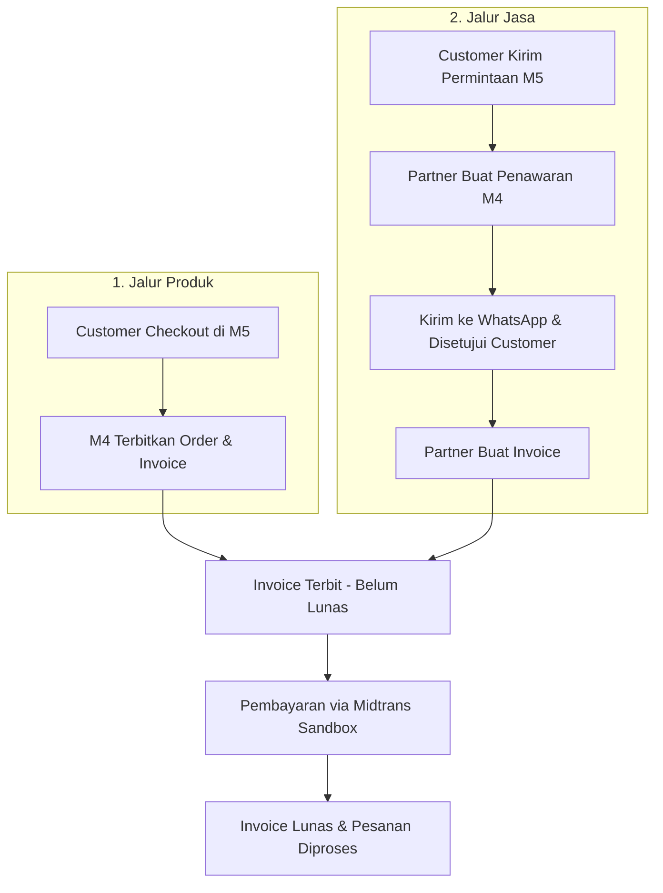

# BRD Modul M4 — Penawaran & Tagihan Penjualan

**Araya Business Hub Platform** · Kelompok A4 · 19 Nov 2026 _(Revisi Alur Permintaan Jasa)_

---

## Ringkasan

Modul M4 membuat setiap transaksi partner tercatat dari permintaan atau checkout sampai pesanan selesai, dengan tagihan yang lunas otomatis lewat payment gateway. Partner menjual satu tipe usaha (produk atau jasa). Customer memakai akun: produk dibeli lewat checkout M5, sedangkan jasa diminta lewat form permintaan, ditawar partner, lalu disetujui customer sendiri dari akunnya.

Dokumen ini menjelaskan kebutuhan bisnis M4 sebelum diturunkan menjadi kebutuhan sistem di Dokumen Teknis Bab 2. Isinya menjawab apa yang dibutuhkan bisnis dan mengapa, bukan bagaimana sistem membangunnya.

---

## Latar Belakang dan Masalah Bisnis

Araya Business Hub menghimpun banyak unit usaha dan partner dalam satu platform. Tanpa modul transaksi bersama, setiap partner mencatat penawaran, tagihan, dan pesanan dengan caranya sendiri.

Masalah yang diselesaikan M4:

| Masalah saat ini                                              | Dampak bisnis                                                         |
| :------------------------------------------------------------ | :-------------------------------------------------------------------- |
| Penawaran dan tagihan dibuat manual di luar platform          | Transaksi tidak tercatat rapi dan sulit ditelusuri                    |
| Permintaan jasa masuk lewat chat pribadi dan mudah terlewat   | Calon customer jasa tidak ditindaklanjuti                             |
| Invoice bisa terbit sebelum customer setuju                   | Sengketa harga dan tagihan yang tidak diakui customer                 |
| Pembayaran dicek manual dari bukti transfer                   | Konfirmasi lambat dan rawan bukti palsu                               |
| Customer harus menghubungi partner untuk tahu progres pesanan | Beban layanan partner naik dan customer tidak puas                    |
| Katalog mencampur atribut produk dan jasa                     | Partner jasa mengisi kolom yang tidak relevan, seperti stok dan berat |

---

## Tujuan Bisnis dan Ukuran Keberhasilan

Keberhasilan diukur saat demo Sprint Review dan integration test di server bersama. Angka target di bawah adalah usulan kelompok dan perlu disepakati PO.

| ID      | Tujuan bisnis                                                     | Ukuran keberhasilan                                                                                                                   |
| :------ | :---------------------------------------------------------------- | :------------------------------------------------------------------------------------------------------------------------------------ |
| `TB-01` | Semua transaksi partner tercatat di satu tempat                   | 100% invoice berasal dari penawaran yang disetujui customer atau dari checkout M5; tidak ada invoice tanpa sumber                     |
| `TB-02` | Tagihan hanya terbit untuk penawaran yang disetujui customer      | 0 invoice dari penawaran berstatus Draf atau Terkirim                                                                                 |
| `TB-03` | Pembayaran terkonfirmasi tanpa verifikasi manual                  | Status Lunas berubah dari notifikasi gateway tanpa aksi partner                                                                       |
| `TB-04` | Customer tahu progres pesanan tanpa bertanya ke partner           | Customer melihat status dan waktu perubahan terakhir di menu Pesanan saya                                                             |
| `TB-05` | Permintaan jasa customer tidak tercecer dan cepat ditindaklanjuti | Setiap permintaan dari M5 tercatat di halaman Permintaan partner tujuan dan berubah menjadi Sudah ditawarkan setelah penawaran dibuat |
| `TB-06` | Katalog partner hanya memuat yang relevan dengan usahanya         | Partner jasa tidak melihat kolom stok, SKU, atau berat; partner produk tidak melihat menu Permintaan dan Penawaran                    |

---

## Lingkup

M4 mengurus transaksi dari katalog partner sampai pesanan selesai. Pendaftaran partner, login, katalog publik, dan dashboard milik modul lain.

| Termasuk                                                                                       | Tidak termasuk                                                                                         |
| :--------------------------------------------------------------------------------------------- | :----------------------------------------------------------------------------------------------------- |
| Katalog produk atau jasa partner, sesuai tipe usahanya                                         | Pendaftaran partner, pendaftaran customer, dan pemilihan tipe usaha (M3)                               |
| Data pelanggan milik partner                                                                   | Akun, login, dan hak akses partner maupun customer (M1)                                                |
| Permintaan jasa dari form M5 dan tindak lanjutnya oleh partner jasa                            | Katalog publik, keranjang, form checkout, dan form permintaan (M5)                                     |
| Penawaran jasa, pengiriman ke WhatsApp, dan persetujuan oleh customer                          | Kerangka dashboard (M2); M4 hanya mengirim data                                                        |
| Invoice dari penawaran yang disetujui atau dari checkout                                       | Pembayaran sungguhan (produksi), refund, dan cicilan                                                   |
| Pembayaran invoice lewat Midtrans sandbox                                                      | Pengiriman barang, pelacakan kurir, dan WhatsApp Business API (penawaran dikirim lewat tautan `wa.me`) |
| Status order Baru, Diproses, Selesai beserta waktunya, dan halaman Pesanan saya untuk customer | Pajak penjualan, laporan penjualan, dan pembatalan order: belum ada user story                         |

---

## Pemangku Kepentingan

Tiga aktor memakai M4 secara langsung; sisanya menentukan atau bergantung pada M4.

| Pemangku kepentingan             | Peran terhadap M4                                                                         | Kepentingan utama                                                                                    |
| :------------------------------- | :---------------------------------------------------------------------------------------- | :--------------------------------------------------------------------------------------------------- |
| **Partner**                      | Aktor: menjual produk atau jasa                                                           | Katalog sesuai usahanya, permintaan jasa tidak terlewat, tagihan sah, pembayaran cepat terkonfirmasi |
| **Customer (berakun)**           | Aktor: meminta jasa atau membeli produk, menyetujui penawaran, membayar, memantau pesanan | Satu akun untuk semua transaksi, membayar dengan mudah, dan tahu progres pesanan                     |
| **Administrator Penjualan**      | Aktor: mengelola data semua partner                                                       | Data produk dan pelanggan rapi, semua transaksi terpantau                                            |
| **Product Owner (dosen)**        | Menetapkan urutan backlog dan menyetujui AC tambahan                                      | Increment yang bisa didemokan tiap sprint                                                            |
| **Kelompok A3 (M3)**             | Penyedia data partner, tipe usaha, dan pendaftaran customer                               | Kontrak data partner dan customer dipakai dengan benar                                               |
| **Kelompok A5 (M5)**             | Pemakai API order (checkout) dan API permintaan jasa                                      | Kontrak order dan permintaan stabil dan terdokumentasi                                               |
| **Kelompok A1 (M1), A2 (M2)**    | Penyedia autentikasi partner dan customer; penerima data dashboard                        | Izin `m4.*` per peran dan format data dashboard disepakati                                           |
| **Superadmin, Admin organisasi** | Pengelola platform dan organisasi di M1                                                   | Bukan aktor M4; mengatur siapa yang boleh memakai M4                                                 |

---

## Proses Bisnis Usulan

Transaksi masuk lewat dua jalur sesuai tipe usaha. Jalur produk: customer checkout dari katalog M5, lalu M4 membuat order dan invoice. Jalur jasa: customer mengisi form permintaan di M5, partner jasa membuat penawaran dan mengirimkannya ke WhatsApp customer, lalu customer menyetujuinya dari akun dan partner membuat invoice. Kedua jalur bertemu saat invoice terbit, lalu mengikuti alur bayar, proses, dan pantau yang sama.

_Gambar 1. Proses bisnis to-be M4: jalur produk dan jalur jasa (diagram visual resmi terlampir pada Dokumen PPL & Desain Arsitektur)._

Penawaran hanya dipakai pada jalur jasa, karena harga jasa perlu disesuaikan dengan permintaan customer. Rincian per langkah ada di activity diagram UC-01 sampai UC-09 di Dokumen PPL dan Dokumen Teknis Bab 2.2.

---

## Kebutuhan Bisnis

Setiap kebutuhan bisnis diturunkan ke User Story dan use case di Dokumen Teknis. Prioritas memakai MoSCoW: **Must** wajib untuk proyek ini, **Should** penting tetapi bisa ditunda tanpa menggagalkan tujuan.

| ID       | Kebutuhan bisnis                                                                                           | Prioritas | User Story · Use Case        |
| :------- | :--------------------------------------------------------------------------------------------------------- | :-------- | :--------------------------- |
| `BRQ-01` | Partner mencatat produk atau jasa sesuai tipe usaha yang dipilih saat mendaftar                            | Must      | `M4-US1 · UC-01`             |
| `BRQ-02` | Partner dan Administrator mencatat data pelanggan sebagai dasar penawaran dan transaksi                    | Must      | `M4-US1 · UC-02`             |
| `BRQ-03` | Data yang tidak lengkap tidak boleh tersimpan                                                              | Must      | `M4-US1 AC-2 · UC-01, UC-02` |
| `BRQ-04` | Permintaan jasa dari customer di M5 diterima partner jasa tujuan dan ditindaklanjuti                       | Must      | `M4-US3 · UC-03`             |
| `BRQ-05` | Partner jasa membuat penawaran dari permintaan (hanya berisi jasa) dan mengirimkannya ke WhatsApp customer | Must      | `M4-US2 AC-4, AC-5 · UC-04`  |
| `BRQ-06` | Customer menyetujui penawaran sendiri melalui akunnya                                                      | Must      | `M4-US2 AC-3 · UC-05`        |
| `BRQ-07` | Invoice hanya terbit dari penawaran yang disetujui customer atau dari checkout M5                          | Must      | `M4-US2 AC-1, AC-2 · UC-06`  |
| `BRQ-08` | Customer membayar invoice lewat payment gateway, dan status lunas berubah otomatis                         | Must      | `M4-US4 AC-1 · UC-07`        |
| `BRQ-09` | Pembayaran yang gagal tidak mengubah status tagihan                                                        | Must      | `M4-US4 AC-2 · UC-07`        |
| `BRQ-10` | Partner memperbarui progres pesanan, dan waktu setiap perubahan tercatat                                   | Must      | `M4-US5 AC-1 · UC-08`        |
| `BRQ-11` | Pesanan yang selesai tidak dapat diubah lagi                                                               | Must      | `M4-US5 AC-2 · UC-08`        |
| `BRQ-12` | Customer melihat progres pesanan miliknya setelah login, dan tidak bisa membuka pesanan orang lain         | Must      | `M4-US5 AC-3 · UC-09`        |
| `BRQ-13` | Checkout produk di M5 menghasilkan order dan invoice di M4                                                 | Must      | `Kontrak M5-US4`             |
| `BRQ-14` | Ringkasan penjualan tersedia untuk dashboard bersama                                                       | Should    | `Kontrak M2-US2`             |

---

## Aturan Bisnis

Aturan ini berlaku apa pun tampilannya, termasuk bila sistem dipanggil langsung lewat API.

| ID      | Aturan                                                                                                                                                                          | Sumber                                |
| :------ | :------------------------------------------------------------------------------------------------------------------------------------------------------------------------------ | :------------------------------------ |
| `BR-01` | Partner memilih satu tipe usaha, produk atau jasa, saat mendaftar                                                                                                               | Keputusan tim, M3-US1                 |
| `BR-02` | Setiap item mewarisi tipe usaha partner; item dengan tipe lain ditolak                                                                                                          | Keputusan tim                         |
| `BR-03` | Partner hanya melihat menu, form, dan data miliknya; Administrator melihat semua partner                                                                                        | Keputusan tim, NFR-01                 |
| `BR-04` | Data produk, jasa, atau pelanggan yang kolom wajibnya kosong ditolak                                                                                                            | M4-US1 AC-2                           |
| `BR-05` | Ganti tipe usaha lewat pengajuan di M3 dan verifikasi admin, ditolak selama ada order Baru atau Diproses; item tipe lama dinonaktifkan, tidak dihapus                           | Keputusan tim                         |
| `BR-06` | Penawaran dibuat dari permintaan customer dan berstatus Draf; menjadi Terkirim saat partner mengirimnya lewat WhatsApp; menjadi Disetujui saat customer menyetujui dari akunnya | M4-US2 AC-3, AC-4, AC-5               |
| `BR-07` | Invoice hanya dibuat dari penawaran Disetujui (atau dari checkout M5), status awal Belum lunas; saat invoice terbit, order Baru ikut dibuat                                     | M4-US2 AC-1, AC-2                     |
| `BR-08` | Status Lunas hanya diubah oleh notifikasi gateway yang valid; pembayaran gagal tidak mengubah status                                                                            | M4-US4 AC-1, AC-2                     |
| `BR-09` | Status order hanya bergerak Baru → Diproses → Selesai; Selesai bersifat final; setiap perubahan dicatat waktunya                                                                | M4-US5 AC-1, AC-2                     |
| `BR-10` | Customer bertransaksi dengan akun (daftar di M3, login di M1); customer hanya dapat membuka permintaan, penawaran, invoice, dan order miliknya                                  | M4-US5 AC-3, keputusan tim            |
| `BR-11` | Checkout produk wajib menyertakan alamat pengiriman; form permintaan jasa wajib menyertakan nomor WhatsApp untuk pengiriman penawaran                                           | Keputusan tim                         |
| `BR-12` | Setiap dokumen bernomor unik: permintaan `PMT-`, penawaran `PNW-`, invoice `INV-`, order `ORD-`                                                                                 | Keputusan tim                         |
| `BR-13` | Menu Permintaan dan Penawaran hanya untuk partner jasa; penawaran hanya berisi jasa; satu permintaan hanya punya satu penawaran                                                 | M4-US1 AC-3, M4-US2 AC-4, M4-US3 AC-2 |
| `BR-14` | Permintaan dari M5 hanya tampil di partner tujuan, berstatus Baru lalu Sudah ditawarkan setelah penawarannya disimpan                                                           | M4-US3 AC-1, AC-2, AC-3               |

---

## Asumsi, Batasan, dan Ketergantungan

### Asumsi

- Tipe usaha melekat di level partner, bukan di unit usaha M2. Perlu dikonfirmasi ke A2 dan A3.
- Customer sudah punya akun (daftar di M3, login di M1) sebelum mengirim permintaan, checkout, atau menyetujui penawaran.
- Penawaran dikirim lewat tautan WhatsApp (`wa.me`) yang dibuka partner; sistem mencatat status Terkirim saat tombol ditekan, bukan saat pesan diterima.

### Batasan

- Proyek berjalan 2 sprint, masing-masing 4 minggu.
- Pembayaran hanya mode sandbox Midtrans; tidak ada uang sungguhan.
- Tampilan wajib mengikuti Panduan UI Bersama v1.0, termasuk lima warna status baku.

### Ketergantungan

| Dari         | Yang dibutuhkan M4                                                                | Dibutuhkan untuk                                       |
| :----------- | :-------------------------------------------------------------------------------- | :----------------------------------------------------- |
| **M3 (A3)**  | Data partner: `partner_id`, `tipe_usaha`, status verifikasi; pendaftaran customer | Katalog sesuai tipe (`BRQ-01`) dan akun customer       |
| **M1 (A1)**  | Login dan izin `m4.*` per peran, termasuk peran customer                          | Semua fitur Partner, Administrator, dan Customer       |
| **M5 (A5)**  | Pemanggilan API order saat checkout dan API permintaan saat form jasa dikirim     | Order produk (`BRQ-13`) dan permintaan jasa (`BRQ-04`) |
| **M2 (A2)**  | Format data dashboard                                                             | Ringkasan penjualan (`BRQ-14`)                         |
| **Midtrans** | Akun sandbox, server key, notifikasi webhook                                      | Pembayaran otomatis (`BRQ-08`)                         |

---

## Risiko dan Mitigasi

Risiko terbesar ada di ketergantungan antarkelompok, karena DoR mewajibkan kontrak disepakati sebelum Sprint Planning.

| Risiko                                                              | Dampak                                                       | Mitigasi                                                                         |
| :------------------------------------------------------------------ | :----------------------------------------------------------- | :------------------------------------------------------------------------------- |
| Kontrak data partner dan customer dari M3/M1 belum siap di Sprint 1 | Tipe usaha dan akun customer tidak bisa dibaca               | Stub data partner dan customer di M4, diganti saat API M3/M1 siap                |
| Form permintaan M5 tidak mengirim partner tujuan                    | Permintaan tidak bisa diarahkan ke partner jasa yang benar   | Sepakati kontrak permintaan dengan A5: wajib `partner_id` dan nomor WhatsApp     |
| Keranjang M5 berisi item dari beberapa partner                      | Satu invoice untuk banyak partner sulit dibayar dan diproses | Sepakati dengan A5: checkout dipecah satu order dan invoice per partner (`U-02`) |
| Customer tidak membalas atau tidak menyetujui penawaran             | Penawaran menggantung dan partner tidak bisa menagih         | Penawaran punya masa berlaku; partner dapat mengirim ulang lewat WhatsApp        |
| Notifikasi Midtrans palsu                                           | Invoice berstatus Lunas tanpa pembayaran                     | Verifikasi signature di setiap notifikasi (`NFR-03`)                             |
| Webhook Midtrans tidak bisa menjangkau server uji                   | Status tidak berubah saat demo                               | Deploy ke server ber-URL publik sebelum Sprint 2 dimulai                         |

---

## Keputusan yang Masih Terbuka

Lima usulan sudah dipakai di Dokumen PPL dan Dokumen Teknis sebagai rancangan, tetapi belum diputuskan.

| ID     | Usulan                                                                                                               | Diputuskan oleh |
| :----- | :------------------------------------------------------------------------------------------------------------------- | :-------------- |
| `U-01` | Partner baru bisa memproses order setelah invoice Lunas                                                              | PO              |
| `U-02` | Satu checkout hanya untuk satu partner; keranjang lintas partner dipecah per partner                                 | PO, A5          |
| `U-03` | Customer otomatis tercatat sebagai pelanggan partner saat mengirim permintaan atau checkout, dicocokkan dari akunnya | PO              |
| `U-04` | Order dibuat bersamaan dengan invoice pada jalur penawaran                                                           | PO              |
| `U-05` | Customer menyetujui penawaran sendiri di sistem (bukan partner yang mencatat persetujuan)                            | PO              |

- [ ] Konfirmasi ke PO: AC tambahan `M4-US1 AC-3`, `M4-US2 AC-3` sampai `AC-5`, `M4-US5 AC-3`, dan story baru `M4-US3`
- [ ] Konfirmasi ke A2 dan A3: tipe usaha melekat di partner, bukan unit usaha; pendaftaran customer di M3
- [ ] Sepakati kontrak data partner dan customer dengan A3/A1, serta kontrak order dan permintaan jasa dengan A5

---

## Glosarium

| Istilah                   | Arti                                                                                              |
| :------------------------ | :------------------------------------------------------------------------------------------------ |
| **Tipe usaha**            | Jenis yang dijual partner: produk atau jasa, dipilih satu kali saat mendaftar di M3               |
| **Permintaan jasa**       | Form dari customer di M5 (judul permintaan dan nomor WhatsApp); status Baru atau Sudah ditawarkan |
| **Penawaran (quotation)** | Daftar jasa dan harga untuk satu permintaan; status Draf, Terkirim, atau Disetujui                |
| **Invoice**               | Tagihan bernomor unik; status Belum lunas atau Lunas                                              |
| **Order**                 | Pesanan yang diproses partner; status Baru, Diproses, atau Selesai                                |
| **Customer**              | Pembeli yang memiliki akun (daftar di M3, login di M1)                                            |
| **Nomor dokumen**         | Kode unik: `PMT-` (permintaan), `PNW-` (penawaran), `INV-` (invoice), `ORD-` (order)              |
| **Midtrans sandbox**      | Payment gateway mode uji, tanpa uang sungguhan                                                    |
| **MoSCoW**                | Cara memberi prioritas: Must, Should, Could, Won't                                                |

---

## Persetujuan

| Peran                      | Nama                        | Tanggal | Tanda tangan |
| :------------------------- | :-------------------------- | :------ | :----------- |
| Product Owner              | Dr. Ayi Purbasari, ST., MT. |         |              |
| Sistem Analis, Kelompok A4 | Desi                        |         |              |
| Scrum Master, Kelompok A4  | Hikmal                      |         |              |

_Acuan: Studi Kasus Capstone Kelas A, Dokumen PPL Modul 4 (revisi alur permintaan jasa), Panduan UI Bersama v1.0 (5 Okt 2026), dan Dokumen Teknis M4._
