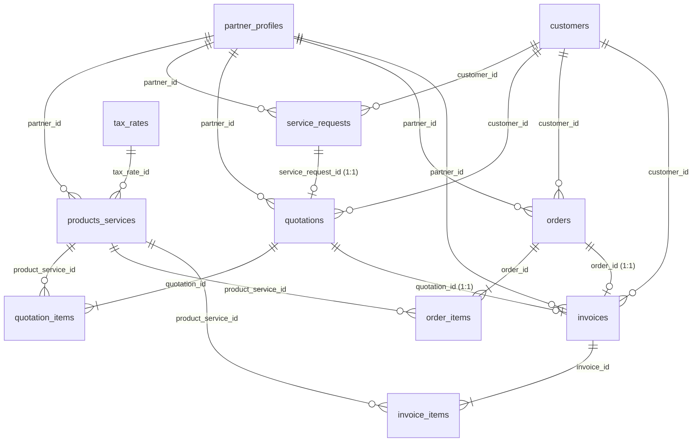
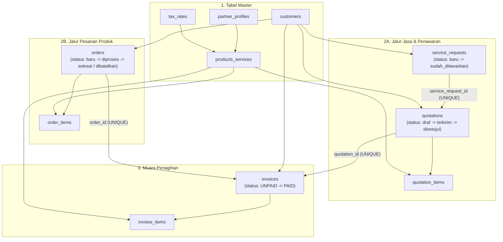

# Dokumentasi & Alur Skema Database (Modul 4)

Dokumen ini menjelaskan struktur, relasi antar-tabel, dan alur pergerakan data pada skema basis data PostgreSQL/Prisma ([`prisma/schema.prisma`](../prisma/schema.prisma)) yang terdiri dari **12 tabel**.

---

## 1. Diagram Relasi Antar-Tabel (ERD)

---

## 2. Pengelompokan 12 Tabel dalam Skema

Seluruh tabel pada skema basis data dibagi ke dalam 4 kelompok fungsional:

| Kelompok | Nama Tabel | Fungsi Utama dalam Skema |
| :--- | :--- | :--- |
| **1. Master & Referensi** | `partner_profiles` | Menyimpan identitas mitra (`partner_id`, `user_id`), kategori usaha (`tipe_usaha`: `'produk'` \| `'jasa'`), dan status verifikasi (`is_verified`). |
| | `tax_rates` | Menyimpan daftar tarif pajak (`name`, `rate` `Decimal(5,2)`, `is_active`). |
| | `products_services` | Menyimpan katalog produk dan jasa milik partner (`sku` unik, `type`, `unit`, `stock`, `price`, `tax_rate_id`, `partner_id`). |
| | `customers` | Menyimpan profil pelanggan (`name`, `email` unik, `phone` unik, `address`) serta `user_id` (opsional/nullable) untuk mengikat data ke akun login pelanggan. |
| **2. Alur Jasa & Penawaran** | `service_requests` | Menyimpan permintaan jasa yang masuk untuk partner tertentu (`partner_id`, `customer_id`, `customer_user_id`, identitas kontak customer, `title`, `description`, dan `status`: `'baru'` \| `'sudah_ditawarkan'`). |
| | `quotations` | Menyimpan kepala dokumen penawaran harga (`quotation_number` unik, `service_request_id` unik opsional, `customer_id`, `partner_id`, `status`: `'draf'` \| `'terkirim'` \| `'disetujui'`, waktu `sent_at`, `approved_at`, serta rekap nilai uang). |
| | `quotation_items` | Menyimpan rincian baris item di dalam sebuah `quotations` (`quotation_id`, `product_service_id`, `quantity`, `unit_price`, `discount_amount`, `tax_rate`, `tax_amount`, `subtotal`, `total_amount`). |
| **3. Alur Pesanan Produk** | `orders` | Menyimpan kepala dokumen pesanan pembelian (`order_number` unik, `customer_id`, `partner_id`, `status`: `'baru'` \| `'diproses'` \| `'selesai'` \| `'dibatalkan'`, `status_updated_at`, serta rekap nilai uang). |
| | `order_items` | Menyimpan rincian baris item di dalam sebuah `orders` (`order_id`, `product_service_id`, `quantity`, `unit_price`, `discount_amount`, `tax_rate`, `tax_amount`, `subtotal`, `total_amount`). |
| **4. Penagihan & Penomoran** | `invoices` | Menyimpan kepala dokumen tagihan/faktur (`invoice_number` unik) yang berasal dari `quotation_id` (unik opsional) **atau** `order_id` (unik opsional), beserta status bayar (`status`: `'UNPAID'` \| `'PAID'`, `paid_at`, `payment_method`, `snap_token`). |
| | `invoice_items` | Menyimpan rincian baris item di dalam sebuah `invoices` (`invoice_id`, `product_service_id`, `quantity`, `unit_price`, `discount_amount`, `tax_rate`, `tax_amount`, `subtotal`, `total_amount`). |
| | `document_sequences` | Menyimpan penghitung nomor urut dokumen bulanan (`document_type`: `'QUOTATION'` \| `'INVOICE'` \| `'ORDER'`, `period` format `YYYYMM`, dan `last_number`). |

---

## 3. Penjelasan Alur Data pada Skema Database

Di dalam skema ini, seluruh transaksi bermuara ke tabel **`invoices`** dan **`invoice_items`**, namun memiliki **2 jalur masuk** yang berbeda tergantung jenis transaksinya: **Jalur A (Permintaan Jasa & Penawaran)** dan **Jalur B (Pesanan Produk Langsung)**.

---

### Tahap 1: Inisialisasi Data Master (`partner_profiles`, `tax_rates`, `products_services`, `customers`)

1. **`partner_profiles` sebagai Akar Kepemilikan Mitra:**
   - Setiap mitra memiliki satu baris di `partner_profiles` dengan Primary Key `partner_id` dan `user_id` (`UNIQUE`).
   - Kolom `tipe_usaha` menentukan apakah mitra bergerak di bidang `'produk'` atau `'jasa'`, sedangkan `is_verified` menentukan apakah mitra sudah terverifikasi.
   - Hampir seluruh tabel operasional (`products_services`, `service_requests`, `quotations`, `orders`, `invoices`) memiliki Foreign Key `partner_id` yang mengarah ke `partner_profiles.partner_id` dengan aturan `ON DELETE RESTRICT` (profil partner tidak bisa dihapus jika sudah memiliki katalog atau transaksi).
2. **`tax_rates` dan `products_services`:**
   - Tabel `tax_rates` menyimpan persentase pajak (misalnya `rate = 11.00`).
   - Saat partner menambahkan produk atau jasa ke `products_services`, baris tersebut wajib mengisi `partner_id` (pemilik katalog) dan dapat menunjuk `tax_rate_id` ke `tax_rates.id`.
3. **`customers`:**
   - Menyimpan data pelanggan dengan `email` dan `phone` yang bersifat `UNIQUE`.
   - Kolom `user_id` (berindeks `idx_customers_user_id`) menghubungkan data pelanggan dengan ID akun pengguna yang sedang login, sehingga sistem dapat memfilter penawaran atau tagihan khusus milik akun pelanggan tersebut.

---

### Tahap 2A: Alur Permintaan Jasa hingga Penawaran (`service_requests` ➔ `quotations` ➔ `quotation_items`)

Alur ini digunakan ketika transaksi diawali dari permintaan jasa atau pembuatan surat penawaran harga:

1. **Pencatatan Permintaan Jasa (`service_requests`):**
   - Ketika pelanggan mengajukan permintaan jasa ke seorang partner, data disimpan ke `service_requests` dengan `partner_id` (wajib), `customer_id` (opsional, menunjuk ke `customers.id`), dan `customer_user_id` (berindeks untuk pencarian riwayat per akun login).
   - Snapshot kontak pelanggan (`customer_name`, `customer_email`, `customer_phone`) serta detail permintaan (`title`, `description`) ikut disimpan langsung di tabel ini.
   - Status awal baris adalah `status = 'baru'`.
2. **Pembuatan Penawaran (`quotations` & `quotation_items`):**
   - Nomor dokumen penawaran (`quotation_number`) diambil dengan menaikkan `last_number` pada tabel `document_sequences` untuk `document_type = 'QUOTATION'` dan `period` bulan berjalan.
   - Jika penawaran dibuat dari permintaan jasa, kolom `service_request_id` pada `quotations` diisi dengan `id` dari `service_requests`.
   - Karena kolom `service_request_id` pada `quotations` memiliki constraint **`UNIQUE`**, maka **1 permintaan jasa hanya bisa dibuatkan maksimal 1 penawaran** (mencegah duplikasi penawaran untuk permintaan yang sama). Setelah penawaran dibuat, status pada `service_requests` berubah menjadi `'sudah_ditawarkan'`.
   - Penawaran juga tetap bisa dibuat langsung tanpa permintaan jasa karena `service_request_id` bersifat *nullable* (`String?`).
   - Rincian barang/jasa yang ditawarkan disimpan di tabel anak `quotation_items` (berelasi `ON DELETE CASCADE` ke `quotations.id` dan menunjuk `product_service_id` ke `products_services.id`).
3. **Siklus Status & Waktu Penawaran (`quotations`):**
   - `status = 'draf'`: Penawaran baru disusun oleh partner.
   - `status = 'terkirim'`: Penawaran dikirimkan ke pelanggan, dan kolom `sent_at` mencatat waktu pengiriman.
   - `status = 'disetujui'`: Pelanggan menyetujui penawaran, dan kolom `approved_at` mencatat waktu persetujuan.

---

### Tahap 2B: Alur Pesanan Produk Langsung (`orders` ➔ `order_items`)

Alur ini digunakan ketika pelanggan langsung melakukan checkout barang/produk tanpa melalui surat penawaran:

1. **Pembuatan Pesanan (`orders`):**
   - Nomor pesanan (`order_number`) di-generate melalui tabel `document_sequences` (`document_type = 'ORDER'`).
   - Baris pesanan mengikat `customer_id` (ke `customers.id`) dan `partner_id` (ke `partner_profiles.partner_id`).
   - Siklus status pesanan bergerak dari `'baru'` ➔ `'diproses'` ➔ `'selesai'` (atau `'dibatalkan'`), dan setiap perubahan status memperbarui timestamp `status_updated_at`.
2. **Rincian Item Pesanan (`order_items`):**
   - Setiap produk yang dibeli disimpan di `order_items` dengan mengacu ke `order_id` (`ON DELETE CASCADE`) dan `product_service_id`.

---

### Tahap 3: Alur Konversi ke Tagihan & Pembayaran (`invoices` ➔ `invoice_items`)

Tabel `invoices` adalah titik temu (muara) penagihan dari **Penawaran yang Disetujui (`quotations`)** maupun **Pesanan Checkout (`orders`)**:

1. **Relasi 1-ke-1 Anti-Duplikat dari Sumber Transaksi:**
   - Tabel `invoices` memiliki dua kolom sumber yang keduanya bersifat *nullable* dan **`UNIQUE`**:
     - `quotation_id` (`String? @unique`): Diisi jika tagihan berasal dari konversi penawaran (`quotations.id`). Constraint `UNIQUE` memastikan 1 penawaran tidak pernah bisa dikonversi menjadi 2 invoice berbeda.
     - `order_id` (`String? @unique`): Diisi jika tagihan berasal dari pesanan produk (`orders.id`). Constraint `UNIQUE` memastikan 1 order hanya menghasilkan 1 invoice.
2. **Penyalinan Rincian Baris (`invoice_items`):**
   - Saat dokumen `invoices` dibuat (dengan nomor unik `invoice_number` dari `document_sequences` tipe `'INVOICE'`), rincian item dari `quotation_items` atau `order_items` disalin ke tabel `invoice_items`.
   - Penyimpanan nilai `quantity`, `unit_price`, `discount_amount`, `tax_rate`, `tax_amount`, `subtotal`, dan `total_amount` menggunakan tipe `Decimal(15,2)` pada `quotation_items`, `order_items`, dan `invoice_items` berfungsi sebagai **snapshot finansial**—sehingga jika di kemudian hari harga master di `products_services` berubah, nilai histori tagihan lama tidak ikut berubah.
3. **Pelunasan Tagihan (`invoices`):**
   - Tagihan baru memiliki `status = 'UNPAID'` dan menyimpan `snap_token` untuk sesi pembayaran.
   - Ketika pembayaran berhasil diverifikasi, `status` diperbarui menjadi `'PAID'`, waktu pelunasan dicatat di `paid_at`, dan metode pembayaran dicatat di `payment_method`.

---

## 4. Ringkasan Aturan Integritas (Constraints & Indexes) pada Skema

| Tabel | Constraint / Index Penting | Tujuan pada Skema Database |
| :--- | :--- | :--- |
| `partner_profiles` | `partner_id` (PK), `user_id` (UNIQUE), `idx_partner_profiles_is_verified` | Memastikan 1 akun user hanya memiliki 1 profil partner dan mempercepat filter partner terverifikasi. |
| `customers` | `email` (UNIQUE), `phone` (UNIQUE), `idx_customers_user_id` | Mencegah duplikasi kontak pelanggan dan mempercepat pencarian pelanggan berdasarkan akun login (`user_id`). |
| `products_services` | `sku` (UNIQUE), `fk_products_services_partner`, `fk_products_tax_rate` | Memastikan kode SKU unik dan setiap produk terikat ke partner serta tarif pajak yang valid. |
| `service_requests` | `idx_service_requests_partner_id`, `idx_service_requests_customer_user_id` | Mempercepat query daftar permintaan jasa masuk di halaman Partner dan riwayat permintaan jasa di halaman Customer. |
| `quotations` | `quotation_number` (UNIQUE), `service_request_id` (UNIQUE) | Mencegah nomor penawaran ganda dan memastikan 1 `service_requests` hanya menghasilkan maksimal 1 `quotations`. |
| `orders` | `order_number` (UNIQUE), `idx_orders_customer`, `idx_orders_partner_id` | Mencegah nomor order ganda dan mempercepat filter pesanan per pelanggan atau per partner. |
| `invoices` | `invoice_number` (UNIQUE), `quotation_id` (UNIQUE), `order_id` (UNIQUE) | Mencegah tagihan ganda dari satu quotation atau satu order yang sama. |
| `document_sequences` | `uq_document_sequence` (`document_type`, `period`) | Memastikan hanya ada 1 baris penghitung nomor urut untuk setiap jenis dokumen pada periode bulan (`YYYYMM`) yang sama. |
| `*_items` (`quotation_items`, `order_items`, `invoice_items`) | `onDelete: Cascade` ke tabel induk dokumen, `onDelete: NoAction/Restrict` ke `products_services` | Jika kepala dokumen dihapus maka baris item ikut terhapus, tetapi produk di `products_services` tidak boleh dihapus jika sudah pernah dipakai di baris transaksi. |
