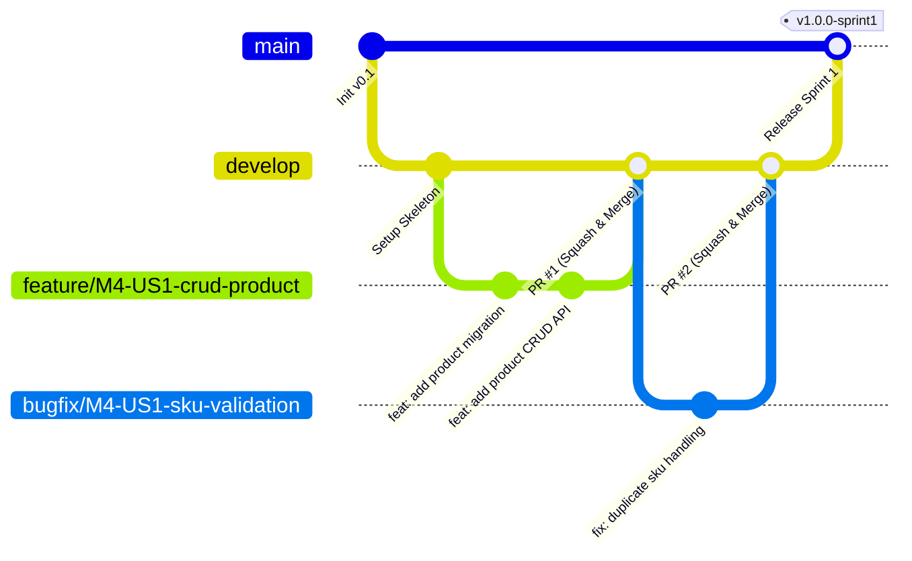
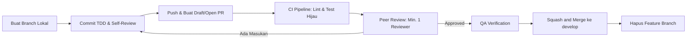

# Panduan Standar Git Branching & Pull Request (PR)
## Araya Business Hub Platform — Modul 4: Penawaran & Tagihan Penjualan (Sales)

Dokumen ini adalah pedoman wajib bagi seluruh anggota tim (Backend Dev, Frontend Dev, DBA, QA/Tester, dan UI-UX/Data Analyst) dalam mengelola branch dan membuat Pull Request pada repository ini.

Aturan ini disusun berdasarkan standar industri dan referensi:
1. **Git Branching Strategies** (*Karm Patel* — [Dev.to](https://dev.to/karmpatel/git-branching-strategies-a-comprehensive-guide-24kh))
2. **The Perfect Pull Request: Best Practices for Collaborative Development** (*DeployHQ* — [DeployHQ Blog](https://www.deployhq.com/blog/the-perfect-pull-request-best-practices-for-collaborative-development))

---

## 1. Strategi Percabangan (Git Branching Strategy)

Kami mengadopsi model **Feature Branching / GitHub Flow yang disesuaikan dengan siklus Sprint Scrum**:



### 1.1 Hierarki Branch

| Branch | Sifat | Deskripsi & Proteksi |
|---|---|---|
| `main` | **Protected** | Kode versi stabil yang siap didemokan / rilis sprint. **Dilarang keras melakukan `git push` langsung**. Perubahan hanya masuk melalui Pull Request dari `develop`. |
| `develop` / `staging` | **Protected** | Cabang integrasi aktif harian antar anggota tim selama sprint berjalan. Sumber deploy ke staging environment. |
| `feature/*` | Ephemeral (Sementara) | Tempat pengembangan user story / task baru. Dibuat dari `develop` dan di-merge kembali ke `develop` via PR. |
| `bugfix/*` | Ephemeral (Sementara) | Perbaikan bug yang ditemukan selama fase testing atau review sprint. Dibuat dari `develop`. |
| `hotfix/*` | Ephemeral (Sementara) | Perbaikan darurat terhadap bug kritis di `main` (misal saat demo atau production staging). Dibuat dari `main` dan di-merge ke `main` & `develop`. |
| `docs/*` / `chore/*` | Ephemeral (Sementara) | Pembaruan dokumentasi, pipeline CI/CD, atau dependency tooling. |

---

### 1.2 Konvensi Penamaan Branch

Nama branch harus profesional, deskriptif, memakai huruf kecil (*lowercase*), dan menggunakan tanda hubung (*kebab-case*). Sertakan ID Task/Story dari Scrum Board agar mudah dilacak:

Format:
```
<tipe>/<id-story-atau-task>-<deskripsi-singkat>
```

#### Contoh Penamaan yang Benar:
- `feature/M4-US1-crud-product`
- `feature/M4-US2a-quotation-calculation`
- `feature/T-01-setup-ci-pipeline`
- `feature/M4-US3-checkout-m5-endpoint`
- `bugfix/M4-US1-fix-tax-rounding-half-up`
- `bugfix/T-27-signature-verification-null-check`
- `hotfix/calc-overflow-bigint`
- `docs/update-api-contract-v0.2`
- `test/M4-US2a-tax-unit-test-suite`

#### ❌ Contoh yang Dilarang:
- `hikmal-branch` *(tidak deskriptif & nama personal)*
- `update` / `fix-bug` / `coba-coba` *(tanpa konteks)*
- `Feature_New_1` *(tidak konsisten, camelCase/snake_case)*

---

## 2. Aturan & Standar Pull Request (The Perfect PR)

Pull Request bukan sekadar formalitas administratif, melainkan **media kolaborasi teknis, dokumentasi keputusan arsitektur, dan gerbang jaminan mutu (QA Gate)**.

### 2.1 Ukuran PR (PR Sizing & Hygiene)
- **Kecil & Fokus (Atomic):** Usahakan perubahan PR berkisar antara **100 – 300 baris kode** (maksimal 400 baris, di luar file *lock* atau file migrasi ter-generate otomatis).
- PR yang terlalu besar lambat ditinjau, meningkatkan risiko lolosnya bug kritis, dan sangat sulit di-*rollback*.
- Jika task berskala besar (misal 12 jam kerja), pecah menjadi beberapa sub-PR fungsional (contoh: PR 1: Migrasi skema DB & Model, PR 2: Service & Unit Test, PR 3: Controller & Endpoint).

---

### 2.2 Format Judul PR (Conventional Commits)
Gunakan format **Conventional Commits** pada judul PR:

```
<tipe>(<lingkup-opsional>): <deskripsi singkat dalam kalimat aktif>
```

**Pilihan Tipe:**
- `feat:` Fitur baru (misal: `feat(quotation): implement tax calculation service UT-TAX`)
- `fix:` Perbaikan bug (misal: `fix(checkout): resolve idempotency key collision`)
- `docs:` Perubahan dokumentasi, README, atau OpenAPI spec
- `style:` Pemformatan kode tanpa mengubah perilaku
- `refactor:` Perubahan kode tanpa mengubah fungsi eksternal
- `perf:` Perubahan kode untuk meningkatkan performa
- `test:` Penambahan atau perbaikan unit/integration test
- `build:` Perubahan sistem build atau dependency eksternal (misal: `build(deps): upgrade axios to version 1.6.0`)
- `ci:` Perubahan file konfigurasi CI/CD (misal: `ci(github): add workflow to run tests on every pull request`)
- `chore:` Pemeliharaan umum yang tidak mengubah kode aplikasi (misal: `chore(changelog): release version 2.4.0`)
- `revert:` Membatalkan commit sebelumnya, misalnya karena memicu error (misal: `revert: feat(auth): add Google OAuth login option`)

---

### 2.3 Format Pesan Commit

Setiap commit harus menjelaskan jenis perubahan dan bagian proyek yang terdampak. Gunakan format:

```
<tipe>(<lingkup-opsional>): <deskripsi singkat>
```

Gunakan tipe yang sesuai dengan daftar pada bagian 2.2. Tulis deskripsi secara ringkas, spesifik, dan sesuai perubahan sebenarnya. Hindari pesan umum seperti `update`, `changes`, atau `fix stuff` tanpa konteks. Kata `update` boleh dipakai di deskripsi, tetapi bukan tipe standar proyek; pilih tipe berdasarkan tujuan perubahan, misalnya `chore(deps): update Next.js`.

Contoh:

```text
feat(quotation): add quotation creation form
fix(invoice): correct per-line tax rounding
docs(design): document visual and icon rules
style(ui): format invoice table component
refactor(format): simplify date formatting
perf(invoice): reduce repeated line total calculation
test(tax): cover half-up rounding cases
build(deps): upgrade axios to version 1.6.0
ci(github): add workflow to run tests on every pull request
chore(changelog): release version 2.4.0
revert: feat(auth): add Google OAuth login option
```

Untuk perubahan yang memutus kompatibilitas, tambahkan tanda `!` setelah tipe atau lingkup dan jelaskan dampaknya. Contoh: `feat(api)!: replace invoice response fields`. Jika perlu, tambahkan footer `BREAKING CHANGE: <dampak perubahan>` pada pesan commit.

### 2.4 Anatomi Deskripsi PR yang Sempurna
Setiap PR wajib mengisi template deskripsi yang mencakup:
1. **Ringkasan (What & Why):** Apa yang diubah dan alasan perubahan tersebut.
2. **Kaitan Backlog / Task ID:** Tautkan ke ID User Story / Task (misal: `Closes M4-US2a`, `Relates to T-13`).
3. **Perubahan Teknis Utama:** Ringkasan file atau komponen inti yang disentuh.
4. **Cara Pengujian (How to Test):** Langkah konkret untuk mereplikasi & memverifikasi di lokal (termasuk perintah menjalankan unit test terkait).
5. **Bukti Pengujian (Proof):** Screenshot hasil test hijau di terminal (`passed`), cURL / respons Swagger, atau rekaman visual UI.
6. **Acceptance Checklist:** Daftar periksa mandiri sebelum meminta review.

*(Template PR otomatis tersedia di [.github/pull_request_template.md](file:///.github/pull_request_template.md))*.

---

## 3. Alur Kerja Review & Kriteria Penggabungan (Merge Gate)



### 3.1 Kriteria Definition of Done (DoD) Sebelum Merge
Sebuah PR hanya boleh di-merge jika memenuhi seluruh syarat berikut:
1. **CI Pipeline Hijau:** Seluruh pemeriksaan otomatis (Linting, Type-check, Unit Test) lolos tanpa error.
2. **Target Test Coverage:**
   - 100% lolos untuk logika finansial/kalkulasi pajak (`TaxCalculator`) dan pemrosesan webhook (`WebhookProcessor`).
   - Minimal 80% coverage untuk service/domain layer.
3. **Minimal 1 Approval:** Direview dan disetujui (*Approved*) oleh minimal 1 rekan tim (Backend Lead / Peer Developer).
4. **Tidak Ada Conflict:** Branch harus selalu ter-rebase atau ter-*update* dengan commit terbaru pada target branch (`develop`).
5. **Bebas Data Sensitif:** Dilarang keras menyertakan API Key, Midtrans Server Key, atau credential database ke dalam PR.

### 3.2 Strategi Penggabungan (Merge Strategy)
- Gunakan **Squash and Merge** untuk penggabungan `feature/*` ke `develop`. Ini menjaga riwayat git di branch utama tetap bersih, di mana satu PR terangkum menjadi satu commit deskriptif.
- **Hapus branch** (`Delete branch`) segera setelah PR berhasil di-merge untuk menghindari penumpukan branch usang (*stale branches*).

---

## 4. Etika & Best Practice Code Review

### Untuk Pembuat PR (Author):
- Lakukan *self-review* terlebih dahulu sebelum menandai PR siap direview (*Ready for Review*). Periksa diff kode sendiri untuk membersihkan `console.log`, file sampah, atau komentar sisa eksperimen.
- Tanggapi setiap komentar reviewer secara konstruktif dan sopan.
- Berikan context tambahan jika ada trade-off arsitektur yang sengaja diambil.

### Untuk Reviewer:
- Prioritaskan review pada kebenaran logika bisnis, kepatuhan kontrak API (OpenAPI), penanganan error edge-case, dan keamanan.
- Berikan masukan yang spesifik dan actionable.
- Bedakan antara masukan kritikal (pemblokir) dan saran minor opsional (gunakan label `[Nitpick]` atau `[Suggestion]`).
- Tinjau PR secara berkala tanpa menunda terlalu lama agar ritme sprint tim tetap lancar.
