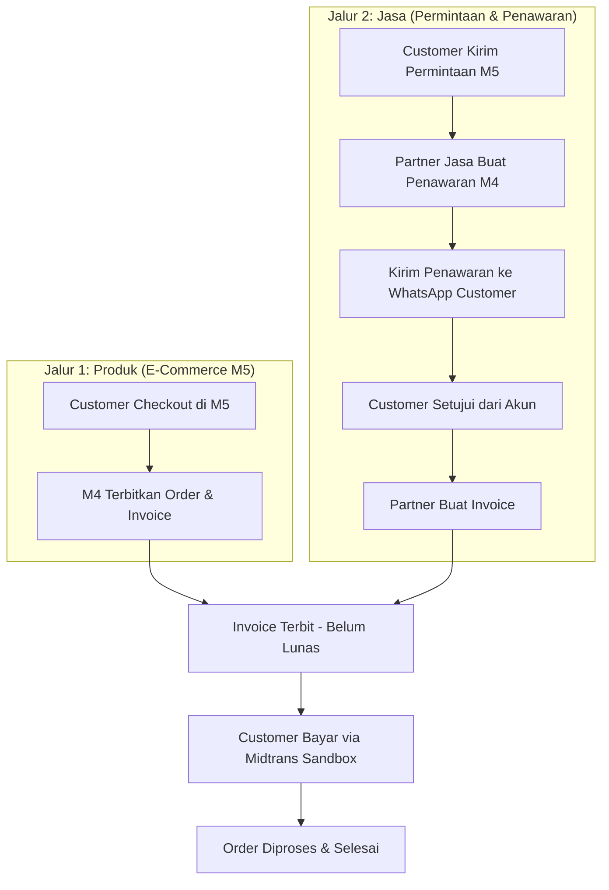

# Product Requirements Document (PRD) — Modul 4: Penawaran & Tagihan Penjualan (Quotation & Sales Invoice Management)

**ARAYA BUSINESS HUB PLATFORM • DOKUMEN SPESIFIKASI KEBUTUHAN PRODUK**

| Kode Dokumen                | `DOC-ABH-M4-PRD-001` (Baseline Spesifikasi Teknis & Fungsional Modul 4)                                                                                                                                                                                                                                                                                                                                                                                                                                                                                                                                                                                        |
| :-------------------------- | :------------------------------------------------------------------------------------------------------------------------------------------------------------------------------------------------------------------------------------------------------------------------------------------------------------------------------------------------------------------------------------------------------------------------------------------------------------------------------------------------------------------------------------------------------------------------------------------------------------------------------------------------------------- |
| **Nama Proyek**             | Araya Business Hub Platform — Sistem ERP Badan Pengembangan Usaha (BPU) Universitas Pasundan                                                                                                                                                                                                                                                                                                                                                                                                                                                                                                                                                                   |
| **Mata Kuliah & Kelompok**  | Proyek Perangkat Lunak (Capstone) `IF21W0705` • Kelas A • Kelompok A4 (Modul 4)                                                                                                                                                                                                                                                                                                                                                                                                                                                                                                                                                                                |
| **Versi & Tanggal Rilis**   | Versi 4.0 (Penyelarasan Dokumen PPL revisi) • 19 November 2026 _(Menggantikan v3.0 tertanggal 7 November 2026)_                                                                                                                                                                                                                                                                                                                                                                                                                                                                                                                                                |
| **Product Owner**           | Dr. Ayi Purbasari, ST., MT. (Dosen Pengampu Proyek Perangkat Lunak)                                                                                                                                                                                                                                                                                                                                                                                                                                                                                                                                                                                            |
| **Tim Pengembang Modul 4**  | • **Desi Hafita Ashri** — _System Analyst & System Designer_ (Analisis Kebutuhan Fungsional, Pemodelan Use Case & Skenario Dokumen PPL, serta Desain Sistem)<br>• **Hikmal Maulana** — _Backend & Integration Lead_ (API Route Handlers, Kalkulasi Finansial, Auth JWT/RBAC, Midtrans & CI/CD)<br>• **Muh Ikhsan** — _Frontend Developer_ (App Layout, Tailwind CSS Tokens, Komponen UI Modular & Interaktivitas Form)<br>• **Murod Adipate** — _Database Administrator_ (Supabase PostgreSQL 17, Prisma ORM Schema, Seeder & Docker Local DB)<br>• **Ahmad Dzaki** — _Quality Assurance / SDET Lead_ (Unit Testing, Playwright E2E, Postman/Newman & Mocking) |
| **Arsitektur & Tech Stack** | Next.js 16.4 (App Router) • React 19 • TypeScript 5 (Strict) • Prisma ORM 7 • Supabase PostgreSQL 17 • Midtrans Snap                                                                                                                                                                                                                                                                                                                                                                                                                                                                                                                                           |

### Riwayat Perubahan Dokumen (Revision History)

| Versi  | Tanggal     | Penulis / Kontributor           | Ringkasan Perubahan Utama                                                                                                                                                                                                                                                                                                                                                                                                                                                                                                                                                                                                                                                                |
| :----- | :---------- | :------------------------------ | :--------------------------------------------------------------------------------------------------------------------------------------------------------------------------------------------------------------------------------------------------------------------------------------------------------------------------------------------------------------------------------------------------------------------------------------------------------------------------------------------------------------------------------------------------------------------------------------------------------------------------------------------------------------------------------------- |
| `v1.0` | 07 Okt 2026 | Tim Kelompok A4                 | Draf inisiasi kebutuhan awal Modul 4 Penjualan dan rancangan kasar alur transaksi.                                                                                                                                                                                                                                                                                                                                                                                                                                                                                                                                                                                                       |
| `v2.0` | 23 Okt 2026 | Tim Kelompok A4                 | Penyesuaian awal terhadap User Story resmi dosen dan keputusan migrasi ke arsitektur Next.js Full-Stack.                                                                                                                                                                                                                                                                                                                                                                                                                                                                                                                                                                                 |
| `v3.0` | 07 Nov 2026 | Desi H.A., Hikmal M. & Tim A4   | **Perombakan Menyeluruh & Sinkronisasi BRD (Baseline Aktif):** (1) Sinkronisasi 100% dengan _BRD Modul M4_ (`TB-01`..`TB-06`, `BRQ-01`..`BRQ-13`, `BR-01`..`BR-12`, `NFR-01`..`NFR-03`, `U-01`..`U-04`), termasuk aturan penyembunyian kolom Stok/SKU/Berat pada UI Partner Jasa (`TB-06`, `TC-M4US1-05`) dengan auto-generasi `SRV-...` di backend, serta alur _Customer Tamu_ tanpa akun (`TB-05`, `BR-12`) yang melacak pesanan & membayar dengan Nomor Invoice + 4 digit akhir WhatsApp; (2) Sinkronisasi skema Supabase PostgreSQL 17 (`prisma/schema.prisma` + migrasi kolom `unit` & `stock`); (3) Integrasi 7 Skenario Use Case (`UC-01`..`UC-07`) & Kontrak API `K-01`..`K-09`. |
| `v4.0` | 19 Nov 2026 | Tim Kelompok A4 (Sistem Analis) | **Penyelarasan dengan Dokumen PPL revisi:** alur permintaan jasa (M5 -> M4), penawaran hanya jasa, customer berakun, 5 user story dan 9 use case, diagram use case, activity, class, sequence, ERD, kamus data, dan kontrak API baru.                                                                                                                                                                                                                                                                                                                                                                                                                                                    |

---

# 1. Pendahuluan, Tujuan Bisnis (BRD) & Ruang Lingkup

## 1.1 Latar Belakang & Masalah Bisnis yang Diselesaikan

Modul 4: Penawaran & Tagihan Penjualan (Quotation & Sales Invoice Management) merupakan subsistem transaksi komersial pada platform ERP Araya Business Hub untuk Badan Pengembangan Usaha (BPU) Universitas Pasundan. Modul ini memastikan setiap transaksi Partner tercatat rapi dari permintaan atau checkout hingga pesanan selesai, dengan tagihan (_invoice_) yang lunas otomatis melalui _payment gateway_ Midtrans Sandbox. Partner menjual satu tipe usaha (Produk atau Jasa). Customer memakai akun: produk dibeli lewat checkout M5, sedangkan jasa diminta lewat form permintaan M5, ditawar partner jasa melalui WhatsApp, lalu disetujui customer dari akunnya. Customer membayar dan memantau pesanannya dari akun tersebut.

| Masalah Bisnis Saat Ini (As-Is)                                     | Dampak Bisnis                                                       | Solusi Sistem pada Modul 4 (To-Be)                                                                                                                      |
| :------------------------------------------------------------------ | :------------------------------------------------------------------ | :------------------------------------------------------------------------------------------------------------------------------------------------------ |
| Penawaran dan tagihan dibuat manual di luar platform                | Transaksi tidak tercatat rapi dan sulit ditelusuri                  | Pencatatan permintaan (`service_requests`), penawaran (`quotations`), tagihan (`invoices`), dan pesanan (`orders`) terpusat per Partner (`TB-01`).      |
| Permintaan jasa masuk lewat chat pribadi dan mudah terlewat         | Calon customer jasa tidak ditindaklanjuti                           | Form permintaan di M5 diteruskan ke halaman Permintaan partner jasa tujuan, lalu ditindaklanjuti dengan penawaran (`TB-05` / `BR-14`).                  |
| Invoice dapat terbit sebelum customer menyetujui harga              | Sengketa harga dan tagihan tidak diakui customer                    | Customer menyetujui penawaran dari akunnya sendiri; invoice hanya dapat dibuat dari penawaran berstatus Disetujui (`TB-02` / `BR-06`, `BR-07`).         |
| Pembayaran dicek manual dari foto bukti transfer                    | Konfirmasi lambat dan rawan bukti transfer palsu                    | Pelunasan otomatis via webhook Midtrans Sandbox dengan verifikasi signature SHA-512 (`TB-03` / `BR-08`).                                                |
| Customer harus menghubungi partner untuk menanyakan progres pesanan | Beban layanan partner naik dan kepuasan pelanggan turun             | Halaman Pesanan saya menampilkan status (Baru/Diproses/Selesai) dan waktu perubahan terakhir untuk order milik customer yang login (`TB-04` / `BR-10`). |
| Katalog mencampur atribut produk fisik dan layanan jasa             | Partner jasa bingung mengisi kolom tidak relevan (stok, SKU, berat) | Katalog dan menu adaptif sesuai tipe usaha Partner; menu Permintaan dan Penawaran hanya untuk partner jasa (`TB-06` / `BR-13`).                         |

## 1.2 Tujuan Bisnis (TB) & Ukuran Keberhasilan (Mengacu BRD)

| ID Tujuan | Pernyataan Tujuan Bisnis (BRD)                                    | Ukuran Keberhasilan & Kode Uji (Test Case)                                                                                            |
| :-------- | :---------------------------------------------------------------- | :------------------------------------------------------------------------------------------------------------------------------------ |
| `TB-01`   | Semua transaksi partner tercatat di satu tempat                   | 100% invoice berasal dari penawaran yang disetujui customer atau dari checkout M5; tidak ada invoice tanpa sumber                     |
| `TB-02`   | Tagihan hanya terbit untuk penawaran yang disetujui customer      | 0 invoice dari penawaran berstatus Draf atau Terkirim                                                                                 |
| `TB-03`   | Pembayaran terkonfirmasi tanpa verifikasi manual                  | Status Lunas berubah dari notifikasi gateway tanpa aksi partner                                                                       |
| `TB-04`   | Customer tahu progres pesanan tanpa bertanya ke partner           | Customer melihat status dan waktu perubahan terakhir di menu Pesanan saya                                                             |
| `TB-05`   | Permintaan jasa customer tidak tercecer dan cepat ditindaklanjuti | Setiap permintaan dari M5 tercatat di halaman Permintaan partner tujuan dan berubah menjadi Sudah ditawarkan setelah penawaran dibuat |
| `TB-06`   | Katalog partner hanya memuat yang relevan dengan usahanya         | Partner jasa tidak melihat kolom stok, SKU, atau berat; partner produk tidak melihat menu Permintaan dan Penawaran                    |

## 1.3 Batas Ruang Lingkup (In-Scope vs Out-of-Scope)

| Termasuk Dalam Lingkup Modul 4 (In-Scope)                                                                                                                                                     | Di Luar Lingkup Modul 4 (Out-of-Scope)                                                                                                                                            |
| :-------------------------------------------------------------------------------------------------------------------------------------------------------------------------------------------- | :-------------------------------------------------------------------------------------------------------------------------------------------------------------------------------- |
| **Katalog Produk atau Jasa Partner sesuai Tipe Usaha (`BRQ-01`):** pengelolaan item produk (SKU, stok, satuan) atau jasa (tanpa stok, SKU, berat di UI) beserta impor CSV massal.             | **Pendaftaran Partner, Pendaftaran Customer & Pemilihan Tipe Usaha:** dikelola Modul 3 (M3) (`BR-01`, `BR-05`).                                                                   |
| **Data Pelanggan Milik Partner (`BRQ-02`):** pencatatan data pelanggan oleh Partner/Admin dan pencocokan otomatis dengan akun customer (`U-03`).                                              | **Manajemen Akun, Login & Hak Akses:** otentikasi dan token izin `m4.*` untuk Partner, Administrator, dan Customer dikelola Modul 1 (M1) (`K-01`).                                |
| **Permintaan Jasa & Penawaran (`BRQ-04` s/d `BRQ-06`):** penerimaan form permintaan dari M5, penawaran jasa dari permintaan, pengiriman ke WhatsApp (`wa.me`), dan persetujuan oleh customer. | **Katalog Publik, Keranjang, Form Checkout & Form Permintaan:** antarmuka belanja dikelola Modul 5 (M5); M4 menerima hasilnya via API Order (`K-04`) dan API Permintaan (`K-06`). |
| **Invoice & Pembayaran Midtrans Sandbox (`BRQ-07` s/d `BRQ-09`):** konversi penawaran Disetujui atau checkout M5 menjadi invoice, Snap Token, dan webhook otomatis.                           | **Transaksi Uang Sungguhan, Refund, Cicilan & WhatsApp Business API:** hanya simulasi Midtrans Sandbox; penawaran dikirim lewat tautan `wa.me`.                                   |
| **Status Order & Pesanan saya (`BRQ-10` s/d `BRQ-12`):** pembaruan Baru -> Diproses -> Selesai oleh Partner dan halaman Pesanan saya untuk customer yang login.                               | **Kerangka Dashboard Eksekutif:** milik Modul 2 (M2); M4 hanya menyuplai `GET /api/m4/v1/dashboard-summary` (`BRQ-14`).                                                           |

## 1.4 Pemangku Kepentingan & Definisi Aktor Sistem

| Pemangku Kepentingan / Aktor                                               | Peran terhadap Modul 4                                                                                                                                                                                                                                     | Mekanisme Akses & Kepentingan Utama                                                                                                                                       |
| :------------------------------------------------------------------------- | :--------------------------------------------------------------------------------------------------------------------------------------------------------------------------------------------------------------------------------------------------------- | :------------------------------------------------------------------------------------------------------------------------------------------------------------------------ |
| **Partner (Mitra Usaha)**<br>_(Aktor Langsung)_                            | Menjual satu tipe usaha (**Produk** atau **Jasa**), mengelola katalog & pelanggan miliknya, membuat penawaran, menerbitkan invoice, dan memperbarui status order.                                                                                          | Login menggunakan **JWT Modul 1** (`role: "partner"`, `partner_id`, izin `m4.*`). Hanya dapat melihat menu, form, dan data milik `partner_id`-nya sendiri (`BR-03`).      |
| **Customer (Pembeli Berakun)**<br>_(Aktor Langsung)_                       | Meminta jasa lewat form M5 atau membeli produk lewat checkout M5, menyetujui penawaran, membayar invoice via Midtrans Sandbox, dan memantau pesanan.                                                                                                       | Mendaftar di M3 dan login dengan **JWT Modul 1** (`role: "customer"`). Hanya dapat membuka permintaan, penawaran, invoice, dan order miliknya (`BR-10`).                  |
| **Administrator Penjualan**<br>_(Aktor Langsung)_                          | Mengelola dan memantau data katalog produk/jasa, pelanggan, penawaran, tagihan, serta pesanan dari seluruh Partner.                                                                                                                                        | Login menggunakan **JWT Modul 1** (`role: "admin"`, izin `m4.*`). Memiliki visibilitas lintas seluruh `partner_id` (`BR-03`).                                             |
| **Kelompok A1 (M1), A2 (M2), A3 (M3), A5 (M5)**<br>_(Sistem Lintas Modul)_ | • M1: Penyedia JWT & izin `m4.*` (Partner, Admin, Customer)<br>• M2: Penerima ringkasan penjualan (`BRQ-14`)<br>• M3: Penyedia `partner_id`, `tipe_usaha`, dan pendaftaran customer<br>• M5: Pemanggil API Order (`K-04`) dan API Permintaan Jasa (`K-06`) | Integrasi melalui REST API `/api/m4/v1/...` menggunakan Bearer JWT (untuk request berbasis sesi) atau header `X-Service-Key` (untuk komunikasi antarmodul / checkout M5). |

---

# 2. Spesifikasi Kebutuhan Bisnis (BRQ), User Story & Use Case

## 2.1 Pemetaan Kebutuhan Bisnis (BRQ-01 s/d BRQ-14) dengan Prioritas MoSCoW

Seluruh kebutuhan bisnis pada dokumen BRD diturunkan secara langsung ke dalam User Story, Use Case, dan kontrak API teknis Modul 4 dengan skala prioritas **MoSCoW** (_Must_ = wajib ada pada rilis proyek; _Should_ = penting dan diimplementasikan untuk keamanan/integrasi):

| ID BRQ   | Pernyataan Kebutuhan Bisnis (BRD)                                                                           | Prioritas | Ketelusuran User Story, Use Case & Aturan Bisnis |
| :------- | :---------------------------------------------------------------------------------------------------------- | :-------- | :----------------------------------------------- |
| `BRQ-01` | Partner mencatat produk atau jasa sesuai tipe usaha yang dipilih saat mendaftar.                            | Must      | `M4-US1 · UC-01 · BR-01, BR-02, TB-06`           |
| `BRQ-02` | Partner dan Administrator mencatat data pelanggan sebagai dasar penawaran dan transaksi.                    | Must      | `M4-US1 · UC-02 · BR-03, U-03`                   |
| `BRQ-03` | Data yang tidak lengkap tidak boleh tersimpan.                                                              | Must      | `M4-US1 AC-2 · UC-01, UC-02 · BR-04`             |
| `BRQ-04` | Permintaan jasa dari customer di M5 diterima partner jasa tujuan dan ditindaklanjuti.                       | Must      | `M4-US3 · UC-03 · BR-13, BR-14, TB-05`           |
| `BRQ-05` | Partner jasa membuat penawaran dari permintaan (hanya berisi jasa) dan mengirimkannya ke WhatsApp customer. | Must      | `M4-US2 AC-4, AC-5 · UC-04 · BR-06, BR-13`       |
| `BRQ-06` | Customer menyetujui penawaran sendiri melalui akunnya.                                                      | Must      | `M4-US2 AC-3 · UC-05 · BR-06, BR-10`             |
| `BRQ-07` | Invoice hanya terbit dari penawaran yang disetujui customer atau dari checkout M5.                          | Must      | `M4-US2 AC-1, AC-2 · UC-06 · BR-07, TB-02`       |
| `BRQ-08` | Customer membayar invoice lewat payment gateway, dan status lunas berubah otomatis.                         | Must      | `M4-US4 AC-1 · UC-07 · BR-08, TB-03`             |
| `BRQ-09` | Pembayaran yang gagal tidak mengubah status tagihan.                                                        | Must      | `M4-US4 AC-2 · UC-07 · BR-08`                    |
| `BRQ-10` | Partner memperbarui progres pesanan, dan waktu setiap perubahan tercatat.                                   | Must      | `M4-US5 AC-1 · UC-08 · BR-09`                    |
| `BRQ-11` | Pesanan yang selesai tidak dapat diubah lagi.                                                               | Must      | `M4-US5 AC-2 · UC-08 · BR-09`                    |
| `BRQ-12` | Customer melihat progres pesanan miliknya setelah login, dan tidak bisa membuka pesanan orang lain.         | Must      | `M4-US5 AC-3 · UC-09 · BR-10, TB-04, NFR-02`     |
| `BRQ-13` | Checkout produk di M5 menghasilkan order dan invoice di M4.                                                 | Must      | `Kontrak M5-US4 · BR-07, BR-11, U-04`            |
| `BRQ-14` | Ringkasan penjualan tersedia untuk dashboard bersama.                                                       | Should    | `Kontrak M2-US2 · K-03`                          |

## 2.2 Daftar User Story & Acceptance Criteria Resmi (Dokumen PPL + BRD)

| ID Story                                           | User Story Resmi (Dokumen PPL)                                                                                                                          | Acceptance Criteria Resmi (Dokumen PPL) & Penyelarasan Aturan Bisnis BRD                                                                                                                                                                                                                                                                                                                                                                                                                                                                                                                                                                                                                                                                                                                                            |
| :------------------------------------------------- | :------------------------------------------------------------------------------------------------------------------------------------------------------ | :------------------------------------------------------------------------------------------------------------------------------------------------------------------------------------------------------------------------------------------------------------------------------------------------------------------------------------------------------------------------------------------------------------------------------------------------------------------------------------------------------------------------------------------------------------------------------------------------------------------------------------------------------------------------------------------------------------------------------------------------------------------------------------------------------------------ |
| **M4-US1**<br>Katalog Produk/Jasa & Data Pelanggan | Sebagai Administrator/Partner, saya ingin menginput data produk/jasa dan pelanggan, supaya transaksi tercatat rapi.                                     | **AC 1 (Resmi):** Given data produk/pelanggan valid, When disimpan, Then tersedia untuk transaksi.<br>**AC 2 (Tambahan kelompok):** Given data tidak lengkap, When disimpan, Then sistem tolak & minta lengkapi.<br>**AC 3 (Tambahan kelompok):** Given partner bertipe produk atau jasa, When membuka menu M4, Then hanya data dan menu sesuai tipe usahanya yang tampil (menu Permintaan dan Penawaran hanya untuk partner jasa).                                                                                                                                                                                                                                                                                                                                                                                 |
| **M4-US2**<br>Penawaran Jasa & Pembuatan Invoice   | Sebagai Partner, saya ingin membuat penawaran (quotation) dan invoice, supaya transaksi tercatat jelas dan dapat ditagih.                               | **AC 1 (Resmi):** Given quotation disetujui, When dibuat invoice, Then invoice berstatus “belum lunas”.<br>**AC 2 (Tambahan kelompok):** Given quotation belum disetujui, When coba buat invoice, Then sistem tidak mengizinkan.<br>**AC 3 (Tambahan kelompok):** Given quotation berstatus “terkirim”, When Customer yang login menyatakan setuju, Then status menjadi “disetujui” sehingga invoice dapat dibuat.<br>**AC 4 (Tambahan kelompok):** Given permintaan jasa dari Customer, When Partner menekan “Buat penawaran”, Then form penawaran terisi otomatis dari data permintaan dan hanya dapat berisi jasa.<br>**AC 5 (Tambahan kelompok):** Given quotation tersimpan, When Partner menekan “Kirim ke WhatsApp”, Then WhatsApp terbuka ke nomor yang diisi Customer di M5 dan status menjadi “terkirim”. |
| **M4-US3**<br>Permintaan Jasa (story baru)         | Sebagai Partner jasa, saya ingin melihat permintaan jasa dari Customer dan membuat penawaran darinya, supaya permintaan segera ditindaklanjuti.         | **AC 1 (Tambahan kelompok):** Given Customer mengirim form permintaan di M5, When diteruskan, Then permintaan muncul di halaman Permintaan milik Partner tujuan dengan status “baru”.<br>**AC 2 (Tambahan kelompok):** Given permintaan berstatus “baru”, When Partner membuka detail lalu menekan “Buat penawaran” dan menyimpannya, Then permintaan berstatus “sudah ditawarkan” dan penawaran muncul di halaman Penawaran.<br>**AC 3 (Tambahan kelompok):** Given Partner membuka halaman Permintaan, When daftar dimuat, Then hanya permintaan untuk Partner itu yang tampil.                                                                                                                                                                                                                                   |
| **M4-US4**<br>Pembayaran Invoice                   | Sebagai Customer, saya ingin membayar Invoice melalui payment gateway (simulasi sandbox), supaya status Invoice otomatis lunas tanpa verifikasi manual. | **AC 1 (Resmi):** Given invoice belum lunas, When bayar via gateway, Then status otomatis “lunas”.<br>**AC 2 (Tambahan kelompok):** Given pembayaran gagal, When gateway respon gagal, Then status invoice tetap “belum lunas”.                                                                                                                                                                                                                                                                                                                                                                                                                                                                                                                                                                                     |
| **M4-US5**<br>Status Order                         | Sebagai Partner, saya ingin memperbarui status Order (diproses, selesai), supaya Customer mengetahui progres pesanannya.                                | **AC 1 (Resmi):** Given Order berstatus baru, When partner ubah ke “diproses”, Then status tersimpan & waktu perubahan tercatat.<br>**AC 2 (Tambahan kelompok):** Given Order berstatus “selesai”, When partner coba ubah status lagi, Then sistem tolak.<br>**AC 3 (Tambahan kelompok):** Given Customer yang login memiliki order yang sudah diperbarui Partner, When Customer membuka halaman status order, Then hanya order miliknya yang tampil dengan status terkini (baru/diproses/selesai) beserta waktu perubahan terakhir.                                                                                                                                                                                                                                                                                |

## 2.3 Use Case Diagram & Spesifikasi Skenario 9 Use Case (UC-01 s/d UC-09)

Use case diagram di bawah ini menggambarkan sembilan use case Modul 4 beserta aktornya. Skenario setiap use case mengikuti Dokumen PPL revisi, termasuk alur permintaan jasa (`UC-03` sampai `UC-05`) dan customer yang memakai akun (`UC-05`, `UC-07`, `UC-09`).

> 📋 **Gambar 2.1 — Use Case Diagram Modul 4 Penawaran & Tagihan Penjualan**  
> _(Diagram visual use case resmi tercantum pada lampiran Dokumen PPL dan repositori desain Google Drive. Pemetaan hubungan use case, aktor, dan user story disajikan lengkap pada tabel dan spesifikasi skenario di bawah)._

Hubungan setiap use case dengan user story dan acceptance criteria-nya:

| ID Use Case | Use Case & Aktor                                              | User Story | Alur Acceptance Criteria                                                                                                                                                                                   |
| :---------- | :------------------------------------------------------------ | :--------- | :--------------------------------------------------------------------------------------------------------------------------------------------------------------------------------------------------------- |
| `UC-01`     | Mengelola data produk/jasa<br>_Aktor: Administrator, Partner_ | `M4-US1`   | AC 1: data valid tersimpan (main flow).<br>AC 2: data tidak lengkap ditolak (exception flow).<br>AC 3 (tambahan): partner hanya melihat dan mengelola item sesuai tipe usahanya.                           |
| `UC-02`     | Mengelola data pelanggan<br>_Aktor: Administrator, Partner_   | `M4-US1`   | AC 1 dan AC 2 sama seperti `UC-01`.                                                                                                                                                                        |
| `UC-03`     | Mengelola permintaan jasa<br>_Aktor: Partner_                 | `M4-US3`   | AC 1: permintaan dari M5 masuk dengan status “baru” (main flow).<br>AC 2: Buat penawaran, permintaan menjadi “sudah ditawarkan” (lanjut ke `UC-04`).<br>AC 3: Partner hanya melihat permintaan miliknya.   |
| `UC-04`     | Membuat penawaran (quotation)<br>_Aktor: Partner_             | `M4-US2`   | AC 4 (tambahan): penawaran dari permintaan, terisi otomatis, hanya jasa, tersimpan “draf” (main flow).<br>AC 5 (tambahan): Kirim ke WhatsApp, status “terkirim”.<br>Dipicu dari `UC-03` (relasi «extend»). |
| `UC-05`     | Menyetujui penawaran<br>_Aktor: Customer_                     | `M4-US2`   | AC 3 (tambahan): Customer login menekan “Setujui” pada penawaran “terkirim”, status “disetujui” (main flow).                                                                                               |
| `UC-06`     | Membuat invoice<br>_Aktor: Partner_                           | `M4-US2`   | AC 1: quotation disetujui, invoice “belum lunas” (main flow).<br>AC 2: quotation belum disetujui, sistem menolak (exception flow).                                                                         |
| `UC-07`     | Membayar invoice<br>_Aktor: Customer_                         | `M4-US4`   | AC 1: bayar via gateway berhasil, status “lunas” (main flow).<br>AC 2: gateway gagal, status tetap “belum lunas” (exception flow).                                                                         |
| `UC-08`     | Memperbarui status order<br>_Aktor: Partner_                  | `M4-US5`   | AC 1: ubah ke “diproses”, waktu tercatat (main flow).<br>AC 2: order “selesai” tidak bisa diubah (exception flow).                                                                                         |
| `UC-09`     | Melihat status order<br>_Aktor: Customer_                     | `M4-US5`   | AC 3 (tambahan): Customer login hanya melihat order miliknya beserta status dan waktu perubahan terakhir.                                                                                                  |

Spesifikasi skenario utama dan alternatif setiap use case:

#### UC-01: Mengelola Data Produk/Jasa (Terkait M4-US1 | Aktor: Administrator, Partner)

**Tujuan:** Menyimpan data produk/jasa partner sesuai tipe usahanya agar tersedia untuk transaksi. | **Endpoint Terkait:** `GET & POST /api/m4/v1/products`, `POST /products/bulk`, `PUT & DELETE /products/[id]`

**SKENARIO UTAMA (MAIN FLOW)** — _Kondisi Awal:_ Aktor sudah login dan berada pada halaman utama aplikasi. Partner sudah terverifikasi di M3 dan memiliki tipe usaha (produk atau jasa).

| Aksi Aktor                                                 | Reaksi Sistem                                                                                                                            |
| :--------------------------------------------------------- | :--------------------------------------------------------------------------------------------------------------------------------------- |
| 1. Aktor memilih menu Produk/Jasa.                         | 1. Sistem membaca tipe usaha partner dan menampilkan daftar item sesuai tipe tersebut (hanya produk atau hanya jasa).                    |
| 2. Aktor memilih “Tambah produk” atau “Tambah jasa”.       | 2. Sistem menampilkan form input sesuai tipe usaha partner.                                                                              |
| 3. Aktor mengisi data secara lengkap dan memilih “Simpan”. | 3. Sistem memvalidasi data, menyimpan item dengan tipe usaha partner dan status “Aktif”, lalu menampilkan pesan “Produk/jasa tersimpan”. |

_Kondisi Akhir (Skenario Utama):_ Data produk/jasa tersimpan, tampil pada daftar sesuai tipe usaha partner, dan tersedia untuk transaksi.

**SKENARIO ALTERNATIF (EXCEPTION FLOW)** — _Kondisi Awal:_ Aktor sudah login dan berada pada halaman utama aplikasi. Partner sudah terverifikasi di M3 dan memiliki tipe usaha (produk atau jasa).

| Aksi Aktor                                              | Reaksi Sistem                                                                                                 |
| :------------------------------------------------------ | :------------------------------------------------------------------------------------------------------------ |
| 1. Aktor memilih menu Produk/Jasa.                      | 1. Sistem menampilkan daftar item sesuai tipe usaha partner.                                                  |
| 2. Aktor memilih “Tambah produk” atau “Tambah jasa”.    | 2. Sistem menampilkan form input sesuai tipe usaha partner.                                                   |
| 3. Aktor mengosongkan kolom wajib dan memilih “Simpan”. | 3. Sistem menolak penyimpanan dan menampilkan pesan “Data belum lengkap” beserta kolom yang harus dilengkapi. |

_Kondisi Akhir (Skenario Alternatif):_ Data tidak tersimpan dan sistem menampilkan pesan bahwa data belum lengkap.

#### UC-02: Mengelola Data Pelanggan (Terkait M4-US1 | Aktor: Administrator, Partner)

**Tujuan:** Menyimpan data pelanggan yang dapat dipakai pada penawaran, invoice, dan order. | **Endpoint Terkait:** `GET & POST /api/m4/v1/customers`, `PUT & DELETE /customers/[id]`

**SKENARIO UTAMA (MAIN FLOW)** — _Kondisi Awal:_ Aktor sudah login dan berada pada halaman utama aplikasi.

| Aksi Aktor                                                           | Reaksi Sistem                                                                            |
| :------------------------------------------------------------------- | :--------------------------------------------------------------------------------------- |
| 1. Aktor memilih menu Pelanggan.                                     | 1. Sistem menampilkan daftar pelanggan milik partner.                                    |
| 2. Aktor memilih “Tambah pelanggan”.                                 | 2. Sistem menampilkan form input pelanggan.                                              |
| 3. Aktor mengisi data pelanggan secara lengkap dan memilih “Simpan”. | 3. Sistem memvalidasi data, menyimpan data, dan menampilkan pesan “Pelanggan tersimpan”. |

_Kondisi Akhir (Skenario Utama):_ Data pelanggan tersimpan, tampil pada daftar pelanggan, dan tersedia untuk transaksi.

**SKENARIO ALTERNATIF (EXCEPTION FLOW)** — _Kondisi Awal:_ Aktor sudah login dan berada pada halaman utama aplikasi.

| Aksi Aktor                                              | Reaksi Sistem                                                                                                 |
| :------------------------------------------------------ | :------------------------------------------------------------------------------------------------------------ |
| 1. Aktor memilih menu Pelanggan.                        | 1. Sistem menampilkan daftar pelanggan milik partner.                                                         |
| 2. Aktor memilih “Tambah pelanggan”.                    | 2. Sistem menampilkan form input pelanggan.                                                                   |
| 3. Aktor mengosongkan kolom wajib dan memilih “Simpan”. | 3. Sistem menolak penyimpanan dan menampilkan pesan “Data belum lengkap” beserta kolom yang harus dilengkapi. |

_Kondisi Akhir (Skenario Alternatif):_ Data tidak tersimpan dan sistem menampilkan pesan bahwa data belum lengkap.

#### UC-03: Mengelola Permintaan Jasa (Terkait M4-US3 | Aktor: Partner)

**Tujuan:** Menindaklanjuti permintaan jasa dari Customer sebagai dasar pembuatan penawaran. | **Endpoint Terkait:** `POST /api/m4/v1/service-requests` (`K-06`), `GET /service-requests`, `GET /service-requests/[id]`

**SKENARIO UTAMA (MAIN FLOW)** — _Kondisi Awal:_ Partner bertipe jasa sudah login dan berada pada halaman utama aplikasi. Customer sudah mengirim form permintaan dari M5.

| Aksi Aktor                                                       | Reaksi Sistem                                                                                                                         |
| :--------------------------------------------------------------- | :------------------------------------------------------------------------------------------------------------------------------------ |
| 1. Partner memilih menu Permintaan.                              | 1. Sistem menampilkan daftar permintaan milik partner, berisi nama permintaan, nama Customer, nomor telepon, waktu masuk, dan status. |
| 2. Partner memilih aksi detail pada permintaan berstatus “Baru”. | 2. Sistem menampilkan isi permintaan secara lengkap beserta tombol “Buat penawaran”.                                                  |
| 3. Partner memilih “Buat penawaran”.                             | 3. Sistem menampilkan form penawaran yang terisi otomatis dari data permintaan (dilanjutkan pada `UC-04`).                            |

_Kondisi Akhir (Skenario Utama):_ Form penawaran terbuka dengan data permintaan. Setelah penawaran disimpan, permintaan berstatus “Sudah ditawarkan”.

**SKENARIO ALTERNATIF (EXCEPTION FLOW)** — _Kondisi Awal:_ Partner bertipe jasa sudah login dan berada pada halaman utama aplikasi. Permintaan sudah dibuatkan penawaran.

| Aksi Aktor                                                                   | Reaksi Sistem                                                                                                   |
| :--------------------------------------------------------------------------- | :-------------------------------------------------------------------------------------------------------------- |
| 1. Partner memilih menu Permintaan.                                          | 1. Sistem menampilkan daftar permintaan milik partner.                                                          |
| 2. Partner memilih aksi detail pada permintaan berstatus “Sudah ditawarkan”. | 2. Sistem menampilkan isi permintaan tanpa tombol “Buat penawaran” dan menampilkan tautan ke penawaran terkait. |
| 3. Partner memilih tautan penawaran.                                         | 3. Sistem menampilkan detail penawaran pada halaman Penawaran.                                                  |

_Kondisi Akhir (Skenario Alternatif):_ Tidak ada penawaran ganda untuk satu permintaan.

#### UC-04: Membuat Penawaran (Terkait M4-US2 | Aktor: Partner)

**Tujuan:** Menyusun penawaran jasa berdasarkan permintaan Customer dan mengirimkannya kepada Customer. | **Endpoint Terkait:** `POST /api/m4/v1/quotations`, `POST /quotations/[id]/send`

**SKENARIO UTAMA (MAIN FLOW)** — _Kondisi Awal:_ Partner bertipe jasa sudah login, membuka permintaan berstatus “Baru” (`UC-03`), dan memiliki data jasa berstatus aktif.

| Aksi Aktor                                                                          | Reaksi Sistem                                                                                                                                                                                                 |
| :---------------------------------------------------------------------------------- | :------------------------------------------------------------------------------------------------------------------------------------------------------------------------------------------------------------ |
| 1. Partner memilih “Buat penawaran” pada detail permintaan.                         | 1. Sistem menampilkan form penawaran yang terisi data Customer dan nama permintaan.                                                                                                                           |
| 2. Partner memilih jasa, mengisi harga, jumlah, dan catatan, lalu memilih “Simpan”. | 2. Sistem memvalidasi bahwa item hanya jasa aktif milik partner, menghitung total, menyimpan penawaran berstatus “Draf”, menandai permintaan “Sudah ditawarkan”, dan menampilkan pesan “Penawaran tersimpan”. |
| 3. Partner membuka detail penawaran dan memilih “Kirim ke WhatsApp”.                | 3. Sistem membuka WhatsApp ke nomor Customer dari form M5 dengan pesan berisi nomor penawaran, ringkasan, dan total, lalu mengubah status menjadi “Terkirim” dan mencatat waktu kirim.                        |

_Kondisi Akhir (Skenario Utama):_ Penawaran berstatus “Terkirim” tampil pada halaman Penawaran dan menunggu persetujuan Customer.

**SKENARIO ALTERNATIF (EXCEPTION FLOW)** — _Kondisi Awal:_ Partner bertipe jasa sudah login dan membuka permintaan berstatus “Baru” (`UC-03`).

| Aksi Aktor                                                                          | Reaksi Sistem                                                                                                 |
| :---------------------------------------------------------------------------------- | :------------------------------------------------------------------------------------------------------------ |
| 1. Partner memilih “Buat penawaran” pada detail permintaan.                         | 1. Sistem menampilkan form penawaran yang terisi data Customer dan nama permintaan.                           |
| 2. Partner tidak memilih jasa atau mengosongkan kolom wajib, lalu memilih “Simpan”. | 2. Sistem menolak penyimpanan dan menampilkan pesan “Data belum lengkap” beserta kolom yang harus dilengkapi. |

_Kondisi Akhir (Skenario Alternatif):_ Penawaran tidak tersimpan dan permintaan tetap berstatus “Baru”.

#### UC-05: Menyetujui Penawaran (Terkait M4-US2 | Aktor: Customer)

**Tujuan:** Mencatat persetujuan Customer atas penawaran sebagai syarat pembuatan invoice. | **Endpoint Terkait:** `GET /api/m4/v1/me/quotations`, `POST /me/quotations/[id]/approve`

**SKENARIO UTAMA (MAIN FLOW)** — _Kondisi Awal:_ Customer sudah login (M1). Terdapat penawaran berstatus “Terkirim” untuk Customer tersebut.

| Aksi Aktor                                          | Reaksi Sistem                                                                                                                                   |
| :-------------------------------------------------- | :---------------------------------------------------------------------------------------------------------------------------------------------- |
| 1. Customer memilih menu Penawaran.                 | 1. Sistem menampilkan daftar penawaran milik Customer.                                                                                          |
| 2. Customer membuka penawaran berstatus “Terkirim”. | 2. Sistem menampilkan detail penawaran (jasa, harga, jumlah, total, dan catatan) beserta tombol “Setujui”.                                      |
| 3. Customer memilih “Setujui”.                      | 3. Sistem memeriksa status penawaran, mengubahnya menjadi “Disetujui”, mencatat waktu persetujuan, dan menampilkan pesan “Penawaran disetujui”. |

_Kondisi Akhir (Skenario Utama):_ Penawaran berstatus “Disetujui” sehingga Partner dapat membuat invoice.

**SKENARIO ALTERNATIF (EXCEPTION FLOW)** — _Kondisi Awal:_ Customer sudah login (M1). Terdapat penawaran berstatus “Terkirim” untuk Customer tersebut.

| Aksi Aktor                                          | Reaksi Sistem                                                                                 |
| :-------------------------------------------------- | :-------------------------------------------------------------------------------------------- |
| 1. Customer memilih menu Penawaran.                 | 1. Sistem menampilkan daftar penawaran milik Customer.                                        |
| 2. Customer membuka penawaran berstatus “Terkirim”. | 2. Sistem menampilkan detail penawaran beserta tombol “Setujui”.                              |
| 3. Customer menutup detail tanpa memilih “Setujui”. | 3. Sistem mempertahankan status “Terkirim” dan invoice belum dapat dibuat dari penawaran ini. |

_Kondisi Akhir (Skenario Alternatif):_ Status penawaran tetap “Terkirim” dan invoice belum dapat dibuat.

#### UC-06: Membuat Invoice (Terkait M4-US2 | Aktor: Partner)

**Tujuan:** Membuat tagihan dari penawaran yang sudah disetujui Customer agar transaksi dapat ditagih. | **Endpoint Terkait:** `POST /api/m4/v1/quotations/[id]/convert`

**SKENARIO UTAMA (MAIN FLOW)** — _Kondisi Awal:_ Partner bertipe jasa sudah login dan berada pada halaman utama aplikasi. Penawaran sudah disetujui Customer (`UC-05`).

| Aksi Aktor                                          | Reaksi Sistem                                                                                                                                                    |
| :-------------------------------------------------- | :--------------------------------------------------------------------------------------------------------------------------------------------------------------- |
| 1. Partner memilih menu Penawaran.                  | 1. Sistem menampilkan daftar penawaran milik partner.                                                                                                            |
| 2. Partner membuka penawaran berstatus “Disetujui”. | 2. Sistem menampilkan detail penawaran beserta tombol “Buat invoice”.                                                                                            |
| 3. Partner memilih “Buat invoice”.                  | 3. Sistem memeriksa status penawaran, membuat invoice bernomor unik berstatus “Belum lunas” dan order berstatus “Baru”, lalu menampilkan pesan “Invoice dibuat”. |

_Kondisi Akhir (Skenario Utama):_ Invoice berstatus “Belum lunas” tampil pada daftar invoice dan dapat dibayar Customer. Order berstatus “Baru” tercatat.

**SKENARIO ALTERNATIF (EXCEPTION FLOW)** — _Kondisi Awal:_ Partner bertipe jasa sudah login dan berada pada halaman utama aplikasi. Penawaran berstatus “Terkirim” dan belum disetujui Customer.

| Aksi Aktor                                         | Reaksi Sistem                                                                                                                |
| :------------------------------------------------- | :--------------------------------------------------------------------------------------------------------------------------- |
| 1. Partner memilih menu Penawaran.                 | 1. Sistem menampilkan daftar penawaran milik partner.                                                                        |
| 2. Partner membuka penawaran berstatus “Terkirim”. | 2. Sistem menampilkan detail penawaran dengan keterangan “Menunggu persetujuan customer”.                                    |
| 3. Partner memilih “Buat invoice”.                 | 3. Sistem menolak pembuatan invoice dan menampilkan pesan “Invoice belum dapat dibuat. Penawaran belum disetujui customer.”. |

_Kondisi Akhir (Skenario Alternatif):_ Invoice tidak terbentuk dan status penawaran tetap “Terkirim”.

#### UC-07: Membayar Invoice (Terkait M4-US4 | Aktor: Customer)

**Tujuan:** Melunasi invoice melalui payment gateway sehingga status invoice berubah otomatis tanpa verifikasi manual. | **Endpoint Terkait:** `GET /api/m4/v1/me/invoices`, `POST /invoices/[id]/payments`, `POST /webhooks/payments/midtrans`

**SKENARIO UTAMA (MAIN FLOW)** — _Kondisi Awal:_ Customer sudah login (M1). Terdapat invoice berstatus “Belum lunas” milik Customer.

| Aksi Aktor                                                                        | Reaksi Sistem                                                                                                                                                                 |
| :-------------------------------------------------------------------------------- | :---------------------------------------------------------------------------------------------------------------------------------------------------------------------------- |
| 1. Customer memilih menu Invoice saya.                                            | 1. Sistem menampilkan daftar invoice milik Customer beserta statusnya.                                                                                                        |
| 2. Customer membuka invoice berstatus “Belum lunas” dan memilih “Bayar sekarang”. | 2. Sistem membuat transaksi pembayaran dan menampilkan halaman pembayaran payment gateway (sandbox).                                                                          |
| 3. Customer memilih metode pembayaran dan menyelesaikan pembayaran.               | 3. Sistem menerima notifikasi berhasil dari payment gateway, mengubah status invoice menjadi “Lunas”, mencatat waktu pembayaran, dan menampilkan pesan “Pembayaran berhasil”. |

_Kondisi Akhir (Skenario Utama):_ Invoice berstatus “Lunas” tanpa verifikasi manual.

**SKENARIO ALTERNATIF (EXCEPTION FLOW)** — _Kondisi Awal:_ Customer sudah login (M1). Terdapat invoice berstatus “Belum lunas” milik Customer.

| Aksi Aktor                                                                               | Reaksi Sistem                                                                                                                                                                               |
| :--------------------------------------------------------------------------------------- | :------------------------------------------------------------------------------------------------------------------------------------------------------------------------------------------ |
| 1. Customer memilih menu Invoice saya.                                                   | 1. Sistem menampilkan daftar invoice milik Customer beserta statusnya.                                                                                                                      |
| 2. Customer membuka invoice berstatus “Belum lunas” dan memilih “Bayar sekarang”.        | 2. Sistem membuat transaksi pembayaran dan menampilkan halaman pembayaran payment gateway (sandbox).                                                                                        |
| 3. Customer membatalkan pembayaran atau pembayaran ditolak pada halaman payment gateway. | 3. Sistem menerima notifikasi gagal dari payment gateway, mencatat percobaan pembayaran, mempertahankan status “Belum lunas”, dan menampilkan pesan “Pembayaran gagal. Silakan coba lagi.”. |

_Kondisi Akhir (Skenario Alternatif):_ Status invoice tetap “Belum lunas” dan Customer dapat membayar ulang.

#### UC-08: Memperbarui Status Order (Terkait M4-US5 | Aktor: Partner)

**Tujuan:** Mencatat progres order agar Customer mengetahui perkembangan pesanannya. | **Endpoint Terkait:** `GET /api/m4/v1/orders`, `PATCH /orders/[id]/status`

**SKENARIO UTAMA (MAIN FLOW)** — _Kondisi Awal:_ Partner sudah login dan berada pada halaman utama aplikasi. Terdapat order berstatus “Baru” milik partner.

| Aksi Aktor                                                        | Reaksi Sistem                                                                                                                             |
| :---------------------------------------------------------------- | :---------------------------------------------------------------------------------------------------------------------------------------- |
| 1. Partner memilih menu Order.                                    | 1. Sistem menampilkan daftar order milik partner beserta statusnya.                                                                       |
| 2. Partner membuka order berstatus “Baru”.                        | 2. Sistem menampilkan detail order, data Customer, invoice terkait, dan tombol “Proses order”.                                            |
| 3. Partner memilih “Proses order”.                                | 3. Sistem mengubah status menjadi “Diproses”, mencatat waktu perubahan dan pengubahnya, lalu menampilkan pesan “Status order diperbarui”. |
| 4. Setelah pekerjaan selesai, Partner memilih “Selesaikan order”. | 4. Sistem mengubah status menjadi “Selesai”, mencatat waktu perubahan, dan menampilkan pesan “Status order diperbarui”.                   |

_Kondisi Akhir (Skenario Utama):_ Status order tersimpan beserta waktu setiap perubahan dan dapat dilihat Customer.

**SKENARIO ALTERNATIF (EXCEPTION FLOW)** — _Kondisi Awal:_ Partner sudah login dan berada pada halaman utama aplikasi. Terdapat order berstatus “Selesai” milik partner.

| Aksi Aktor                                    | Reaksi Sistem                                                                                   |
| :-------------------------------------------- | :---------------------------------------------------------------------------------------------- |
| 1. Partner memilih menu Order.                | 1. Sistem menampilkan daftar order milik partner beserta statusnya.                             |
| 2. Partner membuka order berstatus “Selesai”. | 2. Sistem menampilkan detail order dengan tombol perubahan status nonaktif.                     |
| 3. Partner mencoba mengubah status order.     | 3. Sistem menolak perubahan dan menampilkan pesan “Order sudah selesai dan tidak dapat diubah”. |

_Kondisi Akhir (Skenario Alternatif):_ Status order tetap “Selesai” dan tidak ada perubahan yang tersimpan.

#### UC-09: Melihat Status Order (Terkait M4-US5 | Aktor: Customer)

**Tujuan:** Memantau progres pesanan secara mandiri. | **Endpoint Terkait:** `GET /api/m4/v1/me/orders`, `GET /me/orders/[id]`

**SKENARIO UTAMA (MAIN FLOW)** — _Kondisi Awal:_ Customer sudah login (M1) dan memiliki order.

| Aksi Aktor                             | Reaksi Sistem                                                                                                                             |
| :------------------------------------- | :---------------------------------------------------------------------------------------------------------------------------------------- |
| 1. Customer memilih menu Pesanan saya. | 1. Sistem menampilkan daftar order milik Customer beserta status terkini.                                                                 |
| 2. Customer membuka salah satu order.  | 2. Sistem menampilkan detail order, status terkini (Baru/Diproses/Selesai), waktu perubahan terakhir, riwayat status, dan status invoice. |

_Kondisi Akhir (Skenario Utama):_ Customer mengetahui progres pesanan dan waktu perubahan terakhirnya.

**SKENARIO ALTERNATIF (EXCEPTION FLOW)** — _Kondisi Awal:_ Customer sudah login (M1).

| Aksi Aktor                                                   | Reaksi Sistem                                                            |
| :----------------------------------------------------------- | :----------------------------------------------------------------------- |
| 1. Customer membuka tautan detail order yang bukan miliknya. | 1. Sistem menolak akses dan menampilkan pesan “Pesanan tidak ditemukan”. |
| 2. Customer memilih “Kembali ke Pesanan saya”.               | 2. Sistem menampilkan daftar order milik Customer.                       |

_Kondisi Akhir (Skenario Alternatif):_ Customer hanya dapat melihat order miliknya sendiri.

## 2.4 Activity Diagram per Use Case

Activity diagram menggambarkan alur aktivitas aktor dan sistem pada setiap use case, mencakup skenario utama dan alternatif. Decision hanya muncul pada titik pengkondisian. Diagram visual resmi tercantum pada Dokumen PPL Bab 2.4:

| No | Identifikasi Diagram | Judul Use Case Terkait | Ringkasan Alur Utama |
| :--- | :--- | :--- | :--- |
| 1 | **Gambar 2.2** | `UC-01` Mengelola Data Produk/Jasa | Validasi tipe usaha, CRUD katalog, isolasi role partner |
| 2 | **Gambar 2.3** | `UC-02` Mengelola Data Pelanggan | Pencatatan pelanggan partner, validasi kontak & duplikasi |
| 3 | **Gambar 2.4** | `UC-03` Mengelola Permintaan Jasa | Penerimaan form M5 (`K-06`), notifikasi baru, antrean penawaran |
| 4 | **Gambar 2.5** | `UC-04` Membuat Penawaran | Pembuatan draft penawaran, kalkulasi subtotal, kirim WA |
| 5 | **Gambar 2.6** | `UC-05` Menyetujui Penawaran | Verifikasi customer berakun M1, persetujuan penawaran resmi |
| 6 | **Gambar 2.7** | `UC-06` Membuat Invoice | Konversi penawaran disetujui / order checkout M5 ke invoice |
| 7 | **Gambar 2.8** | `UC-07` Membayar Invoice | Integrasi payment gateway Midtrans Snap & webhook SHA-512 |
| 8 | **Gambar 2.9** | `UC-08` Memperbarui Status Order | Transisi status order: `baru` -> `diproses` -> `selesai` |
| 9 | **Gambar 2.10** | `UC-09` Melihat Status Order | Pelacakan status progres pesanan oleh customer berakun |

> _(Catatan: Berkas grafis diagram aktivitas Gambar 2.2 s/d Gambar 2.10 didokumentasikan pada lampiran Dokumen PPL & repositori Google Drive tim)._

---

# 3. Proses Bisnis Usulan (To-Be) & Arsitektur Sistem

## 3.1 Alur Proses Bisnis Dua Jalur Masuk (Jalur Produk M5 & Jalur Jasa Permintaan -> Penawaran)

Transaksi penjualan masuk melalui dua jalur sesuai tipe usaha partner. Jalur produk: customer checkout dari katalog M5 dan M4 menerbitkan order serta invoice (`K-04`). Jalur jasa: customer mengisi form permintaan di M5 (`K-06`), partner jasa membuat penawaran dari permintaan dan mengirimnya ke WhatsApp customer, lalu customer menyetujuinya dari akun dan partner membuat invoice. Kedua jalur bertemu di invoice (`Belum lunas`) dan order (`Baru`), lalu mengikuti alur pembayaran Midtrans dan pemantauan pesanan yang sama.

_Diagram 3.1 — Alur Proses Bisnis To-Be Modul 4: Jalur Produk (Checkout M5) dan Jalur Jasa (Permintaan -> Penawaran)_



## 3.2 Arsitektur Teknis Aplikasi Full-Stack (Next.js App Router & Supabase)

Modul 4 diimplementasikan sebagai aplikasi **Next.js 16 Full-Stack (App Router)** dengan **TypeScript Strict Mode**, **Prisma ORM v7**, dan **Supabase PostgreSQL 17**. Pembagian lapisan arsitektur dirancang sebagai berikut:

- **Lapisan Middleware & Otentikasi Hibrida (`src/proxy.ts` & `src/lib/auth.ts`):** Memproteksi endpoint manajemen internal Partner & Administrator dengan Bearer JWT M1 (`role`, `partner_id`, izin `m4.*`), mengautentikasi Customer berakun (JWT M1 `role: customer`) pada endpoint `/me/...`, mengizinkan komunikasi lintas modul (`K-04` Checkout M5, `K-06` Permintaan Jasa M5, `K-03` Dashboard M2) via `X-Service-Key`, serta membuka rute publik terbatas hanya untuk Webhook Midtrans (verifikasi SHA-512).
- **Lapisan Antarmuka Pengguna Adaptif (`src/app/` & `src/components/`):** Mengimplementasikan halaman Katalog Produk/Jasa, Pelanggan, Permintaan, Penawaran, Tagihan, dan Status Order untuk Partner, serta halaman Penawaran saya, Invoice saya, dan Pesanan saya untuk Customer, sesuai Panduan UI Bersama v1.0 dengan batas ukuran file `< 400 baris`.
- **Lapisan Service Domain (`src/lib/services/`):** Memisahkan logika bisnis murni (`calculation.service.ts`, `product.service.ts`, `customer.service.ts`, `quotation.service.ts`, `quotation-convert.ts`) dari HTTP Route Handlers agar mudah diuji secara terisolasi.

## 3.3 Class Diagram (Boundary–Control–Entity)

Class diagram BCE memetakan setiap use case ke satu kelas boundary (halaman/form), satu kelas control (controller/service), dan kelas entity yang dipakai. Entity dipetakan ke tabel Supabase: `ProdukJasa -> products_services`, `Pelanggan -> customers`, `Permintaan -> service_requests`, `Penawaran -> quotations`, `PenawaranItem -> quotation_items`, `Invoice -> invoices`, `Order -> orders`, `OrderItem -> order_items`. Partner (M3), AkunCustomer (M1), Payment Gateway, dan WhatsApp adalah sistem luar.

> 📋 **Gambar 3.1 — Class Diagram BCE Modul 4**  
> _(Diagram arsitektur visual BCE terlampir pada Dokumen PPL Bab 3.3 & repositori Google Drive. Pemetaan kelas Entity ke tabel database diuraikan lengkap pada Bab 5.3 Kamus Data)._

## 3.4 Sequence Diagram per Use Case

Sequence diagram menggambarkan urutan pesan antara aktor, boundary, control, entity, dan sistem luar untuk skenario utama dan alternatif (blok `alt/else`) setiap use case. Berkas grafis sequence diagram resmi terlampir pada Dokumen PPL Bab 3.4:

| No | Identifikasi Diagram | Judul Sequence Use Case | Komponen yang Terlibat |
| :--- | :--- | :--- | :--- |
| 1 | **Gambar 3.2** | `UC-01` Mengelola Data Produk/Jasa | `ProductView` ↔ `ProductService` ↔ `products_services` |
| 2 | **Gambar 3.3** | `UC-02` Mengelola Data Pelanggan | `CustomerView` ↔ `CustomerService` ↔ `customers` |
| 3 | **Gambar 3.4** | `UC-03` Mengelola Permintaan Jasa | `M5 Form` ↔ `ServiceRequestService` ↔ `service_requests` |
| 4 | **Gambar 3.5** | `UC-04` Membuat Penawaran | `QuotationView` ↔ `QuotationService` ↔ `quotations` & WA |
| 5 | **Gambar 3.6** | `UC-05` Menyetujui Penawaran | `CustomerPortal` ↔ `QuotationService` ↔ `quotations` |
| 6 | **Gambar 3.7** | `UC-06` Membuat Invoice | `InvoiceView` ↔ `InvoiceService` ↔ `invoices` |
| 7 | **Gambar 3.8** | `UC-07` Membayar Invoice | `CustomerPortal` ↔ `Midtrans API` ↔ `WebhookHandler` |
| 8 | **Gambar 3.9** | `UC-08` Memperbarui Status Order | `OrderView` ↔ `OrderService` ↔ `orders` |
| 9 | **Gambar 3.10** | `UC-09` Melihat Status Order | `CustomerPortal` ↔ `OrderService` ↔ `orders` |

> _(Catatan: Visual interaksi sequence diagram Gambar 3.2 s/d Gambar 3.10 didokumentasikan pada lampiran Dokumen PPL & repositori Google Drive tim)._

---

# 4. Aturan Bisnis (BR-01 s/d BR-14), Kalkulasi & Siklus Status

## 4.1 Daftar Lengkap Aturan Bisnis Resmi (BR-01 s/d BR-14) & Implementasi Sistem

Tabel berikut menetapkan 14 Aturan Bisnis (_Business Rules_) dari dokumen BRD beserta mekanisme penegakannya di lapisan UI, API Backend, dan Database Supabase:

| ID Aturan | Pernyataan Aturan Bisnis (BRD)                                                                                                                                                   | Implementasi Teknis pada UI, API Backend & Database                                                                                                                                                                                                                                              |
| :-------- | :------------------------------------------------------------------------------------------------------------------------------------------------------------------------------- | :----------------------------------------------------------------------------------------------------------------------------------------------------------------------------------------------------------------------------------------------------------------------------------------------- |
| `BR-01`   | Partner memilih satu tipe usaha, produk atau jasa, saat mendaftar.                                                                                                               | Sistem membaca atribut `tipe_usaha` milik `partner_id` (melalui integrasi M3 atau stub profil partner di M4).                                                                                                                                                                                    |
| `BR-02`   | Setiap item mewarisi tipe usaha partner; item dengan tipe lain ditolak.                                                                                                          | Saat Partner menambah item di `POST /api/m4/v1/products`, backend memvalidasi `type` (`PRODUCT` vs `SERVICE`) agar sesuai tipe usaha partner.                                                                                                                                                    |
| `BR-03`   | Partner hanya melihat menu, form, dan data miliknya; Administrator melihat semua partner.                                                                                        | Query Prisma pada seluruh service otomatis menambahkan filter `WHERE partner_id = auth.partner_id` untuk role Partner, sedangkan role Admin dapat mengakses seluruh data.                                                                                                                        |
| `BR-04`   | Data produk, jasa, atau pelanggan yang kolom wajibnya kosong ditolak.                                                                                                            | Divalidasi ganda dengan form validation di Frontend dan skema Zod di Backend (`HTTP 400/422` dengan pesan `"Data belum lengkap"`).                                                                                                                                                               |
| `BR-05`   | Ganti tipe usaha lewat pengajuan di M3 dan verifikasi admin, ditolak selama ada order Baru atau Diproses; item tipe lama dinonaktifkan, tidak dihapus.                           | Penghapusan fisik ditolak bila item memiliki histori transaksi; sistem memakai flag `is_active = false` pada tabel `products_services`.                                                                                                                                                          |
| `BR-06`   | Penawaran dibuat dari permintaan customer dan berstatus Draf; menjadi Terkirim saat partner mengirimnya lewat WhatsApp; menjadi Disetujui saat customer menyetujui dari akunnya. | `quotations.status` default `DRAFT` saat `POST /api/m4/v1/quotations` (wajib `service_request_id`). `POST /quotations/[id]/send` mengubah ke `SENT` dan mengisi `sent_at`; `POST /api/m4/v1/me/quotations/[id]/approve` (JWT customer pemilik) mengubah ke `APPROVED` dan mengisi `approved_at`. |
| `BR-07`   | Invoice hanya dibuat dari penawaran Disetujui (atau dari checkout M5), status awal Belum lunas; saat invoice terbit, order Baru ikut dibuat.                                     | `POST /api/m4/v1/quotations/[id]/convert` menolak status selain `APPROVED` dengan `HTTP 422 QUOTATION_NOT_APPROVED`; bila valid membuat `invoices` (`UNPAID`) dan `orders` (`baru`) dalam satu `prisma.$transaction`.                                                                            |
| `BR-08`   | Status Lunas hanya diubah oleh notifikasi gateway yang valid; pembayaran gagal tidak mengubah status.                                                                            | Hanya endpoint `POST /api/m4/v1/webhooks/payments/midtrans` dengan signature SHA-512 sah dan status `settlement`/`capture` yang dapat mengubah `invoices.status` menjadi `PAID`.                                                                                                                 |
| `BR-09`   | Status order hanya bergerak Baru → Diproses → Selesai; Selesai bersifat final; setiap perubahan dicatat waktunya.                                                                | Service order memblokir transisi mundur atau perubahan dari status `selesai`, serta selalu memperbarui `orders.status_updated_at`.                                                                                                                                                               |
| `BR-10`   | Customer bertransaksi dengan akun (daftar di M3, login di M1); customer hanya dapat membuka permintaan, penawaran, invoice, dan order miliknya.                                  | Endpoint customer (`/api/m4/v1/me/...`) memakai Bearer JWT M1 `role: customer`; `customer_id` diambil dari `customers.user_id = token.sub`. Semua query dibatasi `WHERE customer_id = auth.customer_id`; data milik customer lain dibalas `404`.                                                 |
| `BR-11`   | Checkout produk wajib menyertakan alamat pengiriman; form permintaan jasa wajib menyertakan nomor WhatsApp untuk pengiriman penawaran.                                           | Validasi Zod: payload checkout produk (`K-04`) wajib `address`; payload permintaan jasa (`K-06`) wajib `phone` dengan pola `/^[+0-9\s-]{8,20}$/`.                                                                                                                                                |
| `BR-12`   | Setiap dokumen bernomor unik: permintaan `PMT-`, penawaran `PNW-`, invoice `INV-`, order `ORD-`.                                                                                 | Tabel `document_sequences` menghasilkan nomor atomik per `(document_type, period)`: `PMT-YYYYMM-XXXX`, `PNW-...`, `INV-...`, `ORD-...`; setiap kolom nomor bertanda `UNIQUE`.                                                                                                                    |
| `BR-13`   | Menu Permintaan dan Penawaran hanya untuk partner jasa; penawaran hanya berisi jasa; satu permintaan hanya punya satu penawaran.                                                 | Endpoint `/service-requests` dan `/quotations` hanya aktif bila `tipe_usaha` partner = `SERVICE` (`403` untuk `PRODUCT`); item penawaran divalidasi `type = SERVICE`; `quotations.service_request_id` bertanda `UNIQUE`.                                                                         |
| `BR-14`   | Permintaan dari M5 hanya tampil di partner tujuan, berstatus Baru lalu Sudah ditawarkan setelah penawarannya disimpan.                                                           | `POST /api/m4/v1/service-requests` menyimpan status `NEW` dengan `partner_id` tujuan; `GET /service-requests` memfilter `partner_id = auth.partner_id`; status diubah ke `QUOTED` saat penawaran disimpan, dalam transaksi yang sama.                                                            |

## 4.2 Resolusi 2 Poin Penyelarasan Kritis antara BRD dan Implementasi Teknis PRD

> **KEPUTUSAN ARSITEKTUR RESMI UNTUK MENYELARASKAN BRD, UI, API & DATABASE SUPABASE**
>
> **1. Resolusi Tampilan SKU & Stok pada Partner Jasa (`BRD TB-06` vs Database `products_services`):**
>
> - **Aturan di Lapisan UI:** Ketika Partner bertipe Jasa, komponen UI (`ProductTableCard.tsx` & `ProductFormView.tsx`) wajib menyembunyikan kolom Stok, kode SKU (`SRV-...`), dan Berat. Partner Jasa hanya mengisi Nama Jasa, Satuan Layanan, Harga, dan Deskripsi.
> - **Aturan di Backend & Database:** Bila payload Jasa tidak menyertakan `sku`, `product.service.ts` men-generate `sku` internal (`SRV-YYYYMM-XXXX`) dan menetapkan `stock = 0`.
>
> **2. Customer Berakun & Alur Permintaan Jasa (`BR-10`, `BR-13`, `BR-14`) — menggantikan Guest Checkout:**
>
> - Customer mendaftar di M3 dan login di M1 (`role: customer`). Checkout produk (`K-04`) dan form permintaan jasa (`K-06`) dari M5 membawa identitas customer; M4 mencocokkan `customers.user_id` dan mencatat customer sebagai pelanggan partner (`U-03`).
> - Penawaran hanya dibuat oleh partner jasa dari satu permintaan (`quotations.service_request_id` UNIQUE), dikirim lewat tautan `wa.me`, dan disetujui customer pemilik melalui `POST /me/quotations/[id]/approve`.
> - Pembayaran (`UC-07`) dan pemantauan pesanan (`UC-09`) dilakukan dari akun customer pada endpoint `/me/...`; halaman lacak publik dengan Nomor Invoice + 4 digit WhatsApp (`GET /orders/track`) dihapus.

## 4.3 Formula Kalkulasi Finansial & Pembulatan Round-Half-Up (PRO-48)

Seluruh perhitungan harga pada Modul 4 dikelola oleh `src/lib/services/calculation.service.ts` dengan tipe data database `DECIMAL(15,2)` (tanpa _floating-point error_) dan pembulatan _Round-Half-Up_ per baris:

```text
gross_subtotal   = roundHalfUp(quantity * unit_price)
applied_discount = min(roundHalfUp(discount_amount), gross_subtotal)
subtotal (net)   = roundHalfUp(gross_subtotal - applied_discount)
tax_amount       = roundHalfUp(subtotal * (tax_rate / 100))     // Default 0% jika tidak ada pajak, atau PPN dari tax_rates
total_amount     = roundHalfUp(subtotal + tax_amount)
```

## 4.4 Matriks Status Dokumen: Pemetaan Database, API & Badge UI

| Objek Dokumen                                 | Nilai di Database (Supabase)                            | Nilai di Kontrak API                                       | Label Tampilan UI (BRD & Dokumen PPL) | Warna Badge UI (Panduan UI v1.0)    | Aturan Transisi & Validasi Bisnis                                                                                                                                                                                   |
| :-------------------------------------------- | :------------------------------------------------------ | :--------------------------------------------------------- | :------------------------------------ | :---------------------------------- | :------------------------------------------------------------------------------------------------------------------------------------------------------------------------------------------------------------------ |
| **Permintaan**<br>(`service_requests.status`) | `NEW`<br>`QUOTED`                                       | `baru`<br>`sudah_ditawarkan`                               | Baru<br>Sudah ditawarkan              | Biru Muda<br>Abu-abu                | Permintaan dari form M5 berstatus Baru dan hanya tampil di partner tujuan (`BR-14`). Berubah menjadi Sudah ditawarkan saat penawarannya disimpan; satu permintaan hanya punya satu penawaran (`BR-13`).             |
| **Quotation**<br>(`quotations.status`)        | `DRAFT`<br>`SENT`<br>`APPROVED`                         | `draf`<br>`terkirim`<br>`disetujui`                        | Draf<br>Terkirim<br>Disetujui         | Abu-abu<br>Kuning<br>Hijau          | Draf saat disimpan dari permintaan; Terkirim saat partner menekan Kirim ke WhatsApp; Disetujui hanya oleh customer pemilik dari akunnya (`BR-06`). Hanya Disetujui yang dapat dikonversi menjadi invoice (`BR-07`). |
| **Invoice**<br>(`invoices.status`)            | `UNPAID`<br>`PAID`                                      | `belum_lunas`<br>`lunas`                                   | Belum lunas<br>Lunas                  | Kuning<br>Hijau                     | Terbit dari quotation Disetujui atau checkout M5 dengan status Belum lunas. Berubah ke Lunas otomatis hanya dari webhook Midtrans yang valid (`BR-08`).                                                             |
| **Order**<br>(`orders.status`)                | `baru`<br>`diproses`<br>`selesai`                       | `baru`<br>`diproses`<br>`selesai`                          | Baru<br>Diproses<br>Selesai           | Kuning<br>Biru Muda<br>Hijau        | Dibuat bersamaan dengan invoice (`U-04`). Bergerak satu arah: Baru -> Diproses -> Selesai (`BR-09`); setiap perubahan mencatat `status_updated_at`; Selesai bersifat final.                                         |
| **Produk / Jasa**<br>(`products_services`)    | `is_active = true / false`<br>`type: PRODUCT / SERVICE` | `is_active: true / false`<br>`type: "PRODUCT" / "SERVICE"` | Aktif / Nonaktif<br>Produk / Jasa     | Hijau (Aktif)<br>Abu-abu (Nonaktif) | Mewarisi tipe usaha Partner (`BR-02`). Untuk tipe Jasa, kolom Stok, SKU, dan Berat disembunyikan di UI (`TB-06`).                                                                                                   |

## 4.5 Ketentuan Teknis Khusus: Kolom Stock/Unit, Format WhatsApp & Impor CSV

| Aspek Spesifikasi                                                         | Ketetapan Resmi & Aturan Implementasi Lintas Peran (FE, BE, DBA, QA)                                                                                                                                                                                                                                                                                                                                                                                                                                                                                                                |
| :------------------------------------------------------------------------ | :---------------------------------------------------------------------------------------------------------------------------------------------------------------------------------------------------------------------------------------------------------------------------------------------------------------------------------------------------------------------------------------------------------------------------------------------------------------------------------------------------------------------------------------------------------------------------------- |
| **1. Kolom `unit`, `stock`, dan Auto-SKU pada Tabel `products_services`** | • **Mandat Migrasi DBA:** Tabel `products_services` menyertakan kolom `unit VARCHAR(20) NOT NULL DEFAULT 'pcs'` dan `stock INTEGER NOT NULL DEFAULT 0 CHECK (stock >= 0)`.<br>• **Perilaku UI vs Backend berdasarkan Tipe Usaha (`TB-06`):** Pada Partner **Produk**, `sku`, `stock`, dan `unit` ditampilkan dan dikelola penuh. Pada Partner **Jasa**, kolom `stock`, `sku`, dan `berat` **disembunyikan di UI** (`TC-M4US1-05`), sedangkan backend meng-generate `sku` otomatis (`SRV-YYYYMM-XXXX`) dan mengisi `stock = 0` di database.                                          |
| **2. Format Nomor Telepon / WhatsApp Pelanggan (`customers.phone`)**      | • **Aturan Format & Validasi:** menerima format lokal Indonesia (`08...`), kode negara (`+62...` / `62...`), maupun E.164 dengan pola `/^[+0-9\s-]{8,20}$/` (8–20 karakter).<br>• **Peran pada Penawaran Jasa (`BR-11`, `UC-04`):** nomor WhatsApp dari form permintaan (`service_requests.phone`) dinormalisasi ke format `62...` untuk membentuk tautan `https://wa.me/62...?text=...` saat Partner menekan Kirim ke WhatsApp.                                                                                                                                                    |
| **3. Fitur Impor CSV Katalog (`Bulk Insert` ke Database Server)**         | • **Persistensi Massal ke Server:** Fitur **Impor CSV** pada halaman Katalog (`ProductImportCsvModal.tsx`) **wajib menyimpan data langsung ke database server PostgreSQL secara massal (_bulk insert_)** melalui endpoint `POST /api/m4/v1/products/bulk` di dalam transaksi atomik `prisma.$transaction`, bukan sekadar di _state_ memori lokal browser.<br>• **Adaptif Tipe Usaha:** Setiap baris yang diimpor otomatis mewarisi tipe usaha Partner (`BR-02`), dan jika kolom `sku` tidak disertakan (khususnya untuk Partner Jasa), backend otomatis men-generate kode SKU unik. |

---

# 5. Desain Skema Database Aktual (Supabase PostgreSQL 17)

## 5.1 Arsitektur Koneksi Database (Supabase Cloud & Docker Lokal)

Basis data Modul 4 menggunakan **PostgreSQL 17** yang dikelola melalui **Prisma ORM v7 (`@prisma/adapter-pg`)** dengan sumber kebenaran tunggal pada berkas `prisma/schema.prisma`:

| Lingkungan Database                      | Port & Mekanisme Koneksi                                   | Variabel Environment (.env)         | Kegunaan Utama                                                                                                         |
| :--------------------------------------- | :--------------------------------------------------------- | :---------------------------------- | :--------------------------------------------------------------------------------------------------------------------- |
| **Supabase Cloud — Transaction Pooler**  | Port `6543` (`Supavisor` / `pgbouncer=true`)               | `DATABASE_URL`                      | Koneksi aplikasi runtime saat berjalan di staging/production Vercel agar tahan terhadap lonjakan koneksi _serverless_. |
| **Supabase Cloud — Direct Session**      | Port `5432` (Direct Connection)                            | `DIRECT_URL`                        | Digunakan khusus oleh Prisma CLI untuk menjalankan migrasi skema (`npx prisma migrate`) dan introspeksi (`db pull`).   |
| **Docker Compose — PostgreSQL 17 Lokal** | Port `5433` (`127.0.0.1:5433`, container `araya-postgres`) | `DATABASE_URL` & `DIRECT_URL` lokal | Pengembangan lokal offline dan eksekusi _automated integration test_ (`npm test`) tanpa membebani kuota cloud.         |

> **SINKRONISASI SKEMA SUPABASE TERHADAP ATURAN BISNIS BRD (TB-01 s/d TB-06 & BR-01 s/d BR-14)**
>
> 1. **Tabel `products_services` & Aturan Partner Jasa (`TB-06`):** menyimpan item Produk (`type = PRODUCT`) maupun Jasa (`type = SERVICE`). `sku` diisi manual oleh Partner Produk atau di-generate otomatis (`SRV-YYYYMM-XXXX`) untuk Partner Jasa.
> 2. **Tabel `customers` & Akun Customer (`BR-10`, `U-03`):** kolom baru `user_id` menautkan pelanggan ke akun customer M1, sehingga customer yang login hanya melihat datanya sendiri. 4 digit akhir `phone` tidak lagi dipakai untuk pelacakan.
> 3. **Tabel baru `service_requests` (`BR-13`, `BR-14`):** menyimpan permintaan jasa dari form M5 (`title`, `phone`, partner tujuan) dengan status `NEW` lalu `QUOTED` setelah penawaran dibuat.
> 4. **Tabel `quotations` (`BR-06`):** setiap penawaran terikat satu permintaan (`service_request_id` UNIQUE) dengan status `DRAFT -> SENT -> APPROVED` serta waktu `sent_at` dan `approved_at`.
> 5. **Relasi `quotations`, `orders`, dan `invoices` (`TB-01`, `U-04`):** `invoices` memiliki `quotation_id` dan `order_id` opsional (UNIQUE). Jalur penawaran dan jalur checkout M5 sama-sama menghasilkan pasangan `invoices` (`UNPAID`) dan `orders` (`baru`).

## 5.2 Diagram Relasi Entitas (Entity Relationship Diagram)

Diagram di bawah ini menggambarkan 11 tabel milik Modul 4 (termasuk tabel baru `service_requests` dan kolom baru pada `customers` dan `quotations`), dua entitas referensi milik M3 dan M1, beserta kunci utama (PK), kunci tamu (FK), unique constraint (UQ), dan kardinalitas relasinya pada Supabase PostgreSQL 17:

> 🗄️ **Gambar 5.1 — Entity Relationship Diagram (ERD) Modul 4**  
> _(Diagram visual skema ERD resolusi tinggi mengacu pada lampiran Dokumen PPL Bab 5.2. Definisi teknis skema, tipe data kolom, constraint, dan relasi foreign key 11 tabel PostgreSQL disajikan lengkap pada Kamus Data Bab 5.3 di bawah)._

## 5.3 Kamus Data (Data Dictionary) Seluruh Tabel Database

| Nama Tabel                                                   | Daftar Kolom & Tipe Data PostgreSQL                                                                                                                                                                                                                                                                                                                                                                                                                                                                                                                                                                                                                                      | Constraint, Relasi Foreign Key & Aturan BRD                                                                                                                                                                                                                                                                                                                                                                                                        |
| :----------------------------------------------------------- | :----------------------------------------------------------------------------------------------------------------------------------------------------------------------------------------------------------------------------------------------------------------------------------------------------------------------------------------------------------------------------------------------------------------------------------------------------------------------------------------------------------------------------------------------------------------------------------------------------------------------------------------------------------------------- | :------------------------------------------------------------------------------------------------------------------------------------------------------------------------------------------------------------------------------------------------------------------------------------------------------------------------------------------------------------------------------------------------------------------------------------------------- |
| **1. customers**<br>_(Master Pelanggan)_                     | `id` (`UUID`, PK, default `gen_random_uuid()`)<br>`user_id` (`UUID`, NULL — `[baru]` tautan ke akun customer M1)<br>`name` (`VARCHAR(150)`, NOT NULL)<br>`email` (`VARCHAR(255)`, NOT NULL)<br>`phone` (`VARCHAR(20)`, NOT NULL — Nomor WhatsApp: `08...`, `+62...`, atau E.164, 8–20 karakter)<br>`address` (`TEXT`, NULL — wajib untuk checkout produk sesuai `BR-11`)<br>`created_at`, `updated_at` (`TIMESTAMPTZ(6)`)                                                                                                                                                                                                                                                | • **UNIQUE:** `email`, `phone`, `user_id`<br>• **FK:** `user_id` -> akun customer M1 (referensi lintas modul)<br>• **Fungsi BR-10:** customer yang login dicocokkan lewat `user_id`; semua data customer dibatasi miliknya sendiri.<br>• **Relasi (1:N):** `service_requests`, `quotations`, `orders`, `invoices`                                                                                                                                  |
| **2. tax_rates**<br>_(Master Tarif Pajak)_                   | `id` (`UUID`, PK, default `gen_random_uuid()`)<br>`name` (`VARCHAR(100)`, NOT NULL)<br>`rate` (`DECIMAL(5,2)`, NOT NULL — mis. `11.00` atau `0.00`)<br>`description` (`TEXT`, NULL)<br>`is_active` (`BOOLEAN`, default `true`)<br>`created_at`, `updated_at` (`TIMESTAMPTZ(6)`)                                                                                                                                                                                                                                                                                                                                                                                          | • **Relasi (1:N):** `products_services`<br>• **Catatan:** Opsional pada produk/jasa (`tax_rate_id` boleh `NULL` jika transaksi bebas pajak).                                                                                                                                                                                                                                                                                                       |
| **3. products_services**<br>_(Katalog Produk & Jasa)_        | `id` (`UUID`, PK, default `gen_random_uuid()`)<br>`sku` (`VARCHAR(50)`, NOT NULL — auto-generated `SRV-...` untuk Jasa)<br>`name` (`VARCHAR(150)`, NOT NULL)<br>`description` (`TEXT`, NULL)<br>`type` (`VARCHAR(20)`, NOT NULL — `PRODUCT` / `SERVICE` sesuai `BR-01/02`)<br>`unit` (`VARCHAR(20)`, NOT NULL, default `'pcs'`)<br>`stock` (`INTEGER`, NOT NULL, default `0`)<br>`price` (`DECIMAL(15,2)`, NOT NULL)<br>`tax_rate_id` (`UUID`, NULL)<br>`is_active` (`BOOLEAN`, default `true` — dipakai untuk `BR-05`)<br>`partner_id` (`UUID`, NOT NULL — ref M3)<br>`created_at`, `updated_at` (`TIMESTAMPTZ(6)`)                                                     | • **UNIQUE:** `sku`<br>• **FK:** `tax_rate_id` -> `tax_rates(id)` (`ON DELETE RESTRICT`)<br>• **CHECK:** `price >= 0` AND `stock >= 0`<br>• **Aturan TB-06 (`TC-M4US1-05`):** Untuk `type = 'SERVICE'`, kolom `sku` dan `stock` disembunyikan sepenuhnya di UI Partner Jasa.                                                                                                                                                                       |
| **4. quotations**<br>_(Header Penawaran)_                    | `id` (`UUID`, PK, default `gen_random_uuid()`)<br>`quotation_number` (`VARCHAR(30)`, NOT NULL)<br>`service_request_id` (`UUID`, NOT NULL — `[baru]`)<br>`customer_id` (`UUID`, NOT NULL)<br>`partner_id` (`UUID`, NOT NULL — isolasi `BR-03`)<br>`quotation_date` (`DATE`, default `CURRENT_DATE`)<br>`valid_until` (`DATE`, NULL)<br>`status` (`VARCHAR(30)`, default `"DRAFT"` — `DRAFT` / `SENT` / `APPROVED`) `[ubah]`<br>`subtotal`, `discount_amount`, `tax_amount`, `total_amount` (`DECIMAL(15,2)`, default `0`)<br>`notes` (`TEXT`, NULL)<br>`sent_at`, `approved_at` (`TIMESTAMPTZ(6)`, NULL — `[baru]`)<br>`created_at`, `updated_at` (`TIMESTAMPTZ(6)`)      | • **UNIQUE:** `quotation_number`, `service_request_id`<br>• **FK:** `customer_id` -> `customers(id)`; `service_request_id` -> `service_requests(id)`<br>• **Relasi (1:N):** `quotation_items`; **(0..1):** `invoices`<br>• **Aturan BR-06 & BR-07:** `DRAFT` saat disimpan, `SENT` saat dikirim ke WhatsApp, `APPROVED` oleh customer; hanya `APPROVED` yang boleh menjadi invoice.                                                                |
| **5. quotation_items**<br>_(Rincian Item Penawaran)_         | `id` (`UUID`, PK, default `gen_random_uuid()`)<br>`quotation_id` (`UUID`, NOT NULL)<br>`product_service_id` (`UUID`, NOT NULL)<br>`description` (`TEXT`, NULL)<br>`quantity`, `unit_price`, `discount_amount`, `tax_amount`, `subtotal`, `total_amount` (`DECIMAL(15,2)`)<br>`tax_rate` (`DECIMAL(5,2)`, default `0`)<br>`created_at` (`TIMESTAMPTZ(6)`, default `now()`)                                                                                                                                                                                                                                                                                                | • **FK 1:** `quotation_id` -> `quotations(id)` (`ON DELETE CASCADE`)<br>• **FK 2:** `product_service_id` -> `products_services(id)`<br>• **CHECK:** `quantity > 0`                                                                                                                                                                                                                                                                                 |
| **6. orders**<br>_(Header Pesanan)_                          | `id` (`UUID`, PK, default `gen_random_uuid()`)<br>`order_number` (`VARCHAR(30)`, NOT NULL)<br>`customer_id` (`UUID`, NOT NULL)<br>`partner_id` (`UUID`, NOT NULL — isolasi `BR-03`)<br>`status` (`VARCHAR(20)`, default `"baru"` — `baru` / `diproses` / `selesai`)<br>`subtotal`, `discount_amount`, `tax_amount`, `total_amount` (`DECIMAL(15,2)`, default `0`)<br>`created_at` (`TIMESTAMPTZ(6)`, default `now()`)<br>`status_updated_at` (`TIMESTAMPTZ(6)`, default `now()`)                                                                                                                                                                                         | • **UNIQUE:** `order_number`<br>• **FK:** `customer_id` -> `customers(id)`<br>• **Relasi (1:N):** `order_items`<br>• **Relasi (0..1):** `invoices` (`U-04`)<br>• **Aturan BR-09:** Status `selesai` bersifat final; setiap perubahan wajib memperbarui `status_updated_at`.                                                                                                                                                                        |
| **7. order_items**<br>_(Rincian Item Pesanan)_               | `id` (`UUID`, PK, default `gen_random_uuid()`)<br>`order_id` (`UUID`, NOT NULL)<br>`product_service_id` (`UUID`, NOT NULL)<br>`quantity`, `unit_price`, `discount_amount`, `tax_amount`, `subtotal`, `total_amount` (`DECIMAL(15,2)`)<br>`tax_rate` (`DECIMAL(5,2)`, default `0`)<br>`created_at` (`TIMESTAMPTZ(6)`, default `now()`)                                                                                                                                                                                                                                                                                                                                    | • **FK 1:** `order_id` -> `orders(id)` (`ON DELETE CASCADE`)<br>• **FK 2:** `product_service_id` -> `products_services(id)`                                                                                                                                                                                                                                                                                                                        |
| **8. invoices**<br>_(Header Tagihan & Bayar)_                | `id` (`UUID`, PK, default `gen_random_uuid()`)<br>`invoice_number` (`VARCHAR(30)`, NOT NULL — kode lacak `BR-12`)<br>`quotation_id` (`UUID`, NULL)<br>`order_id` (`UUID`, NULL)<br>`customer_id` (`UUID`, NOT NULL)<br>`partner_id` (`UUID`, NOT NULL)<br>`invoice_date` (`DATE`, default `CURRENT_DATE`)<br>`due_date` (`DATE`, NULL)<br>`status` (`VARCHAR(20)`, default `"UNPAID"` — `UNPAID` / `PAID`)<br>`subtotal`, `discount_amount`, `tax_amount`, `total_amount` (`DECIMAL(15,2)`, default `0`)<br>`paid_at` (`TIMESTAMPTZ(6)`, NULL)<br>`payment_method` (`VARCHAR(50)`, NULL)<br>`snap_token` (`TEXT`, NULL)<br>`created_at`, `updated_at` (`TIMESTAMPTZ(6)`) | • **UNIQUE:** `invoice_number`, `quotation_id`, `order_id`<br>• **FK 1:** `customer_id` -> `customers(id)`<br>• **FK 2:** `quotation_id` -> `quotations(id)` (`ON DELETE RESTRICT`)<br>• **FK 3:** `order_id` -> `orders(id)` (`ON DELETE RESTRICT`)<br>• **Aturan TB-01, BR-07 & BR-08:** berasal dari quotation `APPROVED` atau checkout M5; status `PAID` hanya dari webhook Midtrans valid; customer hanya membuka invoice miliknya (`BR-10`). |
| **9. invoice_items**<br>_(Rincian Item Tagihan)_             | `id` (`UUID`, PK, default `gen_random_uuid()`)<br>`invoice_id` (`UUID`, NOT NULL)<br>`product_service_id` (`UUID`, NOT NULL)<br>`description` (`TEXT`, NULL)<br>`quantity`, `unit_price`, `discount_amount`, `tax_amount`, `subtotal`, `total_amount` (`DECIMAL(15,2)`)<br>`tax_rate` (`DECIMAL(5,2)`, default `0`)<br>`created_at` (`TIMESTAMPTZ(6)`, default `now()`)                                                                                                                                                                                                                                                                                                  | • **FK 1:** `invoice_id` -> `invoices(id)` (`ON DELETE CASCADE`)<br>• **FK 2:** `product_service_id` -> `products_services(id)`                                                                                                                                                                                                                                                                                                                    |
| **10. document_sequences**<br>_(Generator Nomor Urut)_       | `id` (`UUID`, PK, default `gen_random_uuid()`)<br>`document_type` (`VARCHAR(20)`, NOT NULL)<br>`period` (`VARCHAR(6)`, NOT NULL — `YYYYMM`)<br>`last_number` (`BIGINT`, default `0`)<br>`updated_at` (`TIMESTAMPTZ(6)`, default `now()`)                                                                                                                                                                                                                                                                                                                                                                                                                                 | • **UNIQUE COMPOSITE:** `uq_document_sequence (document_type, period)`<br>• Menghasilkan nomor unik `PMT-...`, `PNW-...`, `INV-...`, dan `ORD-...` secara atomik (`BR-12`).                                                                                                                                                                                                                                                                        |
| **11. service_requests**<br>_(Permintaan Jasa — tabel baru)_ | `id` (`UUID`, PK, default `gen_random_uuid()`)<br>`request_number` (`VARCHAR(30)`, NOT NULL — `PMT-YYYYMM-XXXX`)<br>`partner_id` (`UUID`, NOT NULL — partner jasa tujuan)<br>`customer_id` (`UUID`, NOT NULL)<br>`product_service_id` (`UUID`, NULL — jasa yang diminati)<br>`title` (`VARCHAR(150)`, NOT NULL — nama permintaan)<br>`phone` (`VARCHAR(20)`, NOT NULL — nomor WhatsApp dari form M5)<br>`message` (`TEXT`, NULL)<br>`status` (`VARCHAR(20)`, default `"NEW"` — `NEW` / `QUOTED`)<br>`created_at`, `updated_at` (`TIMESTAMPTZ(6)`)                                                                                                                        | • **UNIQUE:** `request_number`<br>• **FK 1:** `customer_id` -> `customers(id)`<br>• **FK 2:** `product_service_id` -> `products_services(id)` (`ON DELETE SET NULL`)<br>• **Relasi (1:0..1):** `quotations`<br>• **Aturan BR-13 & BR-14:** hanya untuk partner bertipe `SERVICE`; status `QUOTED` setelah penawaran disimpan.                                                                                                                      |

_Skrip 5.1 — Migrasi DDL untuk alur permintaan jasa dan customer berakun (tabel `service_requests`, kolom `customers.user_id`, dan perubahan `quotations`)_

```sql
-- Migrasi alur permintaan jasa & customer berakun (Supabase PostgreSQL 17)
-- 1. Kolom unit dan stock (migrasi sebelumnya, tetap berlaku)
ALTER TABLE public.products_services
  ADD COLUMN IF NOT EXISTS unit VARCHAR(20) NOT NULL DEFAULT 'pcs',
  ADD COLUMN IF NOT EXISTS stock INTEGER NOT NULL DEFAULT 0 CHECK (stock >= 0);

-- 2. Tautan pelanggan ke akun customer M1
ALTER TABLE public.customers
  ADD COLUMN IF NOT EXISTS user_id UUID UNIQUE;

-- 3. Tabel baru permintaan jasa
CREATE TABLE IF NOT EXISTS public.service_requests (
  id UUID PRIMARY KEY DEFAULT gen_random_uuid(),
  request_number VARCHAR(30) NOT NULL UNIQUE,
  partner_id UUID NOT NULL,
  customer_id UUID NOT NULL REFERENCES public.customers(id),
  product_service_id UUID REFERENCES public.products_services(id) ON DELETE SET NULL,
  title VARCHAR(150) NOT NULL,
  phone VARCHAR(20) NOT NULL,
  message TEXT,
  status VARCHAR(20) NOT NULL DEFAULT 'NEW' CHECK (status IN ('NEW','QUOTED')),
  created_at TIMESTAMPTZ(6) NOT NULL DEFAULT now(),
  updated_at TIMESTAMPTZ(6) NOT NULL DEFAULT now()
);

-- 4. Penawaran terikat permintaan + status baru
ALTER TABLE public.quotations
  ADD COLUMN IF NOT EXISTS service_request_id UUID UNIQUE REFERENCES public.service_requests(id),
  ADD COLUMN IF NOT EXISTS sent_at TIMESTAMPTZ(6),
  ADD COLUMN IF NOT EXISTS approved_at TIMESTAMPTZ(6),
  ALTER COLUMN status SET DEFAULT 'DRAFT';
```

---

# 6. Spesifikasi Kontrak API & Integrasi Antarmodul

## 6.1 Konvensi Alamat Endpoint, Autentikasi Hibrida & Amplop Seragam

Seluruh endpoint Modul 4 menggunakan awalan `/api/m4/v1/{resource}` dan mengembalikan respons dalam **Unified JSON Envelope** (`{ success, data, meta, error }`). Sesuai penyelarasan BRD dan Panduan API Bersama v1.0, skema autentikasi dibagi menjadi tiga kategori:

1. **Endpoint Back-Office Partner & Administrator:** Wajib menyertakan `Authorization: Bearer <JWT M1>` dengan izin `m4.*` (`BR-03`).
2. **Endpoint Lintas Modul dari M5:** `POST /api/m4/v1/orders` (Kontrak `K-04`, checkout produk) dan `POST /api/m4/v1/service-requests` (Kontrak `K-06`, form permintaan jasa). Keduanya dipanggil M5 dengan `X-Service-Key` dan meneruskan JWT customer yang sedang login (`BR-10`).
3. **Endpoint Customer Berakun & Webhook:** Endpoint `/api/m4/v1/me/...` (penawaran, invoice, dan order milik customer) memakai Bearer JWT `role: customer`; inisiasi pembayaran `POST /api/m4/v1/invoices/[id]/payments` hanya untuk invoice milik customer; callback webhook Midtrans `POST /api/m4/v1/webhooks/payments/midtrans` diverifikasi SHA-512. Endpoint publik lacak pesanan (`GET /orders/track`) dihapus.

## 6.2 Katalog Lengkap Endpoint REST API Modul 4

| Method & Path Endpoint                                                                                                | Aktor / Mekanisme Auth                            | Terkait BRQ / UC                            | Deskripsi Fungsional & Aturan Validasi                                                                                                                                                                                                                                                     |
| :-------------------------------------------------------------------------------------------------------------------- | :------------------------------------------------ | :------------------------------------------ | :----------------------------------------------------------------------------------------------------------------------------------------------------------------------------------------------------------------------------------------------------------------------------------------- |
| `GET /api/m4/v1/products`<br>`POST /api/m4/v1/products`                                                               | Bearer JWT (Partner/Admin) atau Publik Katalog M5 | `BRQ-01, BRQ-03`<br>`UC-01 / K-05`          | Mengambil katalog produk/jasa aktif milik partner atau menambah item baru sesuai tipe usaha partner (`BR-02`). Jika tipe `SERVICE` dan `sku` kosong, backend otomatis men-generate `SRV-...` (`TB-06`).                                                                                    |
| `POST /api/m4/v1/products/bulk`                                                                                       | Bearer JWT<br>(Partner, Admin)                    | `BRQ-01`<br>`UC-01 (Impor CSV)`             | Menyimpan batch item dari fitur Impor CSV Katalog secara massal (_bulk insert_ via `prisma.$transaction`) ke tabel `products_services`.                                                                                                                                                    |
| `GET /api/m4/v1/products/[id]`<br>`PUT /api/m4/v1/products/[id]`<br>`DELETE /api/m4/v1/products/[id]`                 | Bearer JWT<br>(Partner, Admin)                    | `BRQ-01`<br>`UC-01`                         | Mengambil detail, memperbarui data, atau menonaktifkan produk/jasa milik Partner (`BR-03`, `BR-05`).                                                                                                                                                                                       |
| `GET /api/m4/v1/customers`<br>`POST /api/m4/v1/customers`<br>`PUT & DELETE /customers/[id]`                           | Bearer JWT<br>(Partner, Admin)                    | `BRQ-02, BRQ-03`<br>`UC-02`                 | Mengelola data pelanggan (`name`, `phone` WhatsApp, `email`, `address`) dengan validasi kolom wajib dan anti-duplikasi (`BR-04`).                                                                                                                                                          |
| `POST /api/m4/v1/service-requests`                                                                                    | Modul 5 (`X-Service-Key`) + JWT Customer          | `BRQ-04`<br>`UC-03 / Kontrak K-06 (M5-US2)` | **`[Baru]`** Menerima form permintaan jasa dari M5 (`partner_id`, `product_service_id`, `title`, `phone`, `message`). Menyimpan `service_requests` berstatus `NEW` dengan nomor `PMT-...`; customer dicocokkan dari akun (`U-03`). Ditolak `422` bila partner bertipe `PRODUCT` (`BR-13`). |
| `GET /api/m4/v1/service-requests`<br>`GET /api/m4/v1/service-requests/[id]`                                           | Bearer JWT<br>(Partner jasa, Admin)               | `BRQ-04`<br>`UC-03`                         | **`[Baru]`** Daftar dan detail permintaan milik partner (filter `partner_id`, `BR-14`). Detail menyertakan `quotation_id` bila sudah ditawarkan, sehingga tombol Buat penawaran tidak tampil lagi.                                                                                         |
| `GET /api/m4/v1/quotations`<br>`GET /api/m4/v1/quotations/[id]`<br>`POST /api/m4/v1/quotations`                       | Bearer JWT<br>(Partner jasa, Admin)               | `BRQ-05`<br>`UC-04`                         | **`[Ubah]`** `POST` wajib `service_request_id`; data customer terisi dari permintaan, item hanya `SERVICE`, status awal `DRAFT`. Dalam transaksi yang sama status permintaan diubah ke `QUOTED` (`BR-06`, `BR-13`, `BR-14`).                                                               |
| `POST /api/m4/v1/quotations/[id]/send`                                                                                | Bearer JWT<br>(Partner jasa)                      | `BRQ-05`<br>`UC-04`                         | **`[Baru]`** Mengubah status `DRAFT -> SENT`, mengisi `sent_at`, dan mengembalikan `wa_url` (`https://wa.me/62...?text=...`) berisi nomor penawaran, ringkasan, dan total untuk dibuka di WhatsApp.                                                                                        |
| `GET /api/m4/v1/me/quotations`<br>`GET /api/m4/v1/me/quotations/[id]`<br>`POST /api/m4/v1/me/quotations/[id]/approve` | Bearer JWT<br>(Customer pemilik)                  | `BRQ-06`<br>`UC-05`                         | **`[Baru]`** Daftar dan detail penawaran milik customer. Approve hanya dari status `SENT -> APPROVED` dan mengisi `approved_at`; status lain ditolak `422 QUOTATION_NOT_SENT`; penawaran milik customer lain dibalas `404` (`BR-06`, `BR-10`).                                             |
| `POST /api/m4/v1/quotations/[id]/convert`                                                                             | Bearer JWT<br>(Partner, Admin)                    | `BRQ-07`<br>`UC-06`                         | Mengonversi penawaran Disetujui menjadi invoice Belum lunas (`UNPAID`) dan order Baru (`U-04`). Menolak dengan `422 QUOTATION_NOT_APPROVED` jika status bukan `APPROVED` (`BR-07`).                                                                                                        |
| `POST /api/m4/v1/orders`                                                                                              | Modul 5 (`X-Service-Key`) + JWT Customer          | `BRQ-13`<br>`Kontrak K-04 (M5-US4)`         | **`[Ubah]`** Checkout produk dari M5. `customer_id` diambil dari akun customer, alamat pengiriman wajib (`BR-11`). Menerbitkan order (`baru`) + invoice (`belum_lunas`) beserta nomor unik (`BR-12`).                                                                                      |
| `GET /api/m4/v1/me/invoices`<br>`POST /api/m4/v1/invoices/[id]/payments`                                              | Bearer JWT<br>(Customer pemilik)                  | `BRQ-08`<br>`UC-07`                         | **`[Ubah]`** Daftar invoice milik customer dan pembuatan sesi Midtrans Snap (`snap_token`) hanya untuk invoice `UNPAID` miliknya (`BR-10`).                                                                                                                                                |
| `POST /api/m4/v1/webhooks/payments/midtrans`                                                                          | Publik<br>(Verifikasi SHA-512)                    | `BRQ-08, BRQ-09`<br>`UC-07`                 | Memverifikasi `signature_key` SHA-512 (`NFR-03`). Jika `settlement`/`capture`, invoice otomatis menjadi Lunas (`PAID`); jika gagal, tetap Belum lunas (`BR-08`).                                                                                                                           |
| `GET /api/m4/v1/orders`<br>`PATCH /api/m4/v1/orders/[id]/status`                                                      | Bearer JWT<br>(Partner, Admin)                    | `BRQ-10, BRQ-11`<br>`UC-08`                 | Daftar order milik partner dan pembaruan progres (`baru -> diproses -> selesai`) dengan pencatatan `status_updated_at`. Menolak perubahan jika order sudah `selesai` (`BR-09`).                                                                                                            |
| `GET /api/m4/v1/me/orders`<br>`GET /api/m4/v1/me/orders/[id]`                                                         | Bearer JWT<br>(Customer pemilik)                  | `BRQ-12`<br>`UC-09`                         | **`[Baru, menggantikan GET /orders/track]`** Daftar dan detail order milik customer: `status`, `status_updated_at`, dan status invoice. Order milik customer lain dibalas `404 ORDER_NOT_FOUND` (`BR-10`, `NFR-02`).                                                                       |
| `GET /api/m4/v1/dashboard-summary`                                                                                    | Bearer JWT / `X-Service-Key`                      | `BRQ-14`<br>`Kontrak K-03`                  | Menyuplai ringkasan penjualan ke Dashboard Modul 2 (`M2-US2`).                                                                                                                                                                                                                             |

## 6.3 Contoh Payload Kontrak Permintaan Jasa (K-06), Penawaran & Pesanan Customer

_Contoh 6.1 — Kontrak Permintaan Jasa dari M5 (`K-06`), Kirim Penawaran ke WhatsApp, Persetujuan Customer, dan Pesanan saya_

```json
// 1. Kontrak K-06 (M5-US2 -> UC-03): Form Permintaan Jasa dari M5
// POST /api/m4/v1/service-requests   (X-Service-Key + Bearer JWT customer)
{
  "partner_id": "b0000000-0000-4000-8000-000000000002",
  "product_service_id": "a0000000-0000-4000-8000-000000000010",
  "title": "Pendampingan laporan keuangan Q4",
  "phone": "081234567890",
  "message": "Untuk 3 cabang, target selesai akhir Desember"
}
// Response 201 Created
{ "success": true,
  "data": { "id": "f0000000-...-0007", "request_number": "PMT-202611-0007", "status": "baru" } }

// 2. UC-04: Kirim penawaran ke WhatsApp
// POST /api/m4/v1/quotations/{id}/send   (Bearer JWT partner jasa)
{ "success": true,
  "data": { "quotation_number": "PNW-202611-0006", "status": "terkirim",
            "sent_at": "2026-11-17T10:12:00+07:00",
            "wa_url": "https://wa.me/6281234567890?text=Penawaran%20PNW-202611-0006..." } }

// 3. UC-05: Customer menyetujui penawaran dari akunnya
// POST /api/m4/v1/me/quotations/{id}/approve   (Bearer JWT customer pemilik)
{ "success": true,
  "data": { "quotation_number": "PNW-202611-0006", "status": "disetujui",
            "approved_at": "2026-11-17T13:40:00+07:00" } }
// Status selain "terkirim" -> 422 { "success": false, "error": { "code": "QUOTATION_NOT_SENT" } }

// 4. UC-09: Customer melihat pesanannya (menggantikan /orders/track)
// GET /api/m4/v1/me/orders/{id}   (Bearer JWT customer pemilik)
{ "success": true,
  "data": { "order_number": "ORD-202611-0003", "order_status": "diproses",
            "status_updated_at": "2026-11-18T09:30:00+07:00",
            "invoice_number": "INV-202611-0003", "invoice_status": "lunas" } }
// Order milik customer lain -> 404 { "success": false, "error": { "code": "ORDER_NOT_FOUND" } }
```

---

# 7. Standar UI/UX, Kebutuhan Non-Fungsional, Risiko & Keputusan

## 7.1 Ketentuan Antarmuka Pengguna (Panduan UI Bersama v1.0 & BRD TB-06)

| Dimensi Desain UI                                                 | Spesifikasi Teknis Wajib pada Modul 4                                                                                                                                                                                                                                                                                |
| :---------------------------------------------------------------- | :------------------------------------------------------------------------------------------------------------------------------------------------------------------------------------------------------------------------------------------------------------------------------------------------------------------- |
| **Tata Letak & Navigasi**                                         | Navbar atas tetap (_sticky_), Sidebar kiri (`240px`, _sticky_), grup menu "Penjualan" untuk Partner Jasa: **Jasa, Pelanggan, Permintaan, Penawaran, Invoice, Order**; Partner Produk: **Produk, Pelanggan, Invoice, Order**. Customer memakai portal dengan menu **Penawaran saya, Invoice saya, dan Pesanan saya**. |
| **Tampilan Adaptif Tipe Usaha Partner (`TB-06` & `TC-M4US1-05`)** | • **Mode / Partner Produk:** Tabel dan form menampilkan `SKU`, `Nama Produk`, `Stok`, `Satuan`, `Harga`, dan `Deskripsi`.<br>• **Mode / Partner Jasa:** Tabel dan form **wajib menyembunyikan kolom `Stok`, `SKU`, dan `Berat`** (hanya menampilkan `Nama Jasa`, `Satuan Layanan`, `Harga`, dan `Deskripsi`).        |
| **Lima Warna Status Baku**                                        | • **Abu-abu:** Nonaktif, Draf (Penawaran), Sudah ditawarkan (Permintaan)<br>• **Kuning:** Terkirim (Penawaran), Belum lunas (Invoice), Baru (Order)<br>• **Biru Muda:** Baru (Permintaan), Diproses (Order)<br>• **Hijau:** Disetujui (Penawaran), Lunas (Invoice), Selesai (Order), Aktif<br>• **Merah:** Gagal     |
| **Format Data & Ikonografi**                                      | Mata uang `Rp 1.250.000` (rata kanan); tanggal `7 Nov 2026, 17.01 WIB`; telepon `0812-3456-7890`. Menggunakan ikon **Lucide React** (dilarang keras memakai ikon keyboard fisik dan ikon bintang Gemini).                                                                                                            |

## 7.2 Kebutuhan Non-Fungsional (NFR-01 s/d NFR-05) & Standar Kualitas

| Kode NFR   | Aspek Non-Fungsional                                        | Spesifikasi Teknis & Mekanisme Penegakan (Mengacu BRD)                                                                                                                                                                                       |
| :--------- | :---------------------------------------------------------- | :------------------------------------------------------------------------------------------------------------------------------------------------------------------------------------------------------------------------------------------- |
| **NFR-01** | Isolasi Data Antar-Partner & Kontrol Akses (`BR-03`)        | Setiap Partner yang login via JWT M1 hanya dapat melihat dan memodifikasi katalog, pelanggan, permintaan, penawaran, invoice, dan order milik `partner_id`-nya. Administrator Penjualan memiliki akses lintas partner.                       |
| **NFR-02** | Proteksi Data Milik Customer (`BRQ-12`, `BR-10`)            | Setiap endpoint `/me/...` mengambil `customer_id` dari JWT customer dan membatasi query pada data miliknya; permintaan data milik customer lain dibalas `404` (bukan `403`) agar keberadaan data tidak terungkap.                            |
| **NFR-03** | Keamanan & Integritas Notifikasi Webhook Midtrans (`BR-08`) | Setiap request ke `/api/m4/v1/webhooks/payments/midtrans` wajib diverifikasi dengan rumus `SHA512(order_id + status_code + gross_amount + SERVER_KEY)` dan pencocokan `gross_amount == total_amount`. Notifikasi palsu ditolak (`HTTP 401`). |
| **NFR-04** | Integritas Finansial & Transaksi Atomik                     | Semua nilai uang menggunakan `DECIMAL(15,2)` dengan pembulatan _Round-Half-Up_ per baris. Pembuatan dokumen multi-tabel wajib berada di dalam transaksi atomik `prisma.$transaction`.                                                        |
| **NFR-05** | Kualitas Kode & Batas Ukuran Berkas (Ponytail)              | Wajib menggunakan _Strict TypeScript_ (tanpa `any`), 0 error ESLint, dan setiap berkas kode wajib berukuran **< 400 baris** (ideal `< 300 baris`).                                                                                           |

## 7.3 Matriks Risiko, Mitigasi & Keputusan Rancangan (U-01 s/d U-05)

| Kode / Risiko      | Deskripsi Risiko / Usulan Keputusan (BRD)                                                                             | Mitigasi & Ketetapan Rancangan Teknis di PRD                                                                                                                 |
| :----------------- | :-------------------------------------------------------------------------------------------------------------------- | :----------------------------------------------------------------------------------------------------------------------------------------------------------- |
| **Risiko M3**      | Kontrak data partner (`tipe_usaha`) dari M3 belum siap di Sprint 1.                                                   | Menggunakan konfigurasi/stub `partner_id` dan `tipe_usaha` di M4, siap disambungkan saat endpoint M3 aktif.                                                  |
| **Risiko Webhook** | Webhook Midtrans tidak dapat menjangkau server lokal saat demo.                                                       | Menyediakan deploy di Vercel ber-URL publik serta endpoint simulasi/pengujian otomatis di test suite.                                                        |
| **Usulan U-01**    | Partner baru dapat memproses order (`Baru -> Diproses`) setelah invoice `Lunas`.                                      | Diterapkan sebagai validasi pada `PATCH /api/m4/v1/orders/[id]/status` (dan dapat dikonfigurasi sesuai keputusan PO).                                        |
| **Usulan U-02**    | Satu checkout hanya untuk satu partner; keranjang lintas partner dipecah per partner.                                 | Payload `POST /api/m4/v1/orders` menerima satu `partner_id` per transaksi order & invoice.                                                                   |
| **Usulan U-03**    | Customer otomatis tercatat sebagai pelanggan partner saat mengirim permintaan atau checkout, dicocokkan dari akunnya. | Service permintaan dan order melakukan upsert ke tabel `customers` berdasarkan `user_id` sebelum membuat `service_requests`, `orders`, dan `invoices`.       |
| **Usulan U-04**    | Pada jalur penawaran, `orders` dibuat bersamaan dengan `invoices` saat konversi.                                      | Endpoint `POST /api/m4/v1/quotations/[id]/convert` menghasilkan `invoices` (`belum_lunas`) sekaligus `orders` (`baru`) agar kedua jalur masuk menyatu penuh. |
| **Usulan U-05**    | Customer menyetujui penawaran sendiri di sistem (AC tambahan `M4-US2 AC-3`).                                          | Diterapkan lewat `POST /api/m4/v1/me/quotations/[id]/approve`; menunggu persetujuan PO.                                                                      |
