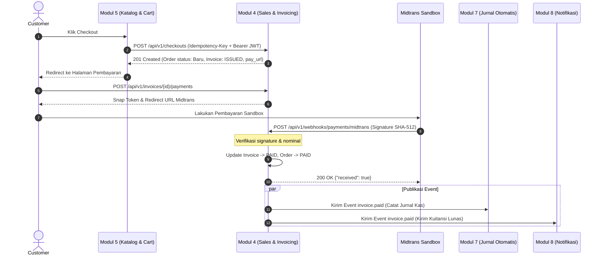

# Spesifikasi Lengkap API & Event Komunikasi Antar-Modul (Modul 4)
## Araya Business Hub Platform — Modul 4: Penawaran & Tagihan Penjualan (Sales & Invoicing)

- **Versi Dokumen:** v1.0
- **Tanggal:** 1 November 2026
- **Status:** Resmi untuk Integrasi Lintas Modul (M1, M2, M3, M5, M7, M8, & Gateway)
- **OpenAPI Specification:** [`docs/openapi.yaml`](openapi.yaml)

---

## 1. Konvensi Umum Arsitektur

1. **Base URL:** `/api/v1`
2. **Format Data:** JSON (`Content-Type: application/json; charset=utf-8`).
3. **Format Waktu:** ISO 8601 UTC (contoh: `2026-11-01T09:15:30Z`).
4. **Format Moneter:** String desimal presisi 2 digit (contoh: `"194250.00"`), mata uang `IDR`. Dilarang memakai tipe `float`.
5. **Autentikasi:** Header `Authorization: Bearer <JWT>` yang diterbitkan oleh Modul 1 (User & Access), kecuali endpoint webhook yang menggunakan verifikasi cryptographic signature (SHA-512).
6. **Pelacakan Request:** Header `X-Request-Id` disertakan pada setiap request dan dikembalikan pada response header untuk audit log.
7. **Idempotensi:** Header `Idempotency-Key: <UUID>` wajib disertakan pada transaksi pembuatan checkout keranjang agar tidak terjadi duplikasi order saat koneksi tidak stabil.

---

## 2. Format Respon Error Seragam (*Uniform Error Response*)

Seluruh endpoint API Modul 4 mengembalikan format error seragam sesuai standar Capstone:

```json
{
  "error": {
    "code": "PRICE_CHANGED",
    "message": "Harga satu atau lebih item telah berubah di sistem penjualan.",
    "details": [
      {
        "field": "items[0].unit_price_displayed",
        "issue": "expected 75000.00, got 70000.00"
      }
    ],
    "trace_id": "req_9f2c1a"
  }
}
```

---

## 3. Matriks Lengkap Endpoint Masuk (*Inbound REST API*)

### 3.1 Integrasi dengan Modul 5 (Checkout Keranjang Belanja)

#### `POST /api/v1/checkouts`
- **Tujuan:** Menerima data keranjang belanja customer dari Modul 5 untuk divalidasi, dihitung ulang pajaknya (PPN 11%), lalu dibuatkan Order dan Invoice tagihan secara atomik.
- **Hak Akses:** Role `Customer` (Bearer JWT M1).
- **Header Wajib:**
  - `Authorization: Bearer <JWT>`
  - `Idempotency-Key: <UUID>`
  - `Content-Type: application/json`

**Contoh Payload Request:**
```json
{
  "source": {
    "module": "M5",
    "cart_id": "cart_01J9ZQ7K3M",
    "checkout_requested_at": "2026-10-07T09:15:30Z"
  },
  "customer": {
    "user_id": "usr_01J9ZP2A8C",
    "full_name": "Budi Santoso",
    "email": "budi@example.com",
    "phone": "+6281234567890",
    "billing_address": {
      "line1": "Jl. Dipati Ukur No. 10",
      "city": "Bandung",
      "province": "Jawa Barat",
      "postal_code": "40132",
      "country": "ID"
    }
  },
  "partner_id": "ptr_01J9ZN5R1D",
  "business_unit_id": "bu_01J9ZM3T9E",
  "currency": "IDR",
  "items": [
    {
      "product_id": "prd_01J9ZK8W2F",
      "sku": "KAOS-UNPAS-M",
      "name": "Kaos Unpas Size M",
      "quantity": 2,
      "unit_price_displayed": "75000.00"
    }
  ],
  "notes": "Mohon dikemas rapi"
}
```

**Contoh Payload Response (HTTP 201 Created):**
```json
{
  "checkout_id": "chk_01J9ZR4B7H",
  "order": {
    "id": "ord_01J9ZR4B8J",
    "order_number": "ORD-202610-0001",
    "status": "Baru",
    "payment_status": "PENDING_PAYMENT",
    "source_cart_id": "cart_01J9ZQ7K3M",
    "partner_id": "ptr_01J9ZN5R1D",
    "business_unit_id": "bu_01J9ZM3T9E",
    "items": [
      {
        "product_id": "prd_01J9ZK8W2F",
        "name": "Kaos Unpas Size M",
        "quantity": 2,
        "unit_price": "75000.00",
        "tax_rate": "0.1100",
        "line_net": "150000.00",
        "line_tax": "16500.00",
        "line_total": "166500.00"
      }
    ],
    "subtotal": "150000.00",
    "discount_total": "0.00",
    "tax_total": "16500.00",
    "grand_total": "166500.00",
    "currency": "IDR",
    "created_at": "2026-10-07T09:15:31Z"
  },
  "invoice": {
    "id": "inv_01J9ZR4B9K",
    "invoice_number": "INV-202610-0001",
    "status": "ISSUED",
    "issue_date": "2026-10-07",
    "due_date": "2026-10-09",
    "grand_total": "166500.00",
    "pay_url": "/api/v1/invoices/inv_01J9ZR4B9K/payments"
  }
}
```

---

### 3.2 Integrasi Pembayaran Sandbox (Customer & Midtrans Webhook)

#### `POST /api/v1/invoices/{invoice_id}/payments`
- **Tujuan:** Customer memulai transaksi pembayaran atas invoice tertentu untuk mendapatkan Snap Token / Redirect URL Midtrans.
- **Hak Akses:** Role `Customer` pemilik invoice.

**Contoh Response (HTTP 201 Created):**
```json
{
  "payment_id": "pay_01J9ZS1C2M",
  "invoice_id": "inv_01J9ZR4B9K",
  "provider": "midtrans",
  "gateway_order_id": "INV-202610-0001-1",
  "amount": "166500.00",
  "currency": "IDR",
  "status": "PENDING",
  "snap_token": "66e4fa55-fdac-4ef9-91b5-733b97d1b862",
  "redirect_url": "https://app.sandbox.midtrans.com/snap/v4/redirection/66e4fa55-...",
  "expires_at": "2026-10-08T09:20:00Z"
}
```

#### `POST /api/v1/webhooks/payments/midtrans`
- **Tujuan:** Menerima notifikasi status transaksi dari payment gateway (Midtrans Sandbox).
- **Autentikasi:** Tanpa JWT. Menggunakan verifikasi tanda tangan kriptografis:
  $$\text{SHA512}(\text{order\_id} + \text{status\_code} + \text{gross\_amount} + \text{SERVER\_KEY})$$
- **Aksi Otomatis:**
  - Jika `transaction_status` = `settlement` atau `capture` (fraud = accept) ➔ Status invoice otomatis berubah menjadi **`PAID`**, status Order menjadi **`PAID`**, dan Event **`invoice.paid`** diterbitkan.

**Contoh Payload Webhook Midtrans:**
```json
{
  "transaction_time": "2026-10-07 16:21:45",
  "transaction_status": "settlement",
  "transaction_id": "9aed5972-5b6a-401e-894b-a32c91ed1a3a",
  "status_message": "midtrans payment notification",
  "status_code": "200",
  "signature_key": "9a2f4c...",
  "payment_type": "bank_transfer",
  "order_id": "INV-202610-0001-1",
  "gross_amount": "166500.00",
  "fraud_status": "accept",
  "currency": "IDR"
}
```

---

### 3.3 Endpoint Manajemen Pesanan & Master Data

#### `PATCH /api/v1/orders/{id}/status` *(M4-US4)*
- **Tujuan:** Mitra/Partner memperbarui status pemrosesan pesanan agar customer dapat melihat progresnya.
- **Hak Akses:** Role `Partner` (pemilik produk) dan `Admin`.
- **Payload Request:**
  ```json
  {
    "status": "Diproses" 
  }
  ```
  *(Nilai status yang valid: `Baru`, `Diproses`, `Selesai`, `Dibatalkan`)*

#### `GET /api/v1/products` & `POST /api/v1/products` *(M4-US1)*
- **Tujuan:** Pengelolaan katalog master produk/jasa (sumber kebenaran harga resmi).
- **Hak Akses:** Role `Admin` dan `Partner`.

#### `GET /api/v1/customers` & `POST /api/v1/customers` *(M4-US1)*
- **Tujuan:** Pengelolaan dan validasi data pelanggan.

#### `POST /api/v1/quotations` *(M4-US2)*
- **Tujuan:** Pembuatan draf penawaran (*Quotation*) dengan kalkulasi pajak dan pembulatan *Round-Half-Up* per baris.

#### `POST /api/v1/quotations/{id}/convert` *(M4-US2)*
- **Tujuan:** Mengonversi quotation yang sudah `ACCEPTED` menjadi Invoice (`ISSUED`).

---

## 4. Spesifikasi Event Keluar (*Outbound Event: invoice.paid*)

Setelah sebuah invoice berhasil dilunasi melalui webhook Midtrans, Modul 4 menerbitkan **Event `invoice.paid`** untuk dikonsumsi oleh modul hilir tanpa kontak database langsung:

### 4.1 Konsumen Event:
1. **Modul 7 (Jurnal Otomatis / Finance):** Menangkap event ini untuk langsung membukukan jurnal debit/kredit pendapatan dan piutang/kas.
2. **Modul 8 (Notifikasi):** Menangkap event ini untuk mengirimkan kuitansi atau tanda terima lunas via WhatsApp / Email ke customer.

### 4.2 Skema Data Event `invoice.paid`:
```json
{
  "event_id": "evt_01J9ZT3D4N",
  "event_type": "invoice.paid",
  "occurred_at": "2026-10-07T09:21:46Z",
  "data": {
    "invoice_id": "inv_01J9ZR4B9K",
    "invoice_number": "INV-202610-0001",
    "order_id": "ord_01J9ZR4B8J",
    "partner_id": "ptr_01J9ZN5R1D",
    "business_unit_id": "bu_01J9ZM3T9E",
    "customer_id": "cus_01J9ZP2A8C",
    "subtotal": "150000.00",
    "tax_total": "16500.00",
    "grand_total": "166500.00",
    "currency": "IDR",
    "payment": {
      "provider": "midtrans",
      "payment_type": "bank_transfer",
      "paid_at": "2026-10-07T09:21:45Z"
    }
  }
}
```

---

## 5. Ringkasan Matriks Alur Komunikasi


