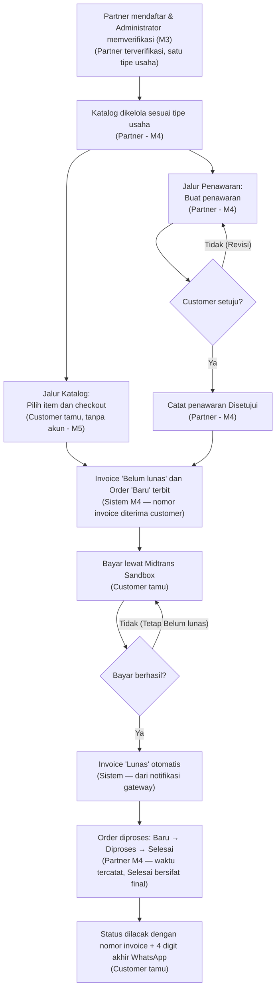

# **BRD Modul M4 Penawaran & Tagihan Penjualan**

Araya Business Hub Platform · Kelompok A4 · Nov 7, 2026 · @Lutfi

## **Ringkasan**

Modul M4 membuat setiap transaksi partner tercatat dari penawaran sampai pesanan selesai, dengan tagihan yang lunas otomatis lewat payment gateway. Partner menjual satu tipe usaha (produk atau jasa), customer membeli tanpa akun, dan setiap pesanan bisa dilacak dengan nomor invoice.

Dokumen ini menjelaskan kebutuhan bisnis M4 sebelum diturunkan menjadi kebutuhan sistem di Dokumen Teknis Bab 2. Isinya menjawab apa yang dibutuhkan bisnis dan mengapa, bukan bagaimana sistem membangunnya.

## **Latar belakang dan masalah bisnis**

Araya Business Hub menghimpun banyak unit usaha dan partner dalam satu platform. Tanpa modul transaksi bersama, setiap partner mencatat penawaran, tagihan, dan pesanan dengan caranya sendiri.

Masalah yang diselesaikan M4:

| Masalah saat ini | Dampak bisnis |
| --- | --- |
| Penawaran dan tagihan dibuat manual di luar platform | Transaksi tidak tercatat rapi dan sulit ditelusuri |
| Invoice bisa terbit sebelum customer setuju | Sengketa harga dan tagihan yang tidak diakui customer |
| Pembayaran dicek manual dari bukti transfer | Konfirmasi lambat dan rawan bukti palsu |
| Customer harus menghubungi partner untuk tahu progres pesanan | Beban layanan partner naik dan customer tidak puas |
| Customer dipaksa membuat akun untuk membeli | Pembeli sekali datang batal membeli |
| Katalog mencampur atribut produk dan jasa | Partner jasa mengisi kolom yang tidak relevan, seperti stok dan berat |

## **Tujuan bisnis dan ukuran keberhasilan**

Keberhasilan diukur saat demo Sprint Review dan integration test di server bersama. Angka target di bawah adalah usulan kelompok dan perlu disepakati PO.

| ID | Tujuan bisnis | Ukuran keberhasilan |
| --- | --- | --- |
| TB-01 | Semua transaksi partner tercatat di satu tempat | 100% invoice berasal dari penawaran disetujui atau checkout M5; tidak ada invoice tanpa sumber |
| TB-02 | Tagihan hanya terbit untuk penawaran yang disetujui customer | 0 invoice dari penawaran berstatus Menunggu persetujuan (diuji TC-M4US2-02) |
| TB-03 | Pembayaran terkonfirmasi tanpa verifikasi manual | Status Lunas berubah dari notifikasi gateway tanpa aksi partner (diuji TC-M4US3-01) |
| TB-04 | Customer tahu progres pesanan tanpa bertanya ke partner | Customer melihat status dan waktu perubahan terakhir dengan nomor invoice (diuji TC-M4US4-03) |
| TB-05 | Customer bisa membeli tanpa membuat akun | Checkout M5 menghasilkan order dan nomor invoice tanpa login |
| TB-06 | Katalog partner hanya memuat yang relevan dengan usahanya | Partner jasa tidak melihat kolom stok, SKU, atau berat (diuji TC-M4US1-05) |

## **Lingkup**

M4 mengurus transaksi dari katalog partner sampai pesanan selesai. Pendaftaran partner, login, katalog publik, dan dashboard milik modul lain.

| Termasuk | Tidak termasuk |
| --- | --- |
| Katalog produk atau jasa partner, sesuai tipe usahanya | Pendaftaran partner dan pemilihan tipe usaha (M3) |
| Data pelanggan milik partner | Akun, login, dan hak akses (M1) |
| Penawaran dan pencatatan persetujuan customer | Katalog publik, keranjang, dan form checkout (M5) |
| Invoice dari penawaran yang disetujui atau dari checkout | Kerangka dashboard (M2); M4 hanya mengirim data |
| Pembayaran invoice lewat Midtrans sandbox | Pembayaran sungguhan (produksi), refund, dan cicilan |
| Status order Baru, Diproses, Selesai beserta waktunya | Pengiriman barang dan pelacakan kurir |
| Halaman lacak pesanan untuk customer tanpa akun | Pajak penjualan, laporan penjualan, dan pembatalan order: belum ada user story |

## **Pemangku kepentingan**

Tiga aktor memakai M4 secara langsung; sisanya menentukan atau bergantung pada M4.

| Pemangku kepentingan | Peran terhadap M4 | Kepentingan utama |
| --- | --- | --- |
| Partner | Aktor: menjual produk atau jasa | Katalog sesuai usahanya, tagihan sah, pembayaran cepat terkonfirmasi |
| Customer (tamu) | Aktor: membeli tanpa akun | Membayar dengan mudah dan tahu progres pesanan |
| Administrator Penjualan | Aktor: mengelola data semua partner | Data produk dan pelanggan rapi, semua transaksi terpantau |
| Product Owner (dosen) | Menetapkan urutan backlog dan menyetujui AC tambahan | Increment yang bisa didemokan tiap sprint |
| Kelompok A3 (M3) | Penyedia data partner dan tipe usaha | Kontrak data partner dipakai dengan benar |
| Kelompok A5 (M5) | Pemakai API order saat checkout | Kontrak order stabil dan terdokumentasi |
| Kelompok A1 (M1), A2 (M2) | Penyedia autentikasi; penerima data dashboard | Izin m4.* dan format data dashboard disepakati |
| Superadmin, Admin organisasi | Pengelola platform dan organisasi di M1 | Bukan aktor M4; mengatur siapa yang boleh memakai M4 |

## **Proses bisnis usulan**

Transaksi masuk lewat dua jalur: customer checkout dari katalog M5, atau partner membuat penawaran yang disetujui customer. Keduanya bertemu saat invoice terbit, lalu mengikuti alur bayar, proses, dan lacak yang sama.

*Proses bisnis to-be · 2 jalur masuk, 2 keputusan*

Jalur penawaran cocok untuk transaksi yang perlu negosiasi, terutama jasa. Rincian per langkah ada di activity diagram UC-01 sampai UC-07 di Dokumen Teknis Bab 2.2.

## **Kebutuhan bisnis**

Setiap kebutuhan bisnis diturunkan ke User Story dan use case di Dokumen Teknis. Prioritas memakai MoSCoW: Must wajib untuk proyek ini, Should penting tetapi bisa ditunda tanpa menggagalkan tujuan.

| ID | Kebutuhan bisnis | Prioritas | User Story · use case |
| --- | --- | --- | --- |
| BRQ-01 | Partner mencatat produk atau jasa sesuai tipe usaha yang dipilih saat mendaftar | Must | M4-US1 · UC-01 |
| BRQ-02 | Partner dan Administrator mencatat data pelanggan sebagai dasar penawaran | Must | M4-US1 · UC-02 |
| BRQ-03 | Data yang tidak lengkap tidak boleh tersimpan | Must | M4-US1 AC-2 |
| BRQ-04 | Partner membuat penawaran dari item aktif miliknya dan mencatat persetujuan customer | Must | M4-US2 · UC-03 |
| BRQ-05 | Invoice hanya terbit dari penawaran yang disetujui | Must | M4-US2 · UC-04 |
| BRQ-06 | Customer membayar invoice lewat payment gateway, dan status lunas berubah otomatis | Must | M4-US3 · UC-05 |
| BRQ-07 | Pembayaran yang gagal tidak mengubah status tagihan | Must | M4-US3 AC-2 |
| BRQ-08 | Partner memperbarui progres pesanan, dan waktu setiap perubahan tercatat | Must | M4-US4 · UC-06 |
| BRQ-09 | Pesanan yang selesai tidak dapat diubah lagi | Must | M4-US4 AC-2 |
| BRQ-10 | Customer tanpa akun melacak pesanan dengan nomor invoice | Must | M4-US4 · UC-07 |
| BRQ-11 | Checkout di M5 menghasilkan order dan invoice di M4 tanpa customer login | Must | Kontrak M5-US4 |
| BRQ-12 | Data pesanan customer terlindungi dari orang yang menebak nomor invoice | Should | M4-US4 AC-4, NFR-02 |
| BRQ-13 | Ringkasan penjualan tersedia untuk dashboard bersama | Should | Kontrak M2-US2 |

## **Aturan bisnis**

Aturan ini berlaku apa pun tampilannya, termasuk bila sistem dipanggil langsung lewat API.

| ID | Aturan | Sumber |
| --- | --- | --- |
| BR-01 | Partner memilih satu tipe usaha, produk atau jasa, saat mendaftar | Keputusan tim, M3-US1 |
| BR-02 | Setiap item mewarisi tipe usaha partner; item dengan tipe lain ditolak | Keputusan tim |
| BR-03 | Partner hanya melihat menu, form, dan data miliknya; Administrator melihat semua partner | Keputusan tim, NFR-01 |
| BR-04 | Data produk, jasa, atau pelanggan yang kolom wajibnya kosong ditolak | M4-US1 AC-2 |
| BR-05 | Ganti tipe usaha lewat pengajuan di M3 dan verifikasi admin, ditolak selama ada order Baru atau Diproses; item tipe lama dinonaktifkan, tidak dihapus | Keputusan tim |
| BR-06 | Penawaran baru berstatus Menunggu persetujuan dan menjadi Disetujui setelah Partner mencatat persetujuan customer | M4-US2 AC-3 |
| BR-07 | Invoice hanya dibuat dari penawaran Disetujui, status awal Belum lunas | M4-US2 AC-1, AC-2 |
| BR-08 | Status Lunas hanya diubah oleh notifikasi gateway yang valid; pembayaran gagal tidak mengubah status | M4-US3 AC-1, AC-2 |
| BR-09 | Status order hanya bergerak Baru → Diproses → Selesai; Selesai bersifat final; setiap perubahan dicatat waktunya | M4-US4 AC-1, AC-2 |
| BR-10 | Customer bertransaksi tanpa akun; nama, WhatsApp, dan alamat atau email disimpan pada order | Keputusan tim |
| BR-11 | Partner produk wajib meminta alamat pengiriman; partner jasa wajib meminta email dan jadwal | Keputusan tim |
| BR-12 | Setiap order punya nomor invoice unik; status pesanan hanya tampil bila nomor invoice dan 4 digit akhir WhatsApp cocok | M4-US4 AC-3, AC-4 |

## **Asumsi, batasan, dan ketergantungan**

### **Asumsi**

- Tipe usaha melekat di level partner, bukan di unit usaha M2. Perlu dikonfirmasi ke A2 dan A3.
- Persetujuan customer atas penawaran terjadi di luar sistem (WhatsApp atau email), lalu dicatat oleh Partner.
- Customer memakai nomor WhatsApp yang aktif saat checkout, karena 4 digit akhirnya dipakai untuk melacak pesanan.

### **Batasan**

- Proyek berjalan 2 sprint, masing-masing 4 minggu.
- Pembayaran hanya mode sandbox Midtrans; tidak ada uang sungguhan.
- Tampilan wajib mengikuti Panduan UI Bersama v1.0, termasuk lima warna status baku.

### **Ketergantungan**

| Dari | Yang dibutuhkan M4 | Dibutuhkan untuk |
| --- | --- | --- |
| M3 (A3) | Data partner: partner_id, tipe_usaha, status verifikasi | Katalog sesuai tipe (BRQ-01) |
| M1 (A1) | Login dan izin m4.* per peran | Semua fitur Partner dan Administrator |
| M5 (A5) | Pemanggilan API order saat checkout | Order dan invoice dari katalog (BRQ-11) |
| M2 (A2) | Format data dashboard | Ringkasan penjualan (BRQ-13) |
| Midtrans | Akun sandbox, server key, notifikasi webhook | Pembayaran otomatis (BRQ-16 / BRQ-06) |

## **Risiko dan mitigasi**

Risiko terbesar ada di ketergantungan antarkelompok, karena DoR mewajibkan kontrak disepakati sebelum Sprint Planning.

| Risiko | Dampak | Mitigasi |
| --- | --- | --- |
| Kontrak data partner dari M3 belum siap di Sprint 1 | M4-US1 tidak bisa membaca tipe usaha | Stub data partner di M4 (task S1 T4), diganti saat API M3 siap |
| Keranjang M5 berisi item dari beberapa partner | Satu invoice untuk banyak partner sulit dibayar dan diproses | Sepakati dengan A5: checkout dipecah satu order dan invoice per partner (U-02) |
| Nomor invoice ditebak orang lain | Data nama, nomor, dan alamat customer bocor | Verifikasi 4 digit WhatsApp dan batas 5 percobaan per 15 menit (BR-12, NFR-02) |
| Notifikasi Midtrans palsu | Invoice berstatus Lunas tanpa pembayaran | Verifikasi signature di setiap notifikasi (NFR-03) |
| Webhook Midtrans tidak bisa menjangkau server uji | Status tidak berubah saat demo | Deploy ke server ber-URL publik sebelum Sprint 2 dimulai |
| Partner salah memilih tipe usaha | Partner tidak bisa menjual yang semestinya | Pengajuan ganti tipe lewat M3 dengan verifikasi admin (BR-05) |

## **Keputusan yang masih terbuka**

Empat usulan sudah dipakai di Dokumen Teknis sebagai rancangan, tetapi belum diputuskan.

| ID | Usulan | Diputuskan oleh |
| --- | --- | --- |
| U-01 | Partner baru bisa memproses order setelah invoice Lunas | PO |
| U-02 | Satu checkout hanya untuk satu partner; keranjang lintas partner dipecah per partner | PO, A5 |
| U-03 | Checkout tamu otomatis menambah data pelanggan partner, dicocokkan dari nomor WhatsApp | PO |
| U-04 | Pada jalur penawaran, order dibuat bersamaan dengan invoice | PO |

- [ ] Konfirmasi ke PO: AC tambahan M4-US1 AC-3 dan M4-US4 AC-3, AC-4
- [ ] Konfirmasi ke A2 dan A3: tipe usaha melekat di partner, bukan unit usaha
- [ ] Sepakati kontrak data partner dengan A3 dan kontrak order dengan A5

## **Glosarium**

| Istilah | Arti |
| --- | --- |
| Tipe usaha | Jenis yang dijual partner: produk atau jasa, dipilih satu kali saat mendaftar di M3 |
| Penawaran (quotation) | Daftar item dan harga untuk pelanggan; status Menunggu persetujuan atau Disetujui |
| Invoice | Tagihan bernomor unik; status Belum lunas atau Lunas |
| Order | Pesanan yang diproses partner; status Baru, Diproses, atau Selesai |
| Customer tamu | Customer tanpa akun; identitasnya disimpan pada order |
| Nomor invoice | Kode unik, mis. INV-20261107-0001, untuk melacak dan membayar pesanan |
| Midtrans sandbox | Payment gateway mode uji, tanpa uang sungguhan |
| MoSCoW | Cara memberi prioritas: Must, Should, Could, Won't |

## **Persetujuan**

| Peran | Nama | Tanggal | Tanda tangan |
| --- | --- | --- | --- |
| Product Owner | Dr. Ayi Purbasari, ST., MT. | | |
| Sistem Analis, Kelompok A4 | [nama] | | |
| Scrum Master, Kelompok A4 | [nama] | | |

Acuan: Studi Kasus Capstone Kelas A, Dokumen PPL Modul 4, Panduan UI Bersama v1.0 (5 Okt 2026), dan Dokumen Teknis M4 versi 0.1.
