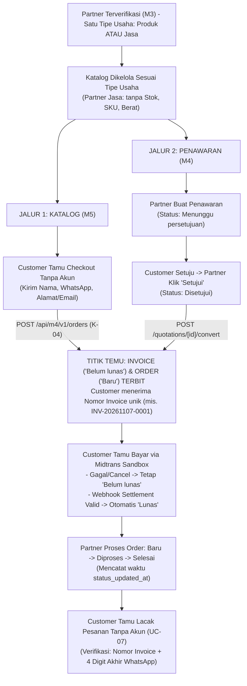

**ARAYA BUSINESS HUB — PRODUCT REQUIREMENTS** 

 

**DOCUMENT** 

**ARAYA BUSINESS HUB PLATFORM  •  DOKUMEN SPESIFIKASI KEBUTUHAN PRODUK** 

# **Product Requirements Document (PRD)** 

#### **Modul 4: Penawaran & Tagihan Penjualan (Quotation & Sales Invoice Management)** 

|**Kode Dokumen**|`DOC-ABH-M4-PRD-001` (Baseline Spesifikasi Teknis & Fungsional Modul 4)|
|---|---|
|**Nama Proyek**|Araya Business Hub Platform — Sistem ERP Badan Pengembangan Usaha (BPU)<br>Universitas Pasundan|
|**Mata Kuliah & Kelompok**|Proyek Perangkat Lunak (Capstone) `IF21W0705` • Kelas A • Kelompok A4 (Modul 4)|
|**Versi & Tanggal Rilis**|**Versi 3.0 (Final Baseline)**• 7 November 2026 *(Menggantikan v2.0 tertanggal 23<br>Oktober 2026)*|
|**Product Owner**|Dr. Ayi Purbasari, ST., MT. (Dosen Pengampu Proyek Perangkat Lunak)|
|**Tim Pengembang Modul 4**|•**Desi Hafita Ashri**— *System Analyst & System Designer* (Analisis Kebutuhan<br>Fungsional, Pemodelan Use Case & Skenario *Dokumen PPL*, serta Desain Sistem)<br>•**Lutfi**— *Business Analyst* (Penyusun *Business Requirements Document / BRD*<br>Modul M4: `TB-01`..`TB-06`,`BRQ-01`..`BRQ-13`,`BR-01`..`BR-12`)<br>•**Hikmal Maulana**— *Backend & Integration Lead* (API Route Handlers, Kalkulasi<br>Finansial, Auth JWT/RBAC, Midtrans & CI/CD)<br>•**Muh Ikhsan**— *Frontend Developer* (App Layout, Tailwind CSS Tokens, Komponen<br>UI Modular & Interaktivitas Form)<br>•**Murod Adipate**— *Database Administrator* (Supabase PostgreSQL 17, Prisma<br>ORM Schema, Seeder & Docker Local DB)<br>•**Ahmad Dzaki**— *Quality Assurance / SDET Lead* (Unit Testing, Playwright E2E,<br>Postman/Newman & Mocking)|
|**Arsitektur & Tech Stack**|Next.js 16.4 (App Router) • React 19 • TypeScript 5 (Strict) • Prisma ORM 7 •<br>Supabase PostgreSQL 17 • Midtrans Snap|

##### **Riwayat Perubahan Dokumen (Revision History)** 

|**Versi**|**Tanggal**|**Penulis / Kontributor**|**Ringkasan Perubahan Utama**|
|---|---|---|---|
|`v1.0`|07 Okt 2026|Tim Kelompok A4|Draf inisiasi kebutuhan awal Modul 4 Penjualan dan rancangan kasar<br>alur transaksi.|
|`v2.0`|23 Okt 2026|Tim Kelompok A4|Penyesuaian awal terhadap User Story resmi dosen dan keputusan<br>migrasi ke arsitektur Next.js Full-Stack.|
|`v3.0`|07 Nov 2026|Desi H.A., Lutfi,<br>Hikmal M. & Tim A4|**Perombakan Menyeluruh & Sinkronisasi BRD (Baseline Aktif):**(1)<br>Sinkronisasi 100% dengan *BRD Modul M4*(`TB-01`..`TB-06`,<br>`BRQ-01`..`BRQ-13`,`BR-01`..`BR-12`,`NFR-01`..`NFR-03`,`U-01`..`U-04`), termasuk<br>aturan penyembunyian kolom Stok/SKU/Berat pada UI Partner Jasa<br>(`TB-06`,`TC-M4US1-05`)dengan auto-generasi `SRV-...` di backend, serta<br>alur *Customer Tamu* tanpa akun(`TB-05`,`BR-12`)yang melacak<br>pesanan & membayar dengan Nomor Invoice + 4 digit akhir<br>WhatsApp; (2) Sinkronisasi skema Supabase PostgreSQL 17<br>(`prisma/schema.prisma` + migrasi kolom `unit` & `stock`); (3) Integrasi 7<br>Skenario Use Case(`UC-01`..`UC-07`)& Kontrak API `K-01`..`K-09`.|

### **Daftar Isi**

| Bab / Sub-Bab | Deskripsi Bagian |
|---|---|
| **Bab 1. Pendahuluan, Tujuan Bisnis (BRD) & Ruang Lingkup** | Latar belakang, Tujuan Bisnis (`TB-01` s/d `TB-06`), Ruang Lingkup, dan Matriks Stakeholder/Aktor |
| 1.1 Latar Belakang & Masalah Bisnis yang Diselesaikan | Masalah fragmentasi penawaran, penagihan manual, dan solusinya |
| 1.2 Tujuan Bisnis (TB) & Ukuran Keberhasilan (Mengacu BRD) | Target otomasi penagihan, eliminasi float, kepatuhan PPN 11% |
| 1.3 Batas Ruang Lingkup (In-Scope vs Out-of-Scope) | Batasan tanggung jawab modul M4 vs modul lain (M1, M3, M5, M7, M9) |
| 1.4 Pemangku Kepentingan & Definisi Aktor Sistem | Matriks peran pengguna: Administrator, Partner, Customer Tamu |
| **Bab 2. Spesifikasi Kebutuhan Bisnis (BRQ), User Story & Use Case** | Pemetaan BRQ MoSCoW, 4 User Story, dan 7 Skenario Use Case |
| 2.1 Pemetaan Kebutuhan Bisnis (BRQ-01 s/d BRQ-13) dengan Prioritas MoSCoW | Klasifikasi kebutuhan bisnis Modul 4 |
| 2.2 Daftar User Story & Acceptance Criteria Resmi (Dokumen PPL + BRD) | M4-US1 s/d M4-US4 beserta acceptance criteria terukur |
| 2.3 Spesifikasi Skenario 7 Use Case (UC-01 s/d UC-07) | Skenario alur utama, alternatif, dan kondisi akhir sistem |
| **Bab 3. Proses Bisnis Usulan (To-Be) & Arsitektur Sistem** | Alur proses dua jalur masuk dan arsitektur Next.js Full-Stack |
| 3.1 Alur Proses Bisnis Dua Jalur Masuk (Jalur Katalog M5 & Jalur Penawaran M4) | Alur transaksi dari inisiasi hingga pelunasan & pelacakan |
| 3.2 Arsitektur Teknis Aplikasi Full-Stack (Next.js App Router & Supabase) | Diagram komponen, layer data, dan proteksi trust boundary |
| **Bab 4. Aturan Bisnis (BR-01 s/d BR-12), Kalkulasi & Siklus Status** | Aturan bisnis, kalkulasi finansial, dan pemetaan status |
| 4.1 Daftar Lengkap Aturan Bisnis Resmi (BR-01 s/d BR-12) & Implementasi Sistem | Implementasi aturan validasi, penomoran, dan hak akses |
| 4.2 Resolusi 2 Poin Penyelarasan Kritis antara BRD dan Implementasi Teknis PRD | Keputusan arsitektur sinkronisasi model data |
| 4.3 Formula Kalkulasi Finansial & Pembulatan Round-Half-Up (PRO-48) | Rumus matematis subtotal, diskon, PPN 11%, dan total akhir |
| 4.4 Matriks Status Dokumen: Pemetaan Database, API & Badge UI | Sinkronisasi status penawaran, tagihan, dan pesanan |
| 4.5 Ketentuan Teknis Khusus: Kolom Stock/Unit, Format WhatsApp & Impor CSV | Detail implementasi master data katalog & pelanggan |
| **Bab 5. Desain Skema Database Aktual (Supabase PostgreSQL 17)** | Skema DDL, relasi tabel, dan kamus data komprehensif |
| 5.1 Arsitektur Koneksi Database (Supabase Cloud & Docker Lokal) | Konfigurasi multi-lingkungan Docker port 5433 & Supabase |
| 5.2 Diagram Relasi Entitas (Entity Relationship Diagram) | Diagram ER visual entitas Modul 4 |
| 5.3 Kamus Data (Data Dictionary) Seluruh Tabel Database | Spesifikasi atribut, tipe data, constraint, dan relasi tabel |
| **Bab 6. Spesifikasi Kontrak API & Integrasi Antarmodul** | Standar endpoint REST API, otentikasi JWT, dan format respons |
| 6.1 Konvensi Alamat Endpoint, Autentikasi Hibrida & Amplop Seragam | Standar JSON envelope, trace ID, dan kode error |
| 6.2 Katalog Lengkap Endpoint REST API Modul 4 | Daftar seluruh endpoint `GET`, `POST`, `PUT`, `PATCH`, `DELETE` |
| 6.3 Contoh Payload Kontrak Checkout Tamu (K-04) & Lacak Pesanan (BR-12) | Contoh riil request & response JSON integrasi antarmodul |
| **Bab 7. Standar UI/UX, Kebutuhan Non-Fungsional, Risiko & Keputusan** | Ketentuan antarmuka, NFR, matriks risiko, dan mitigasi |
| 7.1 Ketentuan Antarmuka Pengguna (Panduan UI Bersama v1.0 & BRD TB-06) | Palet warna status, typography, dan aturan ikonografi |
| 7.2 Kebutuhan Non-Fungsional (NFR-01 s/d NFR-03) & Standar Kualitas | Kinerja, keamanan tanda tangan SHA-512, dan ketersediaan |
| 7.3 Matriks Risiko, Mitigasi & Keputusan Rancangan (U-01 s/d U-04) | Penanganan kegagalan pembayaran, duplikasi, dan konkurensi |

 

## **1. Pendahuluan, Tujuan Bisnis (BRD) & Ruang Lingkup** 

#### **1.1 Latar Belakang & Masalah Bisnis yang Diselesaikan** 

**Modul 4: Penawaran & Tagihan Penjualan (Quotation & Sales Invoice Management)** merupakan subsistem transaksi komersial pada platform ERP **Araya Business Hub** untuk Badan Pengembangan Usaha (BPU) Universitas Pasundan. Modul ini memastikan setiap transaksi Partner tercatat rapi dari tahap penawaran hingga pesanan selesai, dengan tagihan (*invoice*) yang lunas otomatis melalui *payment gateway* Midtrans Sandbox. Partner menjual satu tipe usaha ( **Produk** atau **Jasa** ), **Customer membeli sebagai tamu tanpa perlu membuat akun** , dan setiap pesanan dapat dibayar serta dilacak progresnya menggunakan **Nomor Invoice + 4 digit terakhir nomor WhatsApp** . 

|**Masalah Bisnis Saat Ini**<br>**(As-Is)**|**Dampak Bisnis**|**Solusi Sistem pada Modul 4 (To-Be)**|
|---|---|---|
|Penawaran dan tagihan dibuat<br>manual di luar platform|Transaksi tidak tercatat rapi<br>dan sulit ditelusuri|Pencatatan penawaran (`quotations`), tagihan<br>(`invoices`), dan pesanan (`orders`)terpusat per<br>Partner (`TB-01`).|
|Invoice dapat terbit sebelum<br>customer menyetujui harga|Sengketa harga dan tagihan<br>tidak diakui customer|Validasi sistem mengunci pembuatan invoice<br>hanya dari penawaran berstatus**Disetujui**(`TB-02` /<br>`BR-07`).|
|Pembayaran dicek manual dari<br>foto bukti transfer|Konfirmasi lambat dan rawan<br>bukti transfer palsu|Pelunasan otomatis via *webhook* Midtrans<br>Sandbox dengan verifikasi signature `SHA-512`<br>(`TB-03` / `BR-08`).|
|Customer harus menghubungi<br>partner untuk menanyakan<br>progres pesanan|Beban layanan partner naik<br>dan kepuasan pelanggan<br>turun|Halaman lacak pesanan mandiri menampilkan<br>status (`Baru`/`Diproses`/`Selesai`)dan waktu<br>perubahan terakhir (`TB-04`).|
|Customer dipaksa membuat<br>akun untuk berbelanja sekali<br>waktu|Calon pembeli batal<br>menyelesaikan transaksi<br>(*drop-off*)|Dukungan penuh**Customer Tamu (Guest**<br>**Checkout)**tanpa login; pelacakan via Nomor<br>Invoice + 4 digit akhir WhatsApp (`TB-05` / `BR-12`).|
|Katalog mencampur atribut<br>produk fisik dan layanan jasa|Partner jasa bingung mengisi<br>kolom tidak relevan (stok,<br>SKU, berat)|Katalog adaptif sesuai tipe usaha Partner:**Partner**<br>**Jasa tidak melihat kolom Stok, SKU, atau Berat**<br>**di UI**(`TB-06` / `TC-M4US1-05`).|

#### **1.2 Tujuan Bisnis (TB) & Ukuran Keberhasilan (Mengacu BRD)** 

|**ID Tujuan**|**Pernyataan Tujuan Bisnis (BRD)**|**Ukuran Keberhasilan & Kode Uji (Test Case)**|
|---|---|---|
|**TB-01**|Semua transaksi partner tercatat di satu<br>tempat terpusat.|100% invoice berasal dari penawaran berstatus *Disetujui*<br>atau *Checkout* Modul 5; tidak ada invoice tanpa sumber<br>transaksi.|
|**TB-02**|Tagihan hanya terbit untuk penawaran<br>yang telah disetujui customer.|0 invoice berhasil terbit dari penawaran berstatus<br>*Menunggu persetujuan* (diuji pada**`TC-M4US2-02`**).|
|**TB-03**|Pembayaran terkonfirmasi otomatis tanpa<br>verifikasi manual.|Status *Lunas* berubah otomatis dari notifikasi *webhook*<br>payment gateway tanpa aksi manual Partner (diuji pada<br>**`TC-M4US3-01`**).|
|**TB-04**|Customer mengetahui progres pesanan<br>tanpa harus bertanya ke partner.|Customer dapat melihat status terkini dan waktu<br>perubahan terakhir (`status_updated_at`)dengan Nomor<br>Invoice (diuji pada**`TC-M4US4-03`**).|
|**TB-05**|Customer dapat membeli dengan mudah<br>tanpa harus membuat akun.|Checkout dari katalog Modul 5 menghasilkan Order (`baru`)<br>dan Nomor Invoice (`belum_lunas`)tanpa menuntut login<br>Customer.|

 

|**ID Tujuan**|**Pernyataan Tujuan Bisnis (BRD)**|**Ukuran Keberhasilan & Kode Uji (Test Case)**|
|---|---|---|
|**TB-06**|Katalog partner hanya memuat atribut<br>yang relevan dengan tipe usahanya.|Partner tipe usaha**Jasa**tidak melihat kolom**Stok**,**SKU**,<br>atau**Berat**pada tabel maupun form UI (diuji pada<br>**`TC-M4US1-05`**).|

#### **1.3 Batas Ruang Lingkup (In-Scope vs Out-of-Scope)** 

|**Termasuk Dalam Lingkup Modul 4 (In-Scope)**|**Di Luar Lingkup Modul 4 (Out-of-Scope)**|
|---|---|
|**Katalog Produk atau Jasa Partner sesuai Tipe Usaha**<br>**(`BRQ-01`):**Pengelolaan item produk (dengan SKU,<br>stok, satuan) atau jasa (tanpa menampilkan stok, SKU,<br>berat di UI) beserta fitur impor CSV massal ke server.|**Pendaftaran Partner & Pemilihan Tipe Usaha:**<br>Registrasi awal mitra, verifikasi mitra, dan persetujuan<br>pengajuan ganti tipe usaha dikelola oleh**Modul 3 (M3)**<br>(`BR-01`,`BR-05`).|
|**Data Pelanggan Milik Partner (`BRQ-02`):**Pencatatan<br>data pelanggan (`customers`)oleh Partner/Admin maupun<br>pencatatan otomatis dari transaksi *Customer Tamu*<br>(`U-03`).|**Manajemen Akun, Login & Hak Akses Platform:**<br>Otentikasi SSO dan penerbitan token izin `m4.*` untuk<br>Partner & Administrator dikelola oleh**Modul 1 (M1)**<br>(`K-01`).|
|**Penawaran & Persetujuan Customer (`BRQ-04`,**<br>**`BRQ-05`):**Penyusunan penawaran (`quotations`),<br>pencatatan status *Disetujui*, dan konversi menjadi<br>Invoice berstatus *Belum lunas*.|**Katalog Publik, Keranjang & Form Checkout:**<br>Antarmuka belanja pembeli dan keranjang dikelola oleh<br>**Modul 5 (M5)**; Modul 4 menerima hasilnya via API Order<br>(`K-04`).|
|**Pembayaran Midtrans Sandbox (`BRQ-06`, `BRQ-07`):**<br>Penerbitan *Snap Token* dan pemrosesan *webhook<br>callback* otomatis untuk mengubah status invoice<br>menjadi *Lunas*.|**Transaksi Uang Sungguhan, Refund & Cicilan:**Hanya<br>mencakup simulasi *Midtrans Sandbox*; tidak mencakup<br>*refund*, cicilan (*installment*), atau pelacakan kurir<br>logistik.|
|**Pembaruan Status Order & Lacak Pesanan Tanpa**<br>**Akun (`BRQ-08` s/d `BRQ-12`):**Update status `Baru ->`<br>`Diproses -> Selesai` oleh Partner serta halaman publik<br>**Lacak Pesanan**menggunakan**Nomor Invoice + 4 digit**<br>**akhir WhatsApp**.|**Kerangka Dashboard Eksekutif:**Visualisasi dashboard<br>utama milik**Modul 2 (M2)**; Modul 4 hanya menyuplai<br>endpoint agregasi `GET /api/m4/v1/dashboard-summary`<br>(`BRQ-13`).|

#### **1.4 Pemangku Kepentingan & Definisi Aktor Sistem** 

|**Pemangku**<br>**Kepentingan / Aktor**|**Peran terhadap Modul 4**|**Mekanisme Akses & Kepentingan Utama**|
|---|---|---|
|**Partner (Mitra Usaha)**<br>*(Aktor Langsung)*|Menjual satu tipe usaha (**Produk**atau<br>**Jasa**), mengelola katalog & pelanggan<br>miliknya, membuat penawaran,<br>menerbitkan invoice, dan memperbarui<br>status order.|Login menggunakan**JWT Modul 1**(`role:`<br>`"partner"`,`partner_id`,izin `m4.*`). Hanya dapat<br>melihat menu, form, dan data milik<br>`partner_id`-nya sendiri (`BR-03`).|
|**Customer (Pembeli**<br>**Tamu)**<br>*(Aktor Langsung)*|Membeli produk/jasa tanpa akun (lewat<br>checkout M5 atau penawaran partner),<br>membayar tagihan via Midtrans<br>Sandbox, dan melacak progres pesanan.|**Tanpa Akun / Tanpa Login (`TB-05`,**<br>**`BR-10`)**. Mengakses halaman pembayaran<br>dan pelacakan status pesanan menggunakan<br>**Nomor Invoice + 4 digit terakhir nomor**<br>**WhatsApp**(`BR-12`).|
|**Administrator**<br>**Penjualan**<br>*(Aktor Langsung)*|Mengelola dan memantau data katalog<br>produk/jasa, pelanggan, penawaran,<br>tagihan, serta pesanan dari seluruh<br>Partner.|Login menggunakan**JWT Modul 1**(`role:`<br>`"admin"`,izin `m4.*`). Memiliki visibilitas lintas<br>seluruh `partner_id` (`BR-03`).|

 

|**Pemangku**<br>**Kepentingan / Aktor**|**Peran terhadap Modul 4**|**Mekanisme Akses & Kepentingan Utama**|
|---|---|---|
|**Kelompok A1 (M1), A2**<br>**(M2), A3 (M3), A5 (M5)**<br>*(Sistem Lintas Modul)*|•**M1:**Penyedia JWT & izin `m4.*`<br>•**M2:**Penerima ringkasan penjualan<br>(`BRQ-13`)<br>•**M3:**Penyedia `partner_id` & `tipe_usaha`<br>•**M5:**Pemanggil API Order saat<br>checkout tamu (`BRQ-11`)|Integrasi melalui REST API `/api/m4/v1/...`<br>menggunakan Bearer JWT (untuk request<br>berbasis sesi) atau header `X-Service-Key`<br>(untuk komunikasi antarmodul / checkout tamu<br>M5).|

 

## **2. Spesifikasi Kebutuhan Bisnis (BRQ), User Story & Use Case** 

#### **2.1 Pemetaan Kebutuhan Bisnis (BRQ-01 s/d BRQ-13) dengan Prioritas MoSCoW** 

Seluruh kebutuhan bisnis pada dokumen BRD diturunkan secara langsung ke dalam User Story, Use Case, dan kontrak API teknis Modul 4 dengan skala prioritas **MoSCoW** (*Must* = wajib ada pada rilis proyek; *Should* = penting dan diimplementasikan untuk keamanan/integrasi): 

|**ID BRQ**|**Pernyataan Kebutuhan Bisnis (BRD)**|**Prioritas**|**Ketelusuran User Story, Use Case &**<br>**Aturan Bisnis**|
|---|---|---|---|
|`BRQ-01`|Partner mencatat produk atau jasa sesuai tipe<br>usaha yang dipilih saat mendaftar.|**Must**|`M4-US1` · `UC-01` · `BR-01`,`BR-02`,`TB-06`<br>(`TC-M4US1-05`)|
|`BRQ-02`|Partner dan Administrator mencatat data<br>pelanggan sebagai dasar penawaran dan<br>transaksi.|**Must**|`M4-US1` · `UC-02` · `BR-03`,`U-03`|
|`BRQ-03`|Data produk, jasa, atau pelanggan yang tidak<br>lengkap tidak boleh tersimpan.|**Must**|`M4-US1 AC-2` · `UC-01`,`UC-02` · `BR-04`|
|`BRQ-04`|Partner membuat penawaran dari item aktif<br>miliknya dan mencatat persetujuan customer.|**Must**|`M4-US2 AC-3` · `UC-03` · `BR-06`|
|`BRQ-05`|Invoice hanya dapat terbit dari penawaran yang<br>sudah berstatus Disetujui.|**Must**|`M4-US2 AC-1, AC-2` · `UC-04` · `BR-07`,<br>`TB-02` (`TC-M4US2-02`)|
|`BRQ-06`|Customer membayar invoice lewat payment<br>gateway, dan status Lunas berubah otomatis.|**Must**|`M4-US3 AC-1` · `UC-05` · `BR-08`,`TB-03`<br>(`TC-M4US3-01`)|
|`BRQ-07`|Pembayaran yang gagal atau kedaluwarsa tidak<br>mengubah status tagihan (tetap Belum lunas).|**Must**|`M4-US3 AC-2` · `UC-05` · `BR-08`|
|`BRQ-08`|Partner memperbarui progres pesanan (`Baru ->`<br>`Diproses -> Selesai`), dan waktu perubahan<br>tercatat.|**Must**|`M4-US4 AC-1` · `UC-06` · `BR-09`|
|`BRQ-09`|Pesanan yang sudah berstatus Selesai bersifat<br>final dan tidak dapat diubah lagi.|**Must**|`M4-US4 AC-2` · `UC-06` · `BR-09`|
|`BRQ-10`|Customer tanpa akun melacak progres pesanan<br>menggunakan Nomor Invoice.|**Must**|`M4-US4 AC-3` · `UC-07` · `BR-12`,`TB-04`<br>(`TC-M4US4-03`)|
|`BRQ-11`|Checkout di Modul 5 menghasilkan Order (`Baru`)<br>dan Invoice (`Belum lunas`)di M4 tanpa login<br>customer.|**Must**|Kontrak `M5-US4` (`K-04`)· `TB-01`,`TB-05`,<br>`BR-10`,`U-04`|
|`BRQ-12`|Data pesanan customer terlindungi dari pihak luar<br>yang mencoba menebak nomor invoice.|**Should**|`M4-US4 AC-4`,`NFR-02` · `BR-12` (Verifikasi<br>4 digit akhir WA + Rate Limit)|
|`BRQ-13`|Ringkasan penjualan tersedia melalui API untuk<br>ditampilkan pada dashboard bersama Modul 2.|**Should**|Kontrak `M2-US2` (`K-03` — `GET`<br>`/api/m4/v1/dashboard-summary`)|

 

#### **2.2 Daftar User Story & Acceptance Criteria Resmi (Dokumen PPL + BRD)** 

|**ID Story**|**User Story Resmi**<br>**(Dokumen PPL)**|**Acceptance Criteria Resmi (Dokumen PPL) & Penyelarasan Aturan**<br>**Bisnis BRD**|
|---|---|---|
|**M4-US1**<br>Katalog<br>Produk/Jasa &<br>Data<br>Pelanggan|Sebagai<br>**Administrator/Partner**,<br>saya ingin menginput<br>data produk/jasa dan<br>pelanggan, supaya<br>transaksi tercatat rapi.|**AC 1 (Resmi — Main Flow):***Given* data produk/jasa atau pelanggan<br>valid, *When* disimpan, *Then* data tersimpan dan tersedia untuk<br>transaksi.<br>**AC 2 (Resmi — Exception Flow):***Given* data tidak lengkap (kolom<br>wajib kosong: nama, harga, atau satuan), *When* disimpan, *Then* sistem menolak<br>penyimpanan & meminta pengguna melengkapi kolom wajib (`BR-04`).<br>**AC 3 (Standar ERP & Aturan Tipe Usaha — BRD TB-06 & TC-M4US1-05):**<br>Sesuai standar sistem ERP, kode `SKU` diterbitkan secara otomatis oleh sistem<br>(*Auto-Generated SKU*: `PRD-...` untuk produk fisik dan `SRV-...` untuk layanan jasa)<br>guna mencegah tabrakan kode dan kesalahan ketik manual.<br>*Given* Partner memiliki tipe usaha **Jasa**, *When* membuka<br>halaman/form katalog, *Then* sistem hanya menampilkan atribut<br>layanan yang relevan dan **menyembunyikan kolom Stok, SKU, serta**<br>**Berat** di UI (`TB-06`).<br>**AC 4 (Anti-Duplikasi & Impor CSV Massal):***Given* `email`/`phone`<br>pelanggan atau `sku` produk duplikat, *When* disimpan, *Then* sistem<br>menolak (`HTTP 409`). Fitur Impor CSV menyimpan batch item langsung<br>ke database server (`bulk insert`).|
|**M4-US2**<br>Penawaran<br>(Quotation) &<br>Pembuatan<br>Invoice|Sebagai**Partner**, saya<br>ingin membuat<br>penawaran (*quotation*)<br>dan *invoice*, supaya<br>transaksi tercatat jelas<br>dan dapat ditagih.|**AC 1 (Resmi — Konversi ke Invoice):***Given* quotation berstatus<br>`"disetujui"`,*When* dibuat invoice, *Then* invoice terbit dengan status<br>awal `"belum lunas"` (serta membuat data `orders` berstatus `"baru"`<br>sesuai `U-04` agar alur pelacakan seragam).<br>**AC 2 (Resmi — Proteksi Belum Disetujui / TC-M4US2-02):***Given*<br>quotation belum disetujui (masih berstatus `"menunggu persetujuan"`),<br>*When* Partner mencoba membuat invoice, *Then* sistem menolak<br>(`HTTP 422 QUOTATION_NOT_APPROVED`).<br>**AC 3 (Resmi — Pencatatan Persetujuan Customer):***Given*<br>quotation berstatus `"menunggu persetujuan"`,*When* Customer<br>menyatakan setuju (via WhatsApp/email) dan Partner memilih<br>`"Setujui"`,*Then* status berubah menjadi `"disetujui"` sehingga<br>invoice dapat dibuat (`BR-06`).|
|**M4-US3**<br>Pembayaran<br>Invoice via<br>Payment<br>Gateway|Sebagai**Customer**,<br>saya ingin membayar<br>*Invoice* melalui<br>*payment gateway*<br>(simulasi *sandbox*),<br>supaya status *Invoice*<br>otomatis lunas tanpa<br>verifikasi manual.|**AC 1 (Resmi — Lunas Otomatis / TC-M4US3-01):***Given* invoice<br>berstatus `"belum lunas"`,*When* Customer (tamu) membayar via<br>Midtrans Sandbox dan gateway mengirim notifikasi berhasil<br>(`settlement`/`capture`), *Then* status invoice otomatis berubah menjadi<br>`"lunas"` beserta waktu `paid_at` (`BR-08`).<br>**AC 2 (Resmi — Pembayaran Gagal):***Given* pembayaran<br>gagal/dibatalkan/kedaluwarsa, *When* gateway merespon gagal<br>(`deny`/`cancel`/`expire`), *Then* status invoice tetap `"belum lunas"`<br>(`BRQ-07`).<br>**AC 3 (Verifikasi Signature Webhook — NFR-03):***Given* callback<br>webhook memiliki `signature_key` SHA-512 tidak valid, *When* diterima<br>server, *Then* ditolak (`HTTP 401`)dan status tidak berubah.|

 

|**ID Story**|**User Story Resmi**<br>**(Dokumen PPL)**|**Acceptance Criteria Resmi (Dokumen PPL) & Penyelarasan Aturan**<br>**Bisnis BRD**|
|---|---|---|
|**M4-US4**<br>Pembaruan &<br>Pelacakan<br>Status Order|Sebagai**Partner**, saya<br>ingin memperbarui<br>status *Order* (`diproses`,<br>`selesai`), supaya<br>**Customer**mengetahui<br>progres pesanannya.|**AC 1 (Resmi — Update Progres & Timestamp):***Given* Order<br>berstatus `"baru"`,*When* Partner mengubah ke `"diproses"` (atau dari<br>`"diproses"` ke `"selesai"`), *Then* status tersimpan dan waktu<br>perubahan tercatat pada `status_updated_at` (`BR-09`).<br>**AC 2 (Resmi — Status Selesai Final):***Given* Order sudah berstatus<br>`"selesai"`,*When* Partner mencoba mengubah status lagi, *Then*<br>sistem menolak perubahan (`BRQ-09`).<br>**AC 3 (Resmi — Lacak Pesanan oleh Customer Tamu /**<br>**TC-M4US4-03):***Given* Customer memiliki order yang diperbarui<br>Partner, *When* Customer membuka halaman status order dan<br>memasukkan**Nomor Invoice + 4 digit akhir WhatsApp**yang cocok,<br>*Then* status terkini (`baru`/`diproses`/`selesai`)beserta waktu perubahan<br>terakhir (`status_updated_at`)tampil (`BR-12`).<br>**AC 4 (Proteksi Privasi Pelacakan — BRQ-12 & NFR-02):***Given*<br>Nomor Invoice atau 4 digit akhir WhatsApp tidak cocok (atau melebihi<br>batas 5 percobaan per 15 menit), *When* dicari di halaman lacak,<br>*Then* sistem menolak menampilkan data pesanan.|

#### **2.3 Spesifikasi Skenario 7 Use Case (UC-01 s/d UC-07)** 

Ketujuh Use Case di bawah ini mengintegrasikan skenario resmi pada **Dokumen PPL** dengan aturan bisnis **BRD** (termasuk perilaku spesifik tipe usaha Partner pada `UC-01` serta alur *Customer Tamu* pada `UC-05` dan `UC-07` ) : 

###### **UC-01: Mengelola Data Produk/Jasa (Adaptif Sesuai Tipe Usaha Partner) (Terkait M4-US1 (BRQ-01, BRQ-03, TB-06) | Aktor: Administrator, Partner)** 

Tujuan: Menyimpan dan memelihara data produk atau jasa sesuai tipe usaha Partner yang akan dipakai pada penawaran dan transaksi.  |  Endpoint Terkait: GET & POST /api/m4/v1/products, POST /api/m4/v1/products/bulk, PUT & DELETE /api/m4/v1/products/[id] 

**SKENARIO UTAMA (MAIN FLOW) — Kondisi Awal: Aktor sudah login. Sistem mengenali tipe usaha Partner (Produk atau Jasa).** 

|**Aksi Aktor**|**Reaksi Sistem**|
|---|---|
|1. Aktor memilih menu **Katalog**.|1. Sistem menampilkan daftar katalog milik Partner.<br>Untuk**Partner Jasa**, sistem**menyembunyikan kolom**<br>**Stok, SKU, dan Berat**pada tabel (`TB-06` / `TC-M4US1-05`).|
|2. Aktor memilih**"Tambah produk/jasa"**.|2. Sistem menampilkan form input sesuai tipe usaha:<br>form **Produk** memuat pratinjau `SKU` otomatis (`PRD-...`),<br>input `Nama Produk`,`Kategori`,`Satuan Barang`,`Stok`,<br>`Harga Satuan`,`Status Katalog`,dan `Deskripsi`;<br>form **Jasa** memuat input `Nama Jasa`,`Kategori`,<br>`Satuan Layanan`,`Tarif Acuan`,`Status Katalog`,dan<br>`Deskripsi` (tanpa field Stok, SKU, dan Berat sesuai `TB-06`).|
|3. Aktor mengisi data secara lengkap dan memilih<br>**"Simpan"**.|3. Sistem memvalidasi kelengkapan data dan menetapkan kode<br>`SKU` unik otomatis (*Auto-Generated SKU*: `PRD-...` untuk produk<br>fisik dan `SRV-...` untuk layanan jasa), menyimpan ke<br>`products_services`, dan menampilkan pesan<br>**"Produk/jasa tersimpan"**.|

Kondisi Akhir (Skenario Utama): Data produk/jasa tersimpan di database, tampil pada daftar katalog sesuai tipe usaha Partner, dan tersedia untuk transaksi. 

**SKENARIO ALTERNATIF (EXCEPTION FLOW) — Kondisi Awal: Aktor sudah login dan membuka form tambah/ubah produk/jasa.** 

|**Aksi Aktor**|**Reaksi Sistem**|
|---|---|

 

|1. Aktor mengosongkan kolom input wajib (`Nama`, `Harga`,<br>atau `Satuan`) lalu memilih **"Simpan"**<br>(atau mengirim item yang tidak sesuai tipe usaha<br>Partner).|1. Sistem menolak penyimpanan (`HTTP 400/422`) dan<br>menampilkan pesan **"Data belum lengkap"** beserta<br>kolom yang wajib dilengkapi (`BR-02`, `BR-04`).|

Kondisi Akhir (Skenario Alternatif): Data tidak tersimpan dan sistem menampilkan pesan bahwa data belum lengkap. 

###### **UC-02: Mengelola Data Pelanggan (Terkait M4-US1 (BRQ-02, BRQ-03, BR-11) | Aktor: Administrator, Partner)** 

Tujuan: Menyimpan dan memelihara data pelanggan sebagai dasar pembuatan penawaran, invoice, dan order.  | Endpoint Terkait: GET & POST /api/m4/v1/customers, GET, PUT & DELETE /api/m4/v1/customers/[id] 

**SKENARIO UTAMA (MAIN FLOW) — Kondisi Awal: Aktor sudah login dan berada pada halaman utama aplikasi.** 

|**Aksi Aktor**|**Reaksi Sistem**|
|---|---|
|1. Aktor memilih menu**Pelanggan**lalu memilih**"Tambah**<br>**pelanggan"**.|1. Sistem menampilkan daftar pelanggan dan membuka<br>form input pelanggan (`name`,`phone` / WhatsApp, `email`,<br>`address`).|
|2. Aktor mengisi data pelanggan secara lengkap dan<br>memilih**"Simpan"**.|2. Sistem memvalidasi kelengkapan (termasuk aturan<br>`BR-11`:alamat pengiriman untuk partner produk; email<br>untuk partner jasa), menyimpan ke tabel `customers`,dan<br>menampilkan pesan**"Pelanggan tersimpan"**.|

Kondisi Akhir (Skenario Utama): Data pelanggan tersimpan di tabel `customers` , tampil pada daftar pelanggan, dan tersedia untuk penawaran/transaksi. 

**SKENARIO ALTERNATIF (EXCEPTION FLOW) — Kondisi Awal: Aktor sudah login dan berada pada form input pelanggan.** 

|**Aksi Aktor**|**Reaksi Sistem**|
|---|---|
|1. Aktor mengosongkan kolom wajib (`name`,`email`,atau<br>`phone`)lalu memilih**"Simpan"**.|1. Sistem menolak penyimpanan dan menampilkan<br>pesan**"Data belum lengkap"**beserta kolom yang harus<br>dilengkapi.|

Kondisi Akhir (Skenario Alternatif): Data tidak tersimpan dan sistem menampilkan pesan bahwa data belum lengkap. 

###### **UC-03: Membuat Penawaran & Mencatat Persetujuan Customer (Terkait M4-US2 (BRQ-04, BR-06) | Aktor: Partner)** 

Tujuan: Menyusun penawaran untuk pelanggan dan mencatat persetujuannya sebagai dasar pembuatan invoice.  | Endpoint Terkait: POST /api/m4/v1/quotations, PATCH /api/m4/v1/quotations/[id]/status 

**SKENARIO UTAMA (MAIN FLOW) — Kondisi Awal: Partner sudah login. Data pelanggan dan item produk/jasa aktif milik Partner sudah tersedia.** 

|**Aksi Aktor**|**Reaksi Sistem**|
|---|---|
|1. Partner memilih menu**Penawaran**lalu memilih<br>**"Tambah penawaran"**.|1. Sistem menampilkan daftar penawaran dan membuka<br>form penawaran.|
|2. Partner memilih pelanggan, menambahkan item<br>produk/jasa aktif beserta jumlahnya, lalu memilih<br>**"Simpan"**.|2. Sistem menghitung total harga, menyimpan<br>penawaran dengan status awal**"Menunggu**<br>**persetujuan"**(`PENDING_APPROVAL`), dan menampilkan<br>pesan**"Penawaran tersimpan"**.|
|3. Setelah Customer menyatakan setuju (via<br>WhatsApp/email), Partner membuka penawaran dan<br>memilih**"Setujui"**.|3. Sistem mengubah status penawaran menjadi<br>**"Disetujui"**(`APPROVED`)dan menampilkan pesan<br>**"Penawaran disetujui"**(`BR-06`).|

Kondisi Akhir (Skenario Utama): Penawaran tersimpan dengan status **"Disetujui"** sehingga invoice dapat dibuat. 

 

|**SKENARIO ALTERNATIF (EXCEPTION FLOW) — Kondis**<br>****"Menunggu persetujuan"**.**|**i Awal: Penawaran sudah tersimpan dengan status**|
|---|---|
|**Aksi Aktor**|**Reaksi Sistem**|
|1. Partner membuka penawaran yang belum disetujui<br>Customer dan tidak memilih**"Setujui"**.|1. Sistem mempertahankan status**"Menunggu**<br>**persetujuan"**dan mengunci pembuatan invoice dari<br>penawaran ini.|
|Kondisi Akhir (Skenario Alternatif): Status penawaran tetap <br>dibuat.|**"Menunggu persetujuan"**dan invoice belum dapat|

###### **UC-04: Membuat Invoice dari Penawaran yang Disetujui (Terkait M4-US2 (BRQ-05, TB-02, BR-07, U-04) | Aktor: Partner)** 

Tujuan: Membuat tagihan (invoice) dari penawaran yang sudah disetujui agar transaksi dapat dibayar dan dilacak.  | Endpoint Terkait: POST /api/m4/v1/quotations/[id]/convert 

**SKENARIO UTAMA (MAIN FLOW) — Kondisi Awal: Partner sudah login. Penawaran berstatus **"Disetujui"**.** 

|**Aksi Aktor**|**Reaksi Sistem**|
|---|---|
|1. Partner memilih menu**Penawaran**dan membuka<br>penawaran berstatus**"Disetujui"**.|1. Sistem menampilkan detail penawaran dengan tombol<br>**"Buat invoice"**.|
|2. Partner memilih**"Buat invoice"**.|2. Sistem memeriksa status penawaran, membuat<br>`invoices` berstatus**"Belum lunas"**(`UNPAID`)beserta<br>`orders` berstatus**"Baru"**(`U-04`), menampilkan pesan<br>**"Invoice dibuat"**, dan menampilkan daftar invoice.|

Kondisi Akhir (Skenario Utama): Invoice tersimpan dengan status **"Belum lunas"** (terhubung dengan Order **"Baru"** ) dan nomor invoice siap diberikan ke Customer. 

**SKENARIO ALTERNATIF (EXCEPTION FLOW) — Kondisi Awal: Penawaran masih berstatus **"Menunggu persetujuan"** (`TC-M4US2-02`).** 

|**Aksi Aktor**|**Reaksi Sistem**|
|---|---|
|1. Partner membuka penawaran yang belum disetujui<br>dan mencoba memilih**"Buat invoice"**.|1. Sistem menolak pembuatan invoice (`HTTP 422`)dan<br>menampilkan pesan**"Invoice belum dapat dibuat"**<br>beserta keterangan**"Penawaran belum disetujui.**<br>**Setujui penawaran terlebih dahulu."**|

Kondisi Akhir (Skenario Alternatif): Invoice tidak terbentuk dan sistem menampilkan pesan bahwa penawaran belum disetujui. 

###### **UC-05: Membayar Invoice melalui Payment Gateway Sandbox (Customer Tamu) (Terkait M4-US3 (BRQ-06, BRQ-07, TB-03, BR-08) | Aktor: Customer Tamu (Pembayar), Partner (Pemantau))** 

Tujuan: Melunasi tagihan invoice melalui Midtrans Sandbox sehingga status invoice otomatis menjadi Lunas tanpa verifikasi manual.  |  Endpoint Terkait: POST /api/m4/v1/invoices/[id]/payments & POST /api/m4/v1/webhooks/payments/midtrans 

**SKENARIO UTAMA (MAIN FLOW) — Kondisi Awal: Invoice berstatus **"Belum lunas"** (`UNPAID`). Customer mengakses halaman tagihan/lacak pesanan menggunakan Nomor Invoice.** 

|**Aksi Aktor**|**Reaksi Sistem**|
|---|---|
|1. Customer memilih tombol**"Bayar"**pada tagihan<br>berstatus**"Belum lunas"**.|1. Sistem meminta *Snap Token* ke Midtrans Sandbox,<br>menyimpan `snap_token` ke tabel `invoices`,dan<br>menampilkan popup/halaman pembayaran Midtrans.|
|2. Customer menyelesaikan simulasi pembayaran pada<br>Midtrans Sandbox.|2. Midtrans mengirimkan *webhook notification*<br>(`settlement`/`capture`)ke `POST`<br>`/api/m4/v1/webhooks/payments/midtrans`.|

 

|3. Sistem memverifikasi `signature_key` SHA-512 dan<br>nominal tagihan.|3. Sistem otomatis mengubah status invoice menjadi<br>**"Lunas"**(`PAID`), mencatat waktu `paid_at` dan|
|---|---|
||`payment_method` tanpa aksi manual Partner (`TC-M4US3-01`).|

Kondisi Akhir (Skenario Utama): Status invoice otomatis berubah menjadi **"Lunas"** ( `PAID` ) beserta waktu pelunasan. 

**SKENARIO ALTERNATIF (EXCEPTION FLOW) — Kondisi Awal: Pembayaran dibatalkan, ditolak, atau kedaluwarsa di Midtrans Sandbox.** 

|**Aksi Aktor**|**Reaksi Sistem**|
|---|---|
|1. Midtrans mengirimkan respon gagal (`deny`,`cancel`,<br>`failure`,atau `expire`).|1. Sistem memvalidasi notifikasi dan mempertahankan<br>status invoice tetap**"Belum lunas"**(`UNPAID`)agar|
||Customer dapat mencoba bayar ulang (`BRQ-07`).|

Kondisi Akhir (Skenario Alternatif): Status invoice tetap **"Belum lunas"** ( `UNPAID` ) . 

**UC-06 & UC-07: Memperbarui Status Order (Partner) & Melacak Status Order Tanpa Akun (Customer Tamu) (Terkait M4-US4 (BRQ-08, BRQ-09, BRQ-10, BRQ-12, TB-04, BR-09, BR-12) | Aktor: Partner (UC-06), Customer Tamu Tanpa Akun (UC-07))** 

Tujuan: Partner mencatat progres pengerjaan order dan Customer tanpa akun dapat memantau status terkini secara aman menggunakan Nomor Invoice + 4 digit akhir WhatsApp.  |  Endpoint Terkait: PATCH /api/m4/v1/orders/[id]/status & GET /api/m4/v1/orders/track?invoice_number=...&whatsapp_last4=... 

**SKENARIO UTAMA (MAIN FLOW) — Kondisi Awal: Order telah terbit dengan status **"Baru"** dan memiliki Nomor Invoice unik (`INV-...`).** 

|**Aksi Aktor**|**Reaksi Sistem**|
|---|---|
|1.**UC-06 (Partner):**Partner membuka menu**Order**,<br>memilih order berstatus**"Baru"**, dan mengubah status ke<br>**"Diproses"**(lalu ke**"Selesai"**saat tuntas).|1. Sistem memperbarui kolom `orders.status` (`diproses` /<br>`selesai`)dan mencatat waktu perubahan secara presisi<br>pada kolom `orders.status_updated_at` (`BR-09`).|
|2.**UC-07 (Customer Tamu):**Customer membuka<br>halaman publik**Lacak Pesanan**, memasukkan**Nomor**<br>**Invoice**beserta**4 digit terakhir nomor WhatsApp**, lalu<br>menekan**"Cek Status"**.|2. Sistem memverifikasi kecocokan Nomor Invoice dan 4<br>digit akhir `customers.phone`,lalu menampilkan status<br>terkini order (**Baru**/**Diproses**/**Selesai**) beserta**waktu**<br>**perubahan terakhir (`status_updated_at`)**<br>(`TC-M4US4-03`).|
|Kondisi Akhir (Skenario Utama): Progres order dan waktu p<br>langsung oleh Customer Tamu.|erubahannya tercatat akurat serta dapat dipantau|

|**SKENARIO ALTERNATIF (EXCEPTION FLOW) — Kondi**<br>****"Selesai"**.  |  Kondisi 2 (UC-07): Nomor Invoice / 4 di**|**si Awal: Kondisi 1 (UC-06): Order sudah berstatus**<br>**git WA tidak cocok atau melebihi batas percobaan.**|
|---|---|
|**Aksi Aktor**|**Reaksi Sistem**|
|1.**Eksepsi UC-06:**Partner mencoba mengubah kembali<br>status order yang sudah**"Selesai"**.|1. Sistem menolak perubahan (`HTTP 422`<br>`ORDER_ALREADY_COMPLETED`)karena status**Selesai**bersifat<br>final (`BRQ-09`).|
|2.**Eksepsi UC-07:**Customer/pihak luar memasukkan<br>kombinasi Nomor Invoice dan 4 digit akhir WhatsApp<br>yang salah (atau mencoba > 5 kali dalam 15 menit).|2. Sistem menyembunyikan data pesanan (`HTTP 404/403`<br>atau `HTTP 429 Too Many Requests`)untuk melindungi<br>privasi pelanggan (`BRQ-12`,`BR-12`,`NFR-02`).|
|Kondisi Akhir (Skenario Alternatif): Status order**Selesai**tid<br>digit WhatsApp yang sah ditolak.|ak berubah, dan percobaan tebak nomor invoice tanpa 4|

 

## **3. Proses Bisnis Usulan (To-Be) & Arsitektur Sistem** 

#### **3.1 Alur Proses Bisnis Dua Jalur Masuk (Jalur Katalog M5 & Jalur Penawaran M4)** 

Sesuai diagram proses bisnis pada **BRD Modul 4** , transaksi penjualan masuk melalui **dua jalur** yang bertemu pada satu titik penerbitan **Invoice (`Belum lunas`) dan Order (`Baru`)** , lalu mengikuti satu alur pembayaran Midtrans dan pelacakan pesanan yang seragam: 

**Diagram 3.1 — Alur Proses Bisnis To-Be Modul 4: Dua Jalur Masuk Bertemu di Invoice & Order** 



#### **3.2 Arsitektur Teknis Aplikasi Full-Stack (Next.js App Router & Supabase)** 

Modul 4 diimplementasikan sebagai aplikasi **Next.js 16 Full-Stack (App Router)** dengan **TypeScript Strict Mode** , **Prisma ORM v7** , dan **Supabase PostgreSQL 17** . Pembagian lapisan arsitektur dirancang sebagai berikut: 

- **Lapisan Middleware & Otentikasi Hibrida (`src/proxy.ts` & `src/lib/auth.ts`):** Memproteksi endpoint 

- manajemen internal Partner & Administrator menggunakan **Bearer JWT M1** ( `role` , `partner_id` , izin `m4.*` ) , mengizinkan komunikasi lintas modul ( `K-04` Checkout M5, `K-03` Dashboard M2) via `X-Service-Key` , 

 

serta membuka rute publik terbatas untuk **Webhook Midtrans** (verifikasi SHA-512) dan **Lacak/Bayar Pesanan Customer Tamu** (verifikasi Nomor Invoice + 4 digit akhir WhatsApp dengan *rate limiter*). 

- **Lapisan Antarmuka Pengguna Adaptif (`src/app/` & `src/components/`):** Mengimplementasikan 

- halaman Katalog Produk/Jasa, Pelanggan, Penawaran, Tagihan, Status Order, dan Halaman Lacak Pesanan Publik sesuai **Panduan UI Bersama v1.0** dengan batas ukuran file ketat `< 400 baris` . 

- **Lapisan Service Domain (`src/lib/services/`):** Memisahkan logika bisnis murni 

- ( `calculation.service.ts` , `product.service.ts` , `customer.service.ts` , `quotation.service.ts` , `quotation-convert.ts` ) dari HTTP Route Handlers agar mudah diuji secara terisolasi. 

 

## **4. Aturan Bisnis (BR-01 s/d BR-12), Kalkulasi & Siklus Status** 

#### **4.1 Daftar Lengkap Aturan Bisnis Resmi (BR-01 s/d BR-12) & Implementasi Sistem** 

Tabel berikut menetapkan 12 Aturan Bisnis (*Business Rules*) dari dokumen BRD beserta mekanisme penegakannya di lapisan UI, API Backend, dan Database Supabase: 

|**ID**<br>**Aturan**|**Pernyataan Aturan Bisnis (BRD)**|**Implementasi Teknis pada UI, API Backend &**<br>**Database**|
|---|---|---|
|**BR-01**|Partner memilih satu tipe usaha (**produk**<br>atau**jasa**) saat mendaftar (`M3-US1`).|Sistem membaca klaim/atribut `tipe_usaha` milik<br>`partner_id` (melalui integrasi M3 atau stub profil partner di<br>M4).|
|**BR-02**|Setiap item mewarisi tipe usaha partner;<br>item dengan tipe lain ditolak.|Saat Partner menambah item di `POST`<br>`/api/m4/v1/products`,backend memvalidasi `type` (`PRODUCT`<br>vs `SERVICE`)agar sesuai tipe usaha partner.|
|**BR-03**|Partner hanya melihat menu, form, dan data<br>miliknya; Administrator melihat semua<br>partner (`NFR-01`).|Query Prisma pada seluruh service otomatis<br>menambahkan filter `WHERE partner_id = auth.partner_id`<br>untuk role Partner, sedangkan role Admin dapat<br>mengakses seluruh data.|
|**BR-04**|Data produk, jasa, atau pelanggan yang<br>kolom wajibnya kosong ditolak (`M4-US1`<br>`AC-2`).|Divalidasi ganda menggunakan form validation di<br>Frontend dan skema**Zod**di Backend (`HTTP 400/422`<br>dengan pesan `"Data belum lengkap"`).|
|**BR-05**|Ganti tipe usaha lewat M3 ditolak selama<br>ada order `Baru`/`Diproses`;item tipe lama<br>dinonaktifkan, tidak dihapus.|Penghapusan fisik ditolak bila item memiliki histori<br>transaksi; sistem menggunakan flag `is_active = false`<br>pada tabel `products_services`.|
|**BR-06**|Penawaran baru berstatus `Menunggu`<br>`persetujuan` dan menjadi `Disetujui` setelah<br>Partner mencatat persetujuan customer<br>(`M4-US2 AC-3`).|Kolom `quotations.status` bernilai default<br>`PENDING_APPROVAL` (`Menunggu persetujuan`)dan diubah ke<br>`APPROVED` (`Disetujui`)via `PATCH`<br>`/api/m4/v1/quotations/[id]/status`.|
|**BR-07**|Invoice hanya dibuat dari penawaran<br>`Disetujui` (atau checkout M5), dengan<br>status awal `Belum lunas` (`M4-US2 AC-1,`<br>`AC-2`).|Endpoint `POST /api/m4/v1/quotations/[id]/convert`<br>menolak status selain `APPROVED`/`ACCEPTED` dengan `HTTP`<br>`422 QUOTATION_NOT_APPROVED`.|
|**BR-08**|Status `Lunas` hanya diubah oleh notifikasi<br>gateway yang valid; pembayaran gagal tidak<br>mengubah status (`M4-US3`).|Hanya endpoint `POST`<br>`/api/m4/v1/webhooks/payments/midtrans` dengan<br>signature SHA-512 sah & `settlement`/`capture` yang dapat<br>mengubah `invoices.status` menjadi `PAID`.|
|**BR-09**|Status order hanya bergerak `Baru ->`<br>`Diproses -> Selesai`;`Selesai` bersifat final;<br>setiap perubahan dicatat waktunya (`M4-US4`).|Service order memblokir transisi mundur atau perubahan<br>dari status `selesai`,serta selalu meng-update<br>`orders.status_updated_at = new Date()`.|
|**BR-10**|Customer bertransaksi tanpa akun; nama,<br>WhatsApp, dan alamat/email disimpan pada<br>order (`U-03`).|Saat checkout tamu masuk dari M5, sistem mencocokkan<br>nomor WhatsApp (`phone`)pada tabel `customers` (membuat<br>record pelanggan baru jika belum ada) lalu mengaitkan<br>`customer_id` ke `orders` & `invoices`.|
|**BR-11**|Partner produk wajib meminta alamat<br>pengiriman; partner jasa wajib meminta<br>email dan jadwal.|Validasi kondisional berdasarkan tipe usaha Partner:<br>transaksi Produk mewajibkan `address`,sedangkan<br>transaksi Jasa mewajibkan `email` dan catatan jadwal<br>pada `notes`.|
|**BR-12**|Setiap order punya nomor invoice unik;<br>status pesanan hanya tampil bila**Nomor**<br>**Invoice dan 4 digit akhir WhatsApp cocok**<br>(`M4-US4 AC-3, AC-4`).|Endpoint lacak publik membandingkan parameter<br>`invoice_number` dan `whatsapp_last4 ===`<br>`customer.phone.slice(-4)`,dilengkapi *rate limit*<br>maksimal 5 percobaan per 15 menit per IP (`NFR-02`).|

 

#### **4.2 Resolusi 2 Poin Penyelarasan Kritis antara BRD dan Implementasi Teknis PRD** 

**KEPUTUSAN ARSITEKTUR RESMI UNTUK MENYELARASKAN BRD, UI, API & DATABASE SUPABASE 1. Resolusi Tampilan SKU & Stok pada Partner Jasa (`BRD TB-06` vs Database `products_services`):** 

• **Aturan di Lapisan UI (Frontend):** Sesuai `TB-06` dan skenario uji `TC-M4US1-05` , ketika Partner bertipe usaha **Jasa** (atau saat pengguna memilih tab/filter **Jasa** di halaman Katalog), **komponen UI (`ProductTableCard.tsx` & `ProductFormView.tsx`) WAJIB menyembunyikan kolom Stok, kode SKU (`SRV-...`), dan Berat** . Partner Jasa hanya melihat dan mengisi: *Nama Jasa, Satuan Layanan, Harga, dan Deskripsi*. Sebaliknya, pada tab **Semua Katalog** (hanya dapat diakses Administrator), kode SKU ditampilkan untuk seluruh item, baik Produk (`PRD-...`) maupun Jasa (`SRV-...`). 

• **Aturan di Lapisan Backend & Database (`products_services`):** Karena kolom `sku` di tabel Supabase `products_services` memiliki constraint `NOT NULL UNIQUE` , apabila payload pembuatan Jasa dari UI tidak menyertakan `sku` , maka **`product.service.ts` di Backend secara otomatis men-generate kode `sku` internal** (format `SRV-YYYYMM-XXXX` ) dan menetapkan `stock = 0` . Dengan demikian, ujian `TC-M4US1-05` di UI lulus 100% dan integritas database Supabase tetap terjaga 100%. 

**2. Resolusi Status Customer Tamu / Guest Checkout (`BRD TB-05 & BR-12` vs Proteksi Endpoint):** 

• **Customer Berbelanja & Melacak Tanpa Akun:** Sesuai `TB-05` , `BR-10` , dan `BR-12` , Customer adalah **pembeli tamu tanpa akun login** . Checkout dari katalog Modul 5 ( `POST /api/m4/v1/orders` ) tidak memerlukan token login Customer, melainkan langsung mencatat/mencocokkan biodata tamu (Nama, WhatsApp, Alamat/Email) ke tabel `customers` ( `U-03` ) dan menerbitkan **Order (`baru`) + Invoice (`belum_lunas`)** ( `U-04` ) . 

• **Verifikasi Lacak Pesanan & Pembayaran:** Halaman Lacak Pesanan ( `UC-07` ) dan Pembayaran Invoice ( `UC-05` ) dapat diakses oleh Customer Tamu tanpa login dengan memverifikasi kombinasi **Nomor Invoice (`INV-...`) + 4 digit terakhir nomor WhatsApp (`phone`)** , diproteksi dengan batas percobaan **maksimal 5 kali per 15 menit** ( `NFR-02` ) . 

#### **4.3 Formula Kalkulasi Finansial & Pembulatan Round-Half-Up (PRO-48)** 

Seluruh perhitungan harga pada Modul 4 dikelola oleh [ `src/lib/services/calculation.service.ts` ] (src/lib/services/calculation.service.ts) dengan tipe data database `DECIMAL(15,2)` (tanpa *floating-point error*) dan pembulatan *Round-Half-Up* per baris: 

```
gross_subtotal   = roundHalfUp(quantity * unit_price)
applied_discount = min(roundHalfUp(discount_amount), gross_subtotal)
subtotal (net)   = roundHalfUp(gross_subtotal - applied_discount)
tax_amount       = roundHalfUp(subtotal * (tax_rate / 100))     // Default 0% jika tidak ada pajak,
atau PPN dari tax_rates
total_amount     = roundHalfUp(subtotal + tax_amount)
```

#### **4.4 Matriks Status Dokumen: Pemetaan Database, API & Badge UI** 

|**Objek**<br>**Dokumen**|**Nilai di Database**<br>**(Supabase)**|**Nilai di Kontrak**<br>**API**|**Label Tampilan**<br>**UI (BRD &**<br>**Dokumen PPL)**|**Warna**<br>**Badge UI**<br>**(Panduan**<br>**UI v1.0)**|**Aturan Transisi &**<br>**Validasi Bisnis**|
|---|---|---|---|---|---|
|**Quotation**<br>(`quotations.s`<br>`tatus`)|`PENDING_APPROVAL`<br>`APPROVED` /<br>`ACCEPTED`<br>`REJECTED`<br>`CONVERTED`|`menunggu_perset`<br>`ujuan`<br>`disetujui`<br>`ditolak`<br>`dikonversi`|Menunggu<br>persetujuan<br>Disetujui<br>Ditolak<br>Sudah Jadi<br>Invoice|Kuning<br>Hijau<br>Merah<br>Biru Muda|Penawaran baru<br>langsung berstatus<br>**Menunggu persetujuan**<br>(`BR-06`). Hanya status<br>**Disetujui**yang dapat<br>dikonversi menjadi<br>Invoice (`BR-07`,<br>`TC-M4US2-02`).|

 

|**Objek**<br>**Dokumen**|**Nilai di Database**<br>**(Supabase)**|**Nilai di Kontrak**<br>**API**|**Label Tampilan**<br>**UI (BRD &**<br>**Dokumen PPL)**|**Warna**<br>**Badge UI**<br>**(Panduan**<br>**UI v1.0)**|**Aturan Transisi &**<br>**Validasi Bisnis**|
|---|---|---|---|---|---|
|**Invoice**<br>(`invoices.sta`<br>`tus`)|`UNPAID`<br>`PAID`|`belum_lunas`<br>`lunas`|Belum lunas<br>Lunas|Kuning<br>Hijau|Saat diterbitkan (dari<br>Quotation Disetujui atau<br>Checkout M5) berstatus<br>**Belum lunas**. Berubah<br>ke**Lunas**otomatis<br>hanya dari webhook<br>Midtrans yang valid<br>(`BR-08`,`TC-M4US3-01`).|
|**Order**<br>(`orders.statu`<br>`s`)|`baru`<br>`diproses`<br>`selesai`|`baru`<br>`diproses`<br>`selesai`|Baru<br>Diproses<br>Selesai|Kuning<br>Biru Muda<br>Hijau|Bergerak satu arah:<br>**Baru -> Diproses ->**<br>**Selesai**(`BR-09`). Setiap<br>perubahan mencatat<br>`status_updated_at`.<br>Status**Selesai**bersifat<br>final (`BRQ-09`).|
|**Produk /**<br>**Jasa**<br>(`products_ser`<br>`vices`)|`is_active = true`<br>`| false`<br>`type: PRODUCT |`<br>`SERVICE`|`is_active: true`<br>`| false`<br>`type: "PRODUCT"`<br>`| "SERVICE"`|Aktif / Nonaktif<br>Produk / Jasa|Hijau (Aktif)<br>Abu-abu<br>(Nonaktif)|Mewarisi tipe usaha<br>Partner (`BR-02`). Untuk<br>tipe**Jasa**, kolom Stok,<br>SKU, dan Berat<br>disembunyikan di UI<br>(`TB-06`,`TC-M4US1-05`).|

#### **4.5 Ketentuan Teknis Khusus: Kolom Stock/Unit, Format WhatsApp & Impor CSV** 

|**Aspek Spesifikasi**|**Ketetapan Resmi & Aturan Implementasi Lintas Peran (FE, BE, DBA, QA)**|
|---|---|
|**1. Kolom `unit`, `stock`,**<br>**dan Auto-SKU pada**<br>**Tabel**<br>**`products_services`**|•**Mandat Migrasi DBA:**Tabel `products_services` menyertakan kolom `unit VARCHAR(20)`<br>`NOT NULL DEFAULT 'pcs'` dan `stock INTEGER NOT NULL DEFAULT 0 CHECK (stock >= 0)`.<br>•**Perilaku UI vs Backend berdasarkan Tipe Usaha (`TB-06`):**Pada Partner**Produk**,<br>`sku`,`stock`,dan `unit` ditampilkan dan dikelola penuh. Pada Partner**Jasa**, kolom `stock`,<br>`sku`,dan `berat` **disembunyikan di UI**(`TC-M4US1-05`), sedangkan backend<br>meng-generate `sku` otomatis (`SRV-YYYYMM-XXXX`)dan mengisi `stock = 0` di database.|
|**2. Format Nomor Telepon**<br>**/ WhatsApp Pelanggan**<br>**(`customers.phone`)**|•**Aturan Format & Validasi:**Menerima format lokal Indonesia (`08...`), kode negara<br>Indonesia (`+62...` / `62...`), maupun format internasional E.164 (`+[kode_negara]...`)<br>dengan pola `/^[+0-9\s-]{8,20}$/` (8–20 karakter).<br>•**Peran pada Pelacakan Pesanan (`BR-12`):**4 digit numerik terakhir dari nomor<br>WhatsApp (`phone.replace(/\D/g, "").slice(-4)`)digunakan sebagai kunci verifikasi<br>keamanan saat Customer Tamu melacak status pesanan menggunakan Nomor Invoice.|
|**3. Fitur Impor CSV**<br>**Katalog (`Bulk Insert` ke**<br>**Database Server)**|•**Persistensi Massal ke Server:**Fitur**Impor CSV**pada halaman Katalog<br>(`ProductImportCsvModal.tsx`)**wajib menyimpan data langsung ke database server<br>PostgreSQL secara massal (*bulk insert*)** melalui endpoint `POST`<br>`/api/m4/v1/products/bulk` di dalam transaksi atomik `prisma.$transaction`,bukan<br>sekadar di *state* memori lokal browser.<br>•**Adaptif Tipe Usaha:**Setiap baris yang diimpor otomatis mewarisi tipe usaha Partner<br>(`BR-02`), dan jika kolom `sku` tidak disertakan (khususnya untuk Partner Jasa), backend<br>otomatis men-generate kode SKU unik.|

 

## **5. Desain Skema Database Aktual (Supabase PostgreSQL 17)** 

#### **5.1 Arsitektur Koneksi Database (Supabase Cloud & Docker Lokal)** 

Basis data Modul 4 menggunakan **PostgreSQL 17** yang dikelola melalui **Prisma ORM v7 (`@prisma/adapter-pg`)** dengan sumber kebenaran tunggal pada berkas [ `prisma/schema.prisma` ] (prisma/schema.prisma): 

|**Lingkungan Database**|**Port & Mekanisme**<br>**Koneksi**|**Variabel**<br>**Environment (.env)**|**Kegunaan Utama**|
|---|---|---|---|
|**Supabase Cloud —**<br>**Transaction Pooler**|Port `6543` (`Supavisor` /<br>`pgbouncer=true`)|`DATABASE_URL`|Koneksi aplikasi runtime saat<br>berjalan di staging/production Vercel<br>agar tahan terhadap lonjakan<br>koneksi *serverless*.|
|**Supabase Cloud —**<br>**Direct Session**|Port `5432` (Direct<br>Connection)|`DIRECT_URL`|Digunakan khusus oleh Prisma CLI<br>untuk menjalankan migrasi skema<br>(`npx prisma migrate`)dan<br>introspeksi (`db pull`).|
|**Docker Compose —**<br>**PostgreSQL 17 Lokal**|Port `5433`<br>(`127.0.0.1:5433`,<br>container `araya-postgres`)|`DATABASE_URL` &<br>`DIRECT_URL` lokal|Pengembangan lokal offline dan<br>eksekusi *automated integration<br>test* (`npm test`)tanpa membebani<br>kuota cloud.|

##### **SINKRONISASI SKEMA SUPABASE TERHADAP ATURAN BISNIS BRD (TB-01 s/d TB-06 & BR-01 s/d BR-12)** 

1. **Tabel `products_services` & Aturan Partner Jasa (`TB-06`):** Menyimpan item Produk ( `type = 'PRODUCT'` ) maupun Jasa ( `type = 'SERVICE'` ) . Kolom `sku` ( `NOT NULL UNIQUE` ) di-generate otomatis oleh sistem untuk semua tipe item ( `PRD-...` untuk Produk dan `SRV-YYYYMM-XXXX` untuk Jasa) sehingga SKU tidak pernah diketik manual oleh pengguna. Partner Jasa tidak pernah melihat/mengisi SKU, Stok, atau Berat di UI ( `TC-M4US1-05` ); pada tab **Semua Katalog** (khusus Administrator) SKU Produk maupun Jasa tetap ditampilkan. 

2. **Tabel `customers` & Pencocokan Customer Tamu (`BR-10`, `BR-12`, `U-03`):** Menyimpan biodata pelanggan ( `name` , `phone` / WhatsApp, `email` , `address` ) . Saat Customer Tamu melakukan checkout tanpa akun dari M5, sistem melakukan *upsert*/pencocokan berdasarkan nomor WhatsApp ( `phone` ) , dan 4 digit terakhir `phone` dipakai untuk verifikasi pelacakan pesanan ( `BR-12` ) . 

3. **Relasi `quotations`, `orders`, dan `invoices` (`TB-01`, `U-04`):** Tabel `invoices` memiliki kolom opsional `quotation_id` ( `UNIQUE` ) dan `order_id` ( `UNIQUE` ) . Baik transaksi dari jalur Penawaran Disetujui maupun jalur Checkout Katalog M5 sama-sama menghasilkan pasangan `invoices` ( `UNPAID` ) dan `orders` ( `baru` ) , sehingga setiap pesanan memiliki **Nomor Invoice unik** untuk dibayar via Midtrans ( `snap_token` , `paid_at` , `payment_method` ) dan dilacak progresnya ( `orders.status_updated_at` ) . 

#### **5.2 Diagram Relasi Entitas (Entity Relationship Diagram)** 

Diagram di bawah ini menggambarkan struktur 9 tabel domain utama, 1 tabel utilitas konektivitas ( `connection_test` ) , beserta kunci utama ( `PK` ), kunci tamu ( `FK` ), *unique constraint* ( `UQ` ), dan kardinalitas relasinya pada Supabase PostgreSQL 17: 

 

_Gambar 5.1 — Entity Relationship Diagram (ERD) Aktual Modul 4 pada Supabase PostgreSQL 17 (prisma/schema.prisma)_ 

#### **5.3 Kamus Data (Data Dictionary) Seluruh Tabel Database** 

|**Nama Tabel**|**Daftar Kolom & Tipe Data PostgreSQL**|**Constraint, Relasi Foreign Key &**<br>**Aturan BRD**|
|---|---|---|
|**1. customers**<br>*(Master<br>Pelanggan &<br>Tamu)*|`id`(`UUID`,PK, default `gen_random_uuid()`)<br>`name` (`VARCHAR(150)`,NOT NULL)<br>`email` (`VARCHAR(255)`,NOT NULL)<br>`phone` (`VARCHAR(20)`,NOT NULL — Nomor<br>WhatsApp: `08...`,`+62...`,atau E.164 internasional,<br>8–20 karakter)<br>`address` (`TEXT`,NULL — wajib untuk transaksi<br>Produk sesuai `BR-11`)<br>`created_at`,`updated_at` (`TIMESTAMPTZ(6)`)|•**UNIQUE:** `email`,`phone`<br>•**Validasi Phone:**Regex<br>`/^[+0-9\s-]{8,20}$/`<br>•**Fungsi BR-12:**4 digit akhir `phone`<br>diverifikasi bersama `invoice_number`<br>saat Customer Tamu melacak pesanan.<br>•**Relasi (1:N):** `quotations`,`orders`,<br>`invoices`|
|**2. tax_rates**<br>*(Master Tarif<br>Pajak)*|`id`(`UUID`,PK, default `gen_random_uuid()`)<br>`name` (`VARCHAR(100)`,NOT NULL)<br>`rate` (`DECIMAL(5,2)`,NOT NULL — mis. `11.00` atau<br>`0.00`)<br>`description` (`TEXT`,NULL)<br>`is_active` (`BOOLEAN`,default `true`)<br>`created_at`,`updated_at` (`TIMESTAMPTZ(6)`)|•**Relasi (1:N):** `products_services`<br>•**Catatan:**Opsional pada produk/jasa<br>(`tax_rate_id` boleh `NULL` jika transaksi<br>bebas pajak).|

 

|**Nama Tabel**|**Daftar Kolom & Tipe Data PostgreSQL**|**Constraint, Relasi Foreign Key &**<br>**Aturan BRD**|
|---|---|---|
|**3.**<br>**products_service**<br>**s**<br>*(Katalog Produk &<br>Jasa)*|`id`(`UUID`,PK, default `gen_random_uuid()`)<br>`sku` (`VARCHAR(50)`,NOT NULL — auto-generated<br>`SRV-...` untuk Jasa)<br>`name` (`VARCHAR(150)`,NOT NULL)<br>`description` (`TEXT`,NULL)<br>`type` (`VARCHAR(20)`,NOT NULL — `PRODUCT` | `SERVICE`<br>sesuai `BR-01/02`)<br>`unit` (`VARCHAR(20)`,NOT NULL, default `'pcs'`)<br>`stock` (`INTEGER`,NOT NULL, default`0`)<br>`price` (`DECIMAL(15,2)`,NOT NULL)<br>`tax_rate_id` (`UUID`,NULL)<br>`is_active` (`BOOLEAN`,default `true` — dipakai untuk<br>`BR-05`)<br>`partner_id` (`UUID`,NOT NULL — ref M3)<br>`created_at`,`updated_at` (`TIMESTAMPTZ(6)`)|•**UNIQUE:** `sku`<br>•**FK:** `tax_rate_id` -> `tax_rates(id)` (`ON`<br>`DELETE RESTRICT`)<br>•**CHECK:** `price >= 0` AND `stock >= 0`<br>•**Aturan TB-06 (`TC-M4US1-05`):**<br>Untuk `type = 'SERVICE'`,kolom `sku` dan<br>`stock` disembunyikan sepenuhnya di UI<br>Partner Jasa.|
|**4. quotations**<br>*(Header<br>Penawaran)*|`id`(`UUID`,PK, default `gen_random_uuid()`)<br>`quotation_number` (`VARCHAR(30)`,NOT NULL)<br>`customer_id` (`UUID`,NOT NULL)<br>`partner_id` (`UUID`,NOT NULL — isolasi `BR-03`)<br>`quotation_date` (`DATE`,default `CURRENT_DATE`)<br>`valid_until` (`DATE`,NULL)<br>`status` (`VARCHAR(30)`,default `"PENDING_APPROVAL"`)<br>`subtotal`,`discount_amount`,`tax_amount`,<br>`total_amount` (`DECIMAL(15,2)`,default`0`)<br>`notes` (`TEXT`,NULL — memuat jadwal layanan untuk<br>Jasa sesuai `BR-11`)<br>`created_at`,`updated_at` (`TIMESTAMPTZ(6)`)|•**UNIQUE:** `quotation_number`<br>•**FK:** `customer_id` -> `customers(id)`<br>•**Relasi (1:N):** `quotation_items`<br>•**Relasi (0..1):** `invoices`<br>•**Aturan BR-06 & BR-07:**Status awal<br>`PENDING_APPROVAL` (*Menunggu<br>persetujuan*); hanya `APPROVED`<br>(*Disetujui*) yang boleh jadi Invoice.|
|**5.**<br>**quotation_items**<br>*(Rincian Item<br>Penawaran)*|`id`(`UUID`,PK, default `gen_random_uuid()`)<br>`quotation_id` (`UUID`,NOT NULL)<br>`product_service_id` (`UUID`,NOT NULL)<br>`description` (`TEXT`,NULL)<br>`quantity`,`unit_price`,`discount_amount`,`tax_amount`,<br>`subtotal`,`total_amount` (`DECIMAL(15,2)`)<br>`tax_rate` (`DECIMAL(5,2)`,default`0`)<br>`created_at` (`TIMESTAMPTZ(6)`,default `now()`)|•**FK 1:** `quotation_id` -> `quotations(id)`<br>(`ON DELETE CASCADE`)<br>•**FK 2:** `product_service_id` -><br>`products_services(id)`<br>•**CHECK:** `quantity > 0`|
|**6. orders**<br>*(Header<br>Pesanan)*|`id`(`UUID`,PK, default `gen_random_uuid()`)<br>`order_number` (`VARCHAR(30)`,NOT NULL)<br>`customer_id` (`UUID`,NOT NULL)<br>`partner_id` (`UUID`,NOT NULL — isolasi `BR-03`)<br>`status` (`VARCHAR(20)`,default `"baru"` — `baru` |<br>`diproses` | `selesai`)<br>`subtotal`,`discount_amount`,`tax_amount`,<br>`total_amount` (`DECIMAL(15,2)`,default`0`)<br>`created_at` (`TIMESTAMPTZ(6)`,default `now()`)<br>`status_updated_at` (`TIMESTAMPTZ(6)`,default `now()`)|•**UNIQUE:** `order_number`<br>•**FK:** `customer_id` -> `customers(id)`<br>•**Relasi (1:N):** `order_items`<br>•**Relasi (0..1):** `invoices` (`U-04`)<br>•**Aturan BR-09:**Status `selesai` bersifat<br>final; setiap perubahan wajib<br>memperbarui `status_updated_at`.|

 

|**Nama Tabel**|**Daftar Kolom & Tipe Data PostgreSQL**|**Constraint, Relasi Foreign Key &**<br>**Aturan BRD**|
|---|---|---|
|**7. order_items**<br>*(Rincian Item<br>Pesanan)*|`id`(`UUID`,PK, default `gen_random_uuid()`)<br>`order_id` (`UUID`,NOT NULL)<br>`product_service_id` (`UUID`,NOT NULL)<br>`quantity`,`unit_price`,`discount_amount`,`tax_amount`,<br>`subtotal`,`total_amount` (`DECIMAL(15,2)`)<br>`tax_rate` (`DECIMAL(5,2)`,default`0`)<br>`created_at` (`TIMESTAMPTZ(6)`,default `now()`)|•**FK 1:** `order_id` -> `orders(id)` (`ON`<br>`DELETE CASCADE`)<br>•**FK 2:** `product_service_id` -><br>`products_services(id)`|
|**8. invoices**<br>*(Header Tagihan &<br>Bayar)*|`id`(`UUID`,PK, default `gen_random_uuid()`)<br>`invoice_number` (`VARCHAR(30)`,NOT NULL — kode<br>lacak `BR-12`)<br>`quotation_id` (`UUID`,NULL)<br>`order_id` (`UUID`,NULL)<br>`customer_id` (`UUID`,NOT NULL)<br>`partner_id` (`UUID`,NOT NULL)<br>`invoice_date` (`DATE`,default `CURRENT_DATE`)<br>`due_date` (`DATE`,NULL)<br>`status` (`VARCHAR(20)`,default `"UNPAID"` — `UNPAID` |<br>`PAID`)<br>`subtotal`,`discount_amount`,`tax_amount`,<br>`total_amount` (`DECIMAL(15,2)`,default`0`)<br>`paid_at` (`TIMESTAMPTZ(6)`,NULL)<br>`payment_method` (`VARCHAR(50)`,NULL)<br>`snap_token` (`TEXT`,NULL)<br>`created_at`,`updated_at` (`TIMESTAMPTZ(6)`)|•**UNIQUE:** `invoice_number`,<br>`quotation_id`,`order_id`<br>•**FK 1:** `customer_id` -> `customers(id)`<br>•**FK 2:** `quotation_id` -> `quotations(id)`<br>(`ON DELETE RESTRICT`)<br>•**FK 3:** `order_id` -> `orders(id)` (`ON`<br>`DELETE RESTRICT`)<br>•**Aturan TB-01 & BR-08:**Wajib berasal<br>dari Quotation Disetujui atau Checkout<br>M5; status `PAID` hanya dari webhook<br>Midtrans valid.|
|**9. invoice_items**<br>*(Rincian Item<br>Tagihan)*|`id`(`UUID`,PK, default `gen_random_uuid()`)<br>`invoice_id` (`UUID`,NOT NULL)<br>`product_service_id` (`UUID`,NOT NULL)<br>`description` (`TEXT`,NULL)<br>`quantity`,`unit_price`,`discount_amount`,`tax_amount`,<br>`subtotal`,`total_amount` (`DECIMAL(15,2)`)<br>`tax_rate` (`DECIMAL(5,2)`,default`0`)<br>`created_at` (`TIMESTAMPTZ(6)`,default `now()`)|•**FK 1:** `invoice_id` -> `invoices(id)` (`ON`<br>`DELETE CASCADE`)<br>•**FK 2:** `product_service_id` -><br>`products_services(id)`|
|**10.**<br>**document_seque**<br>**nces**<br>*(Generator Nomor<br>Urut)*|`id`(`UUID`,PK, default `gen_random_uuid()`)<br>`document_type` (`VARCHAR(20)`,NOT NULL)<br>`period` (`VARCHAR(6)`,NOT NULL — `YYYYMM`)<br>`last_number` (`BIGINT`,default`0`)<br>`updated_at` (`TIMESTAMPTZ(6)`,default `now()`)|•**UNIQUE COMPOSITE:**<br>`uq_document_sequence (document_type,`<br>`period)`<br>• Menghasilkan nomor unik `PNW-...`,<br>`INV-...`,dan `ORD-...` secara atomik.|

**Skrip 5.1 — Migrasi DDL Penambahan Kolom unit dan stock pada Tabel products_services** 

```
-- Mandat Migrasi SQL untuk DBA (Murod) pada Supabase PostgreSQL 17:
ALTER TABLE public.products_services
  ADD COLUMN IF NOT EXISTS unit VARCHAR(20) NOT NULL DEFAULT 'pcs',
  ADD COLUMN IF NOT EXISTS stock INTEGER NOT NULL DEFAULT 0 CHECK (stock >= 0);
```

 

## **6. Spesifikasi Kontrak API & Integrasi Antarmodul** 

#### **6.1 Konvensi Alamat Endpoint, Autentikasi Hibrida & Amplop Seragam** 

Seluruh endpoint Modul 4 menggunakan awalan `/api/m4/v1/{resource}` dan mengembalikan respons dalam **Unified JSON Envelope** ( `{ success, data, meta, error }` ) . Sesuai penyelarasan BRD dan Panduan API Bersama v1.0, skema autentikasi dibagi menjadi tiga kategori: 

- **1. Endpoint Back-Office Partner & Administrator:** Wajib menyertakan `Authorization: Bearer <JWT` 

- `M1>` dengan izin `m4.*` ( `BR-03` ) . 

- **2. Endpoint Checkout Lintas Modul (`POST /api/m4/v1/orders` — Kontrak `K-04`):** Dipanggil oleh 

- Modul 5 saat **Customer Tamu (tanpa akun)** melakukan checkout ( `TB-05` , `BRQ-11` ) . Tidak mewajibkan login Customer; dapat diautentikasi via `X-Service-Key` antarmodul. 

- **3. Endpoint Publik Customer Tamu & Webhook:** Meliputi pelacakan pesanan ( `GET` 

- `/api/m4/v1/orders/track` — diverifikasi dengan **Nomor Invoice + 4 digit akhir WhatsApp** sesuai `BR-12` ) , inisiasi pembayaran Midtrans ( `POST /api/m4/v1/invoices/[id]/payments` ) , serta callback webhook Midtrans ( `POST /api/m4/v1/webhooks/payments/midtrans` — diverifikasi dengan `HMAC SHA-512` sesuai `NFR-03` ) . 

#### **6.2 Katalog Lengkap Endpoint REST API Modul 4** 

|**Method & Path Endpoint**|**Aktor /**<br>**Mekanisme**<br>**Auth**|**Terkait BRQ /**<br>**UC**|**Deskripsi Fungsional & Aturan Validasi**|
|---|---|---|---|
|`GET /api/m4/v1/products`<br>`POST /api/m4/v1/products`|Bearer JWT<br>(Partner/Admin)<br>atau Publik<br>Katalog M5|`BRQ-01`,<br>`BRQ-03`<br>`UC-01` / `K-05`|Mengambil katalog produk/jasa aktif milik partner<br>atau menambah item baru sesuai tipe usaha<br>partner (`BR-02`). Jika tipe `SERVICE` dan `sku` kosong,<br>backend otomatis men-generate `SRV-...` (`TB-06`).|
|`POST`<br>`/api/m4/v1/products/bulk`|Bearer JWT<br>(Partner, Admin)|`BRQ-01`<br>`UC-01` (Impor<br>CSV)|Menyimpan batch item dari fitur**Impor CSV**<br>**Katalog**secara massal (*bulk insert* via<br>`prisma.$transaction`)ke tabel<br>`products_services`.|
|`GET`<br>`/api/m4/v1/products/[id]`<br>`PUT`<br>`/api/m4/v1/products/[id]`<br>`DELETE`<br>`/api/m4/v1/products/[id]`|Bearer JWT<br>(Partner, Admin)|`BRQ-01`<br>`UC-01`|Mengambil detail, memperbarui data, atau<br>menonaktifkan/menghapus produk/jasa milik<br>Partner (`BR-03`,`BR-05`).|
|`GET /api/m4/v1/customers`<br>`POST /api/m4/v1/customers`<br>`PUT & DELETE`<br>`/customers/[id]`|Bearer JWT<br>(Partner, Admin)|`BRQ-02`,<br>`BRQ-03`<br>`UC-02`|Mengelola data pelanggan milik Partner (`name`,<br>`phone` WhatsApp, `email`,`address` sesuai `BR-11`)<br>dengan validasi anti-duplikasi.|
|`GET /api/m4/v1/quotations`<br>`POST /api/m4/v1/quotations`<br>`PATCH`<br>`/quotations/[id]/status`|Bearer JWT<br>(Partner, Admin)|`BRQ-04`<br>`UC-03` (`BR-06`)|Membuat penawaran baru dengan status awal<br>`"Menunggu persetujuan"` (`PENDING_APPROVAL`)dan<br>mengubah status menjadi `"Disetujui"` (`APPROVED`)<br>setelah Customer setuju.|
|`POST`<br>`/api/m4/v1/quotations/[id]`<br>`/convert`|Bearer JWT<br>(Partner, Admin)|`BRQ-05`,`TB-02`<br>`UC-04` (`BR-07`)|Mengonversi penawaran `"Disetujui"` menjadi<br>Invoice `"Belum lunas"` (`UNPAID`)dan Order `"Baru"`<br>(`U-04`). Menolak dengan `422`<br>`QUOTATION_NOT_APPROVED` jika belum disetujui<br>(`TC-M4US2-02`).|

 

|**Method & Path Endpoint**|**Aktor /**<br>**Mekanisme**<br>**Auth**|**Terkait BRQ /**<br>**UC**|**Deskripsi Fungsional & Aturan Validasi**|
|---|---|---|---|
|`POST /api/m4/v1/orders`|Modul 5<br>(`X-Service-Key` /<br>Checkout Tamu)|`BRQ-11`,`TB-05`<br>Kontrak `K-04`|Menerima checkout**Customer Tamu tanpa**<br>**akun**dari M5 (`BR-10`), mencocokkan/menyimpan<br>data pelanggan via nomor WhatsApp (`U-03`), lalu<br>menerbitkan Order (`baru`)+ Invoice (`belum_lunas`)<br>beserta Nomor Invoice unik (`U-02`,`U-04`).|
|`GET`<br>`/api/m4/v1/orders/track`|Publik<br>Terproteksi<br>(`invoice_number`<br>+<br>`whatsapp_last4`)|`BRQ-10`,<br>`BRQ-12`<br>`UC-07` (`BR-12`)|Digunakan**Customer Tamu tanpa akun**untuk<br>melacak status order (`baru`/`diproses`/`selesai`)dan<br>`status_updated_at` (`TC-M4US4-03`). Wajib cocok<br>Nomor Invoice & 4 digit akhir WhatsApp; dibatasi<br>*rate limit* 5x / 15 menit (`NFR-02`).|
|`PATCH`<br>`/api/m4/v1/orders/[id]/sta`<br>`tus`|Bearer JWT<br>(Partner, Admin)|`BRQ-08`,<br>`BRQ-09`<br>`UC-06` (`BR-09`)|Memperbarui progres order (`baru -> diproses ->`<br>`selesai`)dan mencatat `status_updated_at`.<br>Menolak perubahan jika order sudah berstatus<br>`"selesai"`.|
|`POST`<br>`/api/m4/v1/invoices/[id]/p`<br>`ayments`|Publik<br>(Customer<br>Tamu) / Bearer<br>JWT|`BRQ-06`<br>`UC-05`|Membuat sesi transaksi pembayaran ke Midtrans<br>Snap Sandbox dan menyimpan `snap_token` pada<br>tabel `invoices`.|
|`POST`<br>`/api/m4/v1/webhooks/paymen`<br>`ts/midtrans`|Publik<br>(Verifikasi<br>SHA-512)|`BRQ-06`,<br>`BRQ-07`<br>`UC-05` (`BR-08`)|Memverifikasi `signature_key` SHA-512 (`NFR-03`).<br>Jika `settlement`/`capture`,status invoice otomatis<br>menjadi `"Lunas"` (`PAID`,`TC-M4US3-01`); jika gagal,<br>tetap `"Belum lunas"`.|
|`GET`<br>`/api/m4/v1/dashboard-summa`<br>`ry`|Bearer JWT /<br>`X-Service-Key`|`BRQ-13`<br>Kontrak `K-03`|Menyuplai ringkasan penjualan ke Dashboard<br>Modul 2 (`M2-US2`).|

#### **6.3 Contoh Payload Kontrak Checkout Tamu (K-04) & Lacak Pesanan (BR-12)** 

###### **Contoh 6.1 — Kontrak Checkout Customer Tamu Tanpa Akun (K-04) & Pelacakan Pesanan dengan 4 Digit Akhir WhatsApp** **(BR-12)** 

```
// 1. Kontrak K-04 (BRQ-11 & TB-05): Checkout Customer Tamu Tanpa Akun dari M5 (POST
/api/m4/v1/orders)
// Request Body:
{
  "partner_id": "b0000000-0000-4000-8000-000000000001",
  "customer": {
    "name": "Budi Santoso",
    "phone": "081234567890",                      // 4 digit akhir "7890" dipakai untuk lacak
pesanan (BR-12)
    "email": "budi@example.com",
    "address": "Jl. Dipati Ukur No. 10, Bandung"  // Wajib untuk partner produk (BR-11)
  },
  "items": [
    { "product_service_id": "a0000000-0000-4000-8000-000000000001", "quantity": 2 }
  ],
  "notes": "Mohon dikemas rapi"
}
// Response 201 Created (Menghasilkan Order "baru" + Invoice "belum_lunas" sekaligus):
{
  "success": true,
  "data": {
    "order_id": "d0000000-0000-4000-8000-000000000001",
    "order_number": "ORD-20261107-0001",
```

 

```
    "order_status": "baru",
    "invoice_id": "e0000000-0000-4000-8000-000000000001",
    "invoice_number": "INV-20261107-0001",
    "invoice_status": "belum_lunas",
    "total_amount": 166500
  }
}
// 2. Endpoint Lacak Pesanan Tanpa Akun (BRQ-10 & BR-12):
// GET /api/m4/v1/orders/track?invoice_number=INV-20261107-0001&whatsapp_last4=7890
{
  "success": true,
  "data": {
    "invoice_number": "INV-20261107-0001",
    "invoice_status": "lunas",
    "order_number": "ORD-20261107-0001",
    "order_status": "diproses",
    "status_updated_at": "2026-11-07T14:30:00+07:00",
    "customer_name_masked": "B*** S******",
    "total_amount": 166500
  }
}
```

 

## **7. Standar UI/UX, Kebutuhan Non-Fungsional, Risiko & Keputusan** 

#### **7.1 Ketentuan Antarmuka Pengguna (Panduan UI Bersama v1.0 & BRD TB-06)** 

|**Dimensi Desain UI**|**Spesifikasi Teknis Wajib pada Modul 4**|
|---|---|
|**Tata Letak & Navigasi**|Navbar atas tetap (`sticky`), Sidebar kiri (`240px`,`sticky`), grup menu**"Penawaran & tagihan penjualan"**<br>memuat:**Katalog**,**Pelanggan**,**Penawaran**,**Invoice**, dan**Order**, ditambah<br>halaman publik**Lacak Pesanan**untuk Customer Tamu.|
|**Tampilan Adaptif Tipe**<br>**Usaha Partner (`TB-06` &**<br>**`TC-M4US1-05`)**|•**Mode / Partner Produk:**Tabel dan form menampilkan `SKU` (otomatis dari sistem),<br>`Nama Produk`,`Stok`,`Satuan`,`Harga`,`Status`,dan `Deskripsi`.<br>•**Mode / Partner Jasa:**Tabel dan form**wajib menyembunyikan kolom `Stok`,**<br>**`SKU`, dan `Berat`**(hanya menampilkan `Nama Jasa`,`Satuan Layanan`,`Harga`,<br>`Status`,dan `Deskripsi`).<br>•**Tab Semua Katalog (Administrator):**Tabel menampilkan `SKU` untuk seluruh item, baik Produk (`PRD-...`) maupun Jasa (`SRV-...`).|
|**Lima Warna Status Baku**|•**Abu-abu:**Nonaktif / Draft<br>•**Kuning:**Menunggu persetujuan (Quotation), Belum lunas (Invoice), Baru (Order)<br>•**Biru Muda:**Diproses (Order)<br>•**Hijau:**Disetujui (Quotation), Lunas (Invoice), Selesai (Order), Aktif<br>•**Merah:**Ditolak / Gagal|
|**Format Data & Ikonografi**|Mata uang `Rp 1.250.000` (rata kanan); tanggal `7 Nov 2026, 17.01 WIB`;telepon<br>`0812-3456-7890`.Menggunakan ikon**Lucide React**(dilarang keras memakai ikon<br>keyboard fisik dan ikon bintang Gemini).|

#### **7.2 Kebutuhan Non-Fungsional (NFR-01 s/d NFR-03) & Standar Kualitas** 

|**Kode NFR**|**Aspek Non-Fungsional**|**Spesifikasi Teknis & Mekanisme Penegakan (Mengacu BRD)**|
|---|---|---|
|**NFR-01**|Isolasi Data Antar-Partner &<br>Kontrol Akses (`BR-03`)|Setiap Partner yang login via JWT M1 hanya dapat melihat dan<br>memodifikasi katalog, pelanggan, penawaran, invoice, dan order milik<br>`partner_id`-nya. Administrator Penjualan memiliki akses lintas partner.|
|**NFR-02**|Proteksi Privasi Pelacakan<br>Pesanan Tamu (`BRQ-12`,<br>`BR-12`)|Halaman & endpoint lacak pesanan publik mewajibkan kecocokan<br>**Nomor Invoice + 4 digit akhir WhatsApp**, dilengkapi *rate limiting*<br>**maksimal 5 percobaan gagal per 15 menit**untuk mencegah<br>penebakan (*brute-force*) nomor invoice.|
|**NFR-03**|Keamanan & Integritas<br>Notifikasi Webhook Midtrans<br>(`BR-08`)|Setiap request ke `/api/m4/v1/webhooks/payments/midtrans` wajib<br>diverifikasi dengan rumus `SHA512(order_id + status_code +`<br>`gross_amount + SERVER_KEY)` dan pencocokan `gross_amount ==`<br>`total_amount`.Notifikasi palsu ditolak (`HTTP 401`).|
|**NFR-04**|Integritas Finansial &<br>Transaksi Atomik|Semua nilai uang menggunakan `DECIMAL(15,2)` dengan pembulatan<br>*Round-Half-Up* per baris. Pembuatan dokumen multi-tabel wajib<br>berada di dalam transaksi atomik `prisma.$transaction`.|
|**NFR-05**|Kualitas Kode & Batas<br>Ukuran Berkas (Ponytail)|Wajib menggunakan *Strict TypeScript* (tanpa `any`), 0 error ESLint, dan<br>setiap berkas kode wajib berukuran**< 400 baris**(ideal `< 300 baris`).|

#### **7.3 Matriks Risiko, Mitigasi & Keputusan Rancangan (U-01 s/d U-04)** 

|**Kode / Risiko**|**Deskripsi Risiko / Usulan Keputusan**<br>**(BRD)**|**Mitigasi & Ketetapan Rancangan Teknis di**<br>**PRD**|
|---|---|---|
|**Risiko M3**|Kontrak data partner (`tipe_usaha`)dari M3<br>belum siap di Sprint 1.|Menggunakan konfigurasi/stub `partner_id` dan<br>`tipe_usaha` di M4, siap disambungkan saat<br>endpoint M3 aktif.|

 

|**Kode / Risiko**|**Deskripsi Risiko / Usulan Keputusan**<br>**(BRD)**|**Mitigasi & Ketetapan Rancangan Teknis di**<br>**PRD**|
|---|---|---|
|**Risiko**<br>**Webhook**|Webhook Midtrans tidak dapat menjangkau<br>server lokal saat demo.|Menyediakan deploy di Vercel ber-URL publik<br>serta endpoint simulasi/pengujian otomatis di test<br>suite.|
|**Usulan U-01**|Partner baru dapat memproses order (`Baru`<br>`-> Diproses`)setelah invoice `Lunas`.|Diterapkan sebagai validasi pada `PATCH`<br>`/api/m4/v1/orders/[id]/status` (dan dapat<br>dikonfigurasi sesuai keputusan PO).|
|**Usulan U-02**|Satu checkout hanya untuk satu partner;<br>keranjang lintas partner dipecah per partner.|Payload `POST /api/m4/v1/orders` menerima satu<br>`partner_id` per transaksi order & invoice.|
|**Usulan U-03**|Checkout tamu otomatis<br>menambah/mencocokkan data pelanggan<br>partner dari nomor WhatsApp.|Service order melakukan *upsert* ke tabel<br>`customers` berdasarkan `phone` sebelum membuat<br>record `orders` dan `invoices`.|
|**Usulan U-04**|Pada jalur penawaran, `orders` dibuat<br>bersamaan dengan `invoices` saat konversi.|Endpoint `POST`<br>`/api/m4/v1/quotations/[id]/convert`<br>menghasilkan `invoices` (`belum_lunas`)sekaligus<br>`orders` (`baru`)agar kedua jalur masuk menyatu<br>penuh.|

 

